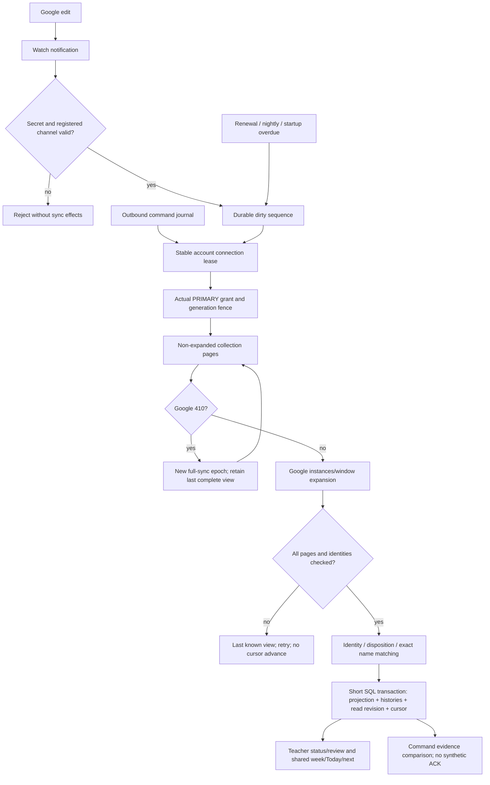

# Phase 25: Google Calendar Two-Way Sync — Research

**Researched:** 2026-10-12
**Domain:** Google Calendar inbound synchronization, projection, review and immutable command recovery.
**Confidence:** MEDIUM. Provider rules are cited; connected execution is UNVERIFIED.

<user_constraints>

## User Constraints (from CONTEXT.md)

Source: 25-CONTEXT.md, copied verbatim. DATA_71ac3f08_START

## Locked Decisions

- **D-01:** Phase order is24→25→22→23→26. Existing IDs, marks, payments and accounting history remain intact. Google wins concurrent edits.
- **D-02:** Target is the actual PRIMARY calendar. The prelaunch site and existing database are authorized with synthetic fixtures and a separate TEST Google account. Personal PRIMARY is not a substitute. Server guy owns release/runtime leases and server secrets.
- **D-03:** One stable connection writer owns both outbound and inbound effects. Provider HTTP runs outside SQL transactions. Unknown/partial outbound commands cannot become false Saved confirmations through inbound observations.
- **D-04:** Series rule columns remain immutable after insert. Schedule rows are not physically removed. Research must define how external master changes project into this model while preserving past occurrence identities and marks.
- **D-05:** App-created identity mapping precedes name matching. Matching must be deterministic and account-bound. Ambiguous names or duplicate provider identities require explicit review; no fuzzy guess binds a lesson.
- **D-06:** UI reuses variant A/v40 and existing Phase24 read/write/command owners. Connected, an active watch channel and a complete checked calendar are different facts. Assign/Ignore and sync failures cannot promise effects beyond actual provider/persistence evidence.
- **D-07:** The owner authorized autonomous research/planning/UI/check/implementation and necessary coordinated rollout/testing, without questions while away. New agents usethe session agent model. Missing access or observation remains unverified; independent work continues.

## Unreviewed Defaults

- **UD-01:** Reuse existing pinned Google SDK and pg-boss. Add no dependency unless a concrete unsupported requirement proves it necessary.
- **UD-02:** Preserve provider event data on Ignore. Store a durable disposition bound to a validated provider identity; research determines its invalidation rules.
- **UD-03:** Match only one canonical short-name candidate. Research must recover the actual card-name owner and define normalization without inventing a second name schema.
- **UD-04:** Preserve existing marks/accounting facts when inbound edits affect historical occurrences. Research must resolve the boundary between authoritative future projection and immutable history.

These are technical defaults selected under autonomous authority. The owner has not reviewed them. Research may replace a default with a better evidence-backed implementation before planning.

### Deferred Ideas (OUT OF SCOPE)

Chat22/23, IELTS26, alternate calendars, a separate test environment, physical schedule/history deletion and unrelated redesign are excluded. Phase24 Production/day8 and real-clock observations remain separate actual evidence; research25 does not close them.

DATA_71ac3f08_END
</user_constraints>

## Summary

Use a non-expanded collection sync cursor, validated watch channels and the existing stable connection lease. Google expands recurrence; the application projects confirmed instances into existing lesson references and immutable history. Keep collection completeness, window completeness, command outcome and delivery health separate. A notification only requests a check. [CITED: https://developers.google.com/workspace/calendar/api/guides/sync] [CITED: https://developers.google.com/workspace/calendar/api/v3/reference/events/list] [ASSUMED:A1]

The current source has window reads and immutable create-command recovery. Its ordered window traversal cannot become the incremental transport unchanged. The existing outbound mapping requires a command; inbound assignment needs its own durable origin. Plans24-08…11 describe future mutation/series/conflict seams, not implemented proof. [CITED: apps/api/src/calendar/gateway.ts:227-244] [CITED: packages/db/src/calendar-schema.ts:313-367] [CITED: apps/api/src/calendar/dispatch.ts:192-230] [CITED: .planning/phases/24-google-calendar-connection-and-outbound-sync/24-08-PLAN.md:80-95]

**Primary recommendation:** add seven additive persistence owners described below; share one resolver and transaction publication owner with Phase24; preserve immutable outbound journals and historical lesson facts. These are autonomous technical defaults, unreviewed by the owner, not assertions that source25 already exists. [ASSUMED:A1]

Research scope is this document only. No source, dependency, Git, private input, runtime, DB, provider-account or shared-state mutation was performed. Current source basis: b3fa8198d1cd2749668c38b2fc73863e293cf048, read via git rev-parse HEAD; concurrent E2E changes belong to parent. [CITED: session read-only command evidence]

### Evidence and provenance discipline

Official URLs were opened in this session and checked against the local snapshot dated2026-10-11. Local source was opened with bounded line-numbered filesystem reads. The connector Read failed with tunnel-client unavailable; no local discrete value is promoted to VERIFIED. Local CITED entries include verbatim evidence below. Proposed symbols, paths, tables, enums and policies are explicitly ASSUMED; they are implementation defaults under current authority, not a new approval gate. [CITED: docs/google-calendar/READING.md:1-8] [CITED: session tool results] [ASSUMED:A1]

Native init.plan-phase25 found the expected directory and GCAL-04…08; nyquist_validation is explicitly false. Agent-skills bootstrap returned45897 bytes with no SKILL.md includes. Graphify reported disabled; .codegraph and project skill directories were not present in the checked root. Router fallback used read-only status/branch/HEAD; no detect-project-state script was found. No install/update was used to repair stale baked model metadata. [CITED: .planning/config.json] [CITED: session init/bootstrap/status evidence]

Research-plan seam received JSON through /dev/stdin, selected jina for three questions and returned cache misses. No jina/Context7/ref tool or ctx7 CLI was available; official web open/search was used. classify-confidence(websearch,--verified)=MEDIUM; webfetch=LOW; ref=MEDIUM. The overall tier is MEDIUM, not HIGH. research-store put was intentionally omitted: user write-set excludes cache artifacts. No package or local enum earns VERIFIED by existence alone. [CITED: session research-plan/classify-confidence evidence]

## Architectural Responsibility Map

Recommended ownership, not an existing implementation claim. [ASSUMED:A1]

| Capability                           | Primary tier               | Secondary tier            | Rationale                                                          |
| ------------------------------------ | -------------------------- | ------------------------- | ------------------------------------------------------------------ |
| Recurrence expansion, event versions | Google Calendar            | API transport             | Use actual instances, not another recurrence engine                |
| Notification authentication          | API webhook                | Database channel registry | No browser/session role for provider callbacks                     |
| Cursor, watch renewal, reconcile     | API worker                 | PostgreSQL + pg-boss      | Runs without any page open; same stable lease as outbound          |
| Matching and Assign/Ignore           | API calendar + cards owner | PostgreSQL                | Teacher-owned decisions; durable identity and idempotency          |
| Series/history projection            | API schedule owner         | core + PostgreSQL         | Existing occurrence keys and accounting owner remain authoritative |
| Confirmed week/Today/next            | API shared read model      | Web presentation          | One published revision and explicit coverage                       |
| Status, review controls, stale forms | Web variant A/v40          | API contracts             | UI renders capabilities and confirmed outcomes                     |

<phase_requirements>

## Phase Requirements

Descriptions copied from REQUIREMENTS.md:80-84, DATA_94bd29e1_START. [CITED: .planning/REQUIREMENTS.md:80-84]

| ID      | Description                                                                                                                                                                                                       | Research support                       |
| ------- | ----------------------------------------------------------------------------------------------------------------------------------------------------------------------------------------------------------------- | -------------------------------------- |
| GCAL-04 | Changes made in Google reach the schedule through push notifications (`events.watch`) and incremental sync with `syncToken`; a `410` response triggers a full resync.                                             | P1–P3; S1–S4; F01/F02/F09; E01/E02     |
| GCAL-05 | Watch channels renew before they expire, and a nightly reconcile catches missed notifications.                                                                                                                    | P2/P3; S1/S4; F01/F02/F09; E03         |
| GCAL-06 | Events created by the app carry the lesson id; other events whose title matches a student's short name become lessons; unmatched events are listed to assign or ignore; all other events count only as busy time. | P4/P5; S5/S6; F03–F06/F08; E04–E08/E12 |
| GCAL-07 | When the same lesson changed in both places, the Google version wins.                                                                                                                                             | P6; history boundary; F07; E09         |
| GCAL-08 | Moving one occurrence in Google moves exactly that occurrence in the schedule, and moving a series in Google moves the series.                                                                                    | P7; S5/S7; F05/F07; E10                |

DATA_94bd29e1_END
</phase_requirements>

## Project Constraints (from AGENTS.md)

Applicable directives from user-supplied global instructions, repository AGENTS.md and EXECUTOR-RULES.md. Current task restrictions override older executor instructions for Git/deletion. [CITED: AGENTS.md:1-136] [CITED: .planning/EXECUTOR-RULES.md:1-60] [CITED: current user request]

- Only this RESEARCH.md may be written. Parent owns shared planning/state, contexts and E2E helpers. No source25 execution, new agent, branch, worktree, commit, install, env/runtime/DB/Google account call, SSH, CUA or deletion.
- Russian reports; product UI copy English; no new code comments. Preserve privacy: no names, amounts, notes, tokens, server addresses or private fixture/control contents in public artifacts.
- Work-router and finite Scope Card precede persistent work. Active GSD recipe and executor rules inform ownership; AgentFlow is suspended. Autonomous engineering defaults do not require repeated approval.
- Web uses approved variant A/v40, Base UI, existing wrappers and tokens. No Radix/cmdk, no eyebrows. Discover shadcn blocks only when a needed existing component cannot satisfy scope; current UI needs existing components.
- Web must not depend on api/db. Contracts own wire schemas/types/constants; core stays dependency-free, without Node/DB/env. Environment is read by loadConfig; DB role URL by resolveDatabaseUrl.
- Hono routes omit /api; Caddy owns that prefix. Existing request/error/log, auth/session/Origin, credential and lifecycle owners must be reused.
- PostgreSQL18, application/migrator roles separated. Generate additive migrations with yarn db:generate; do not hand-edit generated migrations or use drizzle-kit push or CREATE EXTENSION.
- Lesson/series/exception/mark rows are preserved. Series rule columns are immutable after insert; endsOn and exception/status changes follow existing core/domain owners. Money and marks never become Google data.
- Dependencies remain exact pins; Yarn age gate stays enabled. Do not upgrade TypeScript, Drizzle or Turbo to accommodate this phase.
- New automated functional proof uses existing public E2E journeys and actual application/persistence/provider path. No new unit/component/contract/integration layers. Scenario failure modes precede implementation. Preserve existing tests.
- Source readiness uses relevant static checks, mandatory simplify, complexity <22, cognitive <22, Halstead Difficulty <80 with method, source file <500 lines, no confirmed dead code or any. This research-only task does not claim source readiness or run implementation gates.
- Only necessary checks; preserve original exit status; bounded output. Runtime access gaps are UNVERIFIED. Coordinated runtime proof belongs to parent/Server guy.

## Standard Stack

Reuse pins; installation command: **none**. Exact source quote from apps/api/package.json:20-27, DATA_af609781_START: `"drizzle-orm": "1.0.0-rc.4"`, `"googleapis": "185.0.0"`, `"pg": "8.23.1"`, `"pg-boss": "12.37.1"`, `"zod": "4.6.5"`. DATA_af609781_END. [CITED: apps/api/package.json:20-27]

| Library                                                            | Pinned version    | Purpose                               | Source / disposition                                                               |
| ------------------------------------------------------------------ | ----------------- | ------------------------------------- | ---------------------------------------------------------------------------------- |
| googleapis [WARNING: flagged as suspicious — verify before using.] | 185.0.0           | Existing Google transport/OAuth       | Official Google client; registry/pin present, gate SUS, reuse without installation |
| pg-boss [WARNING: flagged as suspicious — verify before using.]    | 12.37.1           | Durable worker/scheduling             | Official pg-boss docs match12.37.1; gate SUS, reuse without installation           |
| Existing Drizzle/pg/zod                                            | Pins quoted above | Transactions, validation, persistence | Existing project stack; no new dependency recommendation                           |

Official discovery: [CITED: https://github.com/googleapis/google-api-nodejs-client] [CITED: https://pgboss.io/api/scheduling]. Registry checks returned googleapis185.0.0 and pg-boss12.37.1; latest matched these pins. Published2026-10-08T17:11:09.982Z and2026-10-08T15:56:14.199Z respectively. Present engines: Node>=22.0.0 and>=22.12.0; inspected machine Node24.17.0/Yarn4.18.1. These are registry observations, not compatibility proof for all production paths. [CITED: session npm view and version probe evidence]

### Package Legitimacy Audit

No install is part of Phase25 research/recommended stack. Read-only legitimacy check was nevertheless executed; SUS must not be hidden. [CITED: session package-legitimacy output]

| Package    | Registry | Published / age at check | Weekly downloads | Source repository                   | Verdict      | Disposition                    |
| ---------- | -------- | ------------------------ | ---------------- | ----------------------------------- | ------------ | ------------------------------ |
| googleapis | npm      | 2026-10-08 / about4 days | 10803557         | googleapis/google-api-nodejs-client | SUS: too-new | Existing pin reuse; no install |
| pg-boss    | npm      | 2026-10-08 / about4 days | 2631330          | timgit/pg-boss                      | SUS: too-new | Existing pin reuse; no install |

Both seam postinstall signals were null; npm view scripts.postinstall returned no value. This is not proof of benign transitive installation. Removed SLOP: none. If a later plan installs or changes either package, it must resolve the current SUS signal before installation; research does not authorize dependency changes. [CITED: session legitimacy/npm output]

## Source-of-truth Evidence and Phase24 Seams

Local discrete facts below are CITED, not VERIFIED, because the dedicated Read connector was unavailable. Quotes are verbatim excerpts bounded by random markers. [CITED: session Read failure and line-numbered filesystem reads]

| Owner                                                               | Verbatim evidence                                                                                                                                                                                                                                                                             | Planning implication                                                                             |
| ------------------------------------------------------------------- | --------------------------------------------------------------------------------------------------------------------------------------------------------------------------------------------------------------------------------------------------------------------------------------------- | ------------------------------------------------------------------------------------------------ |
| packages/contracts/src/identity.ts:13-15                            | DATA_1c2e7fb9_START `return name.trim().replace(/\s+/g, ' ')` DATA_1c2e7fb9_END                                                                                                                                                                                                               | Reuse normalizeDisplayName                                                                       |
| packages/contracts/src/students.ts:86-96,146-155                    | DATA_c6783d19_START `displayName: z.string().transform(normalizeDisplayName).refine(isDisplayNameLength)`; `displayName: string` DATA_c6783d19_END                                                                                                                                            | Whole card displayName is the canonical product name                                             |
| packages/contracts/src/students.ts:22,30-32                         | DATA_bd32ea81_START `['active', 'archived']`; `LESSON_MINUTES_MIN = 15`; `LESSON_MINUTES_MAX = 240`; `LESSON_MINUTES_DEFAULT = 60` DATA_bd32ea81_END                                                                                                                                          | Active-card eligibility, existing duration bounds                                                |
| packages/db/src/schema.ts:94-118; apps/api/src/cards/cards.ts:46-85 | DATA_8fde272a_START `displayName: text('display_name').notNull()`; `status: text('status').default('active').notNull()`; `from(students)` DATA_8fde272a_END                                                                                                                                   | Current cards are shared under the single-teacher product, not per-teacher rows                  |
| packages/db/src/schema.ts:47-49                                     | DATA_30c98a42_START `accounts_one_active_teacher_uq`; `where(sql`${table.role} = 'teacher' and ${table.status} = 'active'`)` DATA_30c98a42_END                                                                                                                                                | Bind calendar decisions to active teacher account; do not invent students.accountId              |
| packages/db/src/calendar-schema.ts:174-195                          | DATA_4dca8721_START `'pending', 'dispatching', 'outcome_unknown', 'projection_pending', 'applied', 'failed', 'partial_recovery', 'recovery_required'`; `['none', 'unknown', 'partial', 'confirmed']`; `['wait', 'refresh', 'retry_new_command', 'resume_recovery', 'none']` DATA_4dca8721_END | Frozen journal states cannot express a terminal superseded partial command                       |
| packages/db/src/calendar-schema.ts:313-367                          | DATA_715db36e_START `commandId: uuid('command_id').notNull()`; `['reserved', 'active', 'retired']`; `unique('google_event_mappings_provider_uq').on(t.connectionId, t.calendarId, t.eventId)` DATA_715db36e_END                                                                               | Outbound origin stays intact; inbound cannot use fictitious commandId                            |
| packages/db/src/calendar-read-schema.ts:84-91                       | DATA_dce17a98_START `['confirmed', 'tentative', 'cancelled']`; `['opaque', 'transparent']`; `['lesson', 'transition', 'external']` DATA_dce17a98_END                                                                                                                                          | Reuse existing read view, nullable commandId for stable inbound lesson                           |
| packages/db/src/calendar-values.ts:46-60                            | DATA_8b31cdef_START `kind: z.literal('single'), lessonId: z.uuid()`; `kind: z.literal('series'), seriesId: z.uuid(), originalOn: isoDate`; `weekday`, `startTime`, `timeZone`, `durationMinutes`, `startsOn`, `endsOn` DATA_8b31cdef_END                                                      | Existing local ref and immutable captured rule owners                                            |
| apps/api/src/calendar/provider-events.ts:38-51,89-116               | DATA_2a36c971_START `ProviderPage = { events: ProviderEvent[]; cancelledIds: string[]; timeZone: string; nextPageToken?: string }`; `timeMin: string` DATA_2a36c971_END                                                                                                                       | Window parser drops syncToken/master metadata and sparse exception identity; add separate parser |
| apps/api/src/calendar/gateway.ts:227-244                            | DATA_759b08de_START `singleEvents: true`; `orderBy: 'startTime'` DATA_759b08de_END                                                                                                                                                                                                            | This transport is window/prefix only                                                             |
| apps/api/src/calendar/read-state.ts:6-19                            | DATA_c720a58f_START `CalendarReadContext = { accountId: string; now: Date }`; `CalendarReadSelection = { kind: 'window'; start: Date; end: Date; displayTimeZone: string }                                                                                                                    | { kind: 'next'; studentIds: readonly string[] }` DATA_c720a58f_END                               | Receipts are request-scoped; durable background receipt needs new owner |
| apps/api/src/calendar/queue-schema.ts:6-14                          | DATA_f309c2be_START `migrate: false`; `createSchema: false`; `supervise: true`; `schedule: false` DATA_f309c2be_END                                                                                                                                                                           | Explicitly enable scheduler for inbound worker; keep runtime DDL disabled                        |

Every row cites its owner path and indicated line range; quoted combined snippets omit unrelated lines without claiming a full contiguous source quote. [CITED: source files/ranges in table]

### Existing operations (source03–07)

- ConnectionLease.run<T>(accountId: string, operation: (context: ConnectionLeaseContext) => Promise<T>): Promise<T>; ConnectionLeaseContext carries db and AbortSignal. Account-derived session advisory lock survives grant replacement and is released in finally; a lost DB session aborts provider work. [CITED: apps/api/src/calendar/lease.ts:8-69]
- Credentials.withAccessToken<T>(accountId: string, operation: (input: {accessToken: string; connection: ConnectionRow; db: Database; signal: AbortSignal}) => Promise<T>): Promise<T> already acquires that lease. Never nest another lease around it. [CITED: apps/api/src/calendar/credentials.ts:116-137]
- createCalendarReads(...).refreshCalendarRead(context: CalendarReadContext, selection: CalendarReadSelection): Promise<void>; readCalendarWindow(executor: DbExecutor, context: CalendarReadContext, selection: WindowSelection): Promise<GoogleScheduleWindow>; readNextLessons(executor: DbExecutor, context: CalendarReadContext, studentIds: readonly string[]): Promise<ReadonlyMap<string, NextLessonRead>>. [CITED: apps/api/src/calendar/reads.ts:14-66] [CITED: apps/api/src/calendar/read-model.ts:69-73,183-187]
- publishWindow(input:{db,context,selection,connection,mappings,events,timeZone,series}) performs its own transaction and revision publication. Add a transaction-scoped publication primitive instead of calling this wrapper inside inbound transaction. [CITED: apps/api/src/calendar/read-store.ts:74-137] [ASSUMED:A1]
- bindEvent(event: ProviderEvent, snapshot: MappingSnapshot): BoundEvent resolves exact mapping then master; originalOn currently requires occurrenceAt on the stored rule. That guard stops a changed master rule from silently becoming the old local series. [CITED: apps/api/src/calendar/event-mapping.ts:73-84,101-129]
- verifyGoogleResult(input: unknown, request: InsertRequest, timeZone: string, generation: number, httpStatus: number): VerifiedGoogleResponse checks identity plus owned fields; storedGoogleResult adds no fabricated HTTP status. applyConfirmedCommand currently implements create only. [CITED: apps/api/src/calendar/command-result.ts:71-131] [CITED: apps/api/src/schedule/command-apply.ts:11-80]
- historyEligibility(executor: DbExecutor, accountId: string, subjects: readonly HistorySubject[]) and loadMarkRows(executor: DbExecutor, studentIds: readonly string[]) feed cardFacts. Current accounting recomputes from rule/exception/lesson times, so changing these historical inputs can change deductions even if mark rows survive. [CITED: apps/api/src/calendar/history.ts:192-211] [CITED: apps/api/src/schedule/rows.ts:298-353] [CITED: apps/api/src/cards/card-facts.ts:29-66]

### Planned08–11: NOT implementation proof

| Plan  | Planned seam                                                                       | Phase25 dependency                                                             |
| ----- | ---------------------------------------------------------------------------------- | ------------------------------------------------------------------------------ |
| 24-08 | Single prepare/confirmed apply, conditional patch, tombstone/replacement identity  | Rebind final gateway/apply signatures; do not bypass its unknown-insert fence  |
| 24-09 | Master and canonical instance operations; originalStartTime resolution             | Reuse real instances pagination and provider version guards                    |
| 24-10 | Immutable cut plan, ordered remote stages, current-mark-safe atomic apply          | Integrate inbound identity lineage; never run a second local cut               |
| 24-11 | GoogleConflictResult, calendar-conflicts owner, self-exclusion in provider windows | Newly assigned/projected events must participate in the same conflict resolver |

Sources are planned artifacts: [CITED: .planning/phases/24-google-calendar-connection-and-outbound-sync/24-08-PLAN.md:80-119] [CITED: .planning/phases/24-google-calendar-connection-and-outbound-sync/24-09-PLAN.md:69-105] [CITED: .planning/phases/24-google-calendar-connection-and-outbound-sync/24-10-PLAN.md:76-124] [CITED: .planning/phases/24-google-calendar-connection-and-outbound-sync/24-11-PLAN.md:78-85]. Re-read final source after24 completion before execution25. [ASSUMED:A1]

## Architecture Patterns

### System Architecture Diagram

Recommended data flow. [ASSUMED:A1]



### P1 — Separate collection cursor and expanded read projection

Provider choice: initial and incremental collection calls use singleEvents=false, showDeleted=true, no temporal/search/extended-property/order filters. Keep the filter definition and fields mask fixed across a cursor epoch. Google rejects syncToken combined with iCalUID, orderBy, privateExtendedProperty, q, sharedExtendedProperty, timeMin, timeMax or updatedMin. Final page alone supplies nextSyncToken. [CITED: https://developers.google.com/workspace/calendar/api/v3/reference/events/list] [CITED: https://developers.google.com/workspace/calendar/api/guides/sync]

Selected projection: non-expanded full collection is finite for recurring masters, includes cancelled exceptions, and drives review/matching. Preserve normalized sparse tombstones, recurrence, visibility and app metadata in a new sync value owner. Expanded existing window/next reads remain separate Google calls. Do not sort incremental pages with traverseEvents' start-time validator. Validate duplicate conflicting ids, token cycles, target, shape and terminal cursor instead. [CITED: https://developers.google.com/workspace/calendar/api/v3/reference/events/list] [CITED: apps/api/src/calendar/read-pages.ts:23-65] [ASSUMED:A1]

For each job: hold the existing session lease through provider reads and publication, capture grant generation and committed cursor/revision, stage all pages outside the publication transaction. Use the original syncToken on every next page. Fetch changed master instances only for registered windows, materialized refs and the next-prefix proof. Recheck relevant master/version dependencies before commit; drift causes retry, not mixed publication. A provider collection response is not a simultaneous global snapshot of independently fetched instances. Label checks by their actual completed ranges and times. [CITED: https://developers.google.com/workspace/calendar/api/guides/sync] [ASSUMED:A1]

### P2 — Watch authenticity, race handling and renewal

Provider facts: watch is per resource; callback is HTTPS POST without event data. Initial sync notification can arrive before watch response. Message numbers increase but are not sequential. Renewal creates a fresh channel with a fresh id; channels can overlap; delivery can be lost. Requested TTL is not proof of returned expiry. events.watch documents default ttl604800 seconds; channels.stop takes id/resourceId. [CITED: https://developers.google.com/workspace/calendar/api/guides/push] [CITED: https://developers.google.com/workspace/calendar/api/v3/reference/events/watch] [CITED: https://developers.google.com/workspace/calendar/api/v3/reference/channels/stop]

Selected algorithm: reserve channel UUID and hash of an independent random256-bit secret before HTTP. Retain the plaintext only for the request; callback compares hashed token with constant-time comparison. Register account/connection/generation/actual calendar and configured callback. During registration, authenticated early notifications only record provisional dirty evidence; their resourceId is not trusted as registration proof. Publish active only after a validated watch response binds resourceId/resourceUri/expiry. Then drain dirty state and perform sync. Unknown watch response remains unconfirmed; fresh registration with a new id may overlap an orphan until expiry, and does not claim cleanup. [ASSUMED:A2]

Receiver uses a separate route outside teacher session/Origin middleware. Validate method, bounded headers, secret, registered channel state, current generation and stored resource binding; compare resourceUri but never fetch it. Expired/retired/old-grant callbacks have no effects. Resource state is a trigger, not proof of deletion. Persist dirty sequence and authenticated receipt before2xx. If persistence fails, return failure. Numbers support diagnostics/deduplication; never discard a legitimate callback just because it is older than a high-water mark. [CITED: https://developers.google.com/workspace/calendar/api/guides/push] [ASSUMED:A2]

Default renewal margin = min(one hour, one quarter of the observed channel lifetime), with a due scan every minute and bounded retry before expiry. This is an unreviewed operating default, not a Google guarantee. Keep old valid channel until replacement confirmed, then stop it under the same grant; a stop failure is recorded and retries are fenced. On disconnect/reconnect retire local old channels immediately; stop remotely before revoke when access permits, never report provider stopped without its result. No automatic credential resurrection. [ASSUMED:A2]

### P3 — 410, restart, nightly reconcile and honest freshness

A real incremental410 invalidates the cursor and requires full synchronization. Implement logical replacement of the provider mirror through a new sync epoch; never wipe lessons, mappings, dispositions, command journals or history. Keep the last complete view with last-known/read-only status. New epoch starts without syncToken or an old pageToken; publish only after all collection/projection pages and transaction succeed. Missing ids from the replacement collection become mirror tombstones, not physically deleted domain rows. [CITED: https://developers.google.com/workspace/calendar/api/guides/sync] [CITED: https://developers.google.com/workspace/calendar/api/v3/reference/events/list] [ASSUMED:A3]

Restart abandons incomplete staging and retries from the last committed token; preserve abandoned batch records. Duplicate callbacks coalesce through durable requestedSequence/processedSequence. Capture requestedSequence before fetch and consume only that value on commit; a callback received during fetch leaves another pending check. A pg-boss job is a wakeup, not the source of work truth. Startup and recurring scans recover dirty/overdue cursor rows even if enqueue/ack was lost. [ASSUMED:A3]

Nightly reconcile runs a replacement full collection read plus checked projections, independently of notifications. Default cron is03:00 in the teacher's current account default time zone, rescheduled on zone change, with missed=once and a durable overdue scan on startup. Enable scheduling explicitly; current queue options have schedule:false. Register recurring/sync queues under the migration owner; application runtime performs no DDL. Node timer alone is not the durable nightly owner. [CITED: https://pgboss.io/api/scheduling] [CITED: node_modules/pg-boss/dist/types.d.ts:834-846] [CITED: apps/api/src/calendar/queue-schema.ts:6-47] [ASSUMED:A3]

Delivery On requires validated unexpired channel and functioning worker; it does not imply fresh calendar. Delayed means observable renewal failure, dirty backlog failure or expired delivery gap, not merely no recent notification on a quiet calendar. Paused means disconnected/revoking/disabled. Unknown means registration/runtime evidence unavailable. lastCompleteSyncAt updates after each committed catalog check; lastFullCheckAt only after full/reconcile completion. Window checkedAt/range/revision remains separate. UI must not label an incremental pass Last full check. [ASSUMED:A4]

No provider latency SLA is inferred. Measure provider edit→authenticated receipt→job start→catalog complete→projection commit→public read. Use the existing E2E90s outer timeout as a test budget only; a timeout is UNVERIFIED. Derive future watchdog bounds from observed workload and retry budget, not an invented Saved deadline. User-visible elapsed status comes from persisted job facts, not a browser timer proving freshness. [CITED: playwright.config.ts] [ASSUMED:A4]

### P4 — Canonical identity and exact name matching

Private extended properties belong to the specific calendar/event copy and can be edited; they are hints requiring local corroboration, not authorization. Scope identity by active account, validated actual PRIMARY id, provider event id and originalStartTime for instances. The sync cursor additionally carries current connection/generation. Never use iCalUID or an event-id suffix as the canonical occurrence key. [CITED: https://developers.google.com/workspace/calendar/api/guides/extended-properties] [CITED: https://developers.google.com/workspace/calendar/api/v3/reference/events] [ASSUMED:A5]

Resolver order: exact persisted app mapping and its immutable reserved lineage → existing inbound binding → durable Ignore → one exact canonical-name candidate → review/busy. Validate master hints against stored local entity and account/calendar; copied markers on another event or two representations claiming one local identity produce identity-conflict review and no new lesson. A known retired/pending app identity must not fall through to name matching and create a second future. Missing metadata does not erase a persisted binding. [ASSUMED:A5]

Short name is the entire current card displayName normalized by normalizeDisplayName. Match case-sensitive normalized equality; do not add lowercasing, first-word extraction, prefix/fuzzy matching, accent removal or an invented shortName column. Active cards only for new auto/explicit assignment; an existing binding survives card rename/archive and must not silently switch student. Reevaluate unmatched rows after card rename/restore/archive; bindings are stable by id. Duplicate exact names remain ambiguous. Current product has one active teacher and a shared cards collection; account-bound means authenticated active teacher plus owned connection/decision, not an imaginary cards accountId filter. [CITED: packages/contracts/src/identity.ts:13-15] [CITED: packages/contracts/src/students.ts:86-96,146-155] [CITED: packages/db/src/schema.ts:47-49,94-118] [ASSUMED:A5]

### P5 — Eligibility, review and durable decisions

Selected scopes and capabilities are defaults, not existing wire literals. Automatic matching and Assign create local binding/projection only, without PATCH to Google. Therefore lost decision replies have local transactional outcomes recoverable by requestId; they are not provider write commands. Timed supported events use actual Google start/end/zone, never student default duration. No mark or deduction is generated automatically. [ASSUMED:A6]

| Provider shape                                                   | Assignment scope / capability                 | Ignore scope                                          | Calendar effect                                                        |
| ---------------------------------------------------------------- | --------------------------------------------- | ----------------------------------------------------- | ---------------------------------------------------------------------- |
| Future timed single, ordinary event, valid15–240min              | One event                                     | One provider identity                                 | Bound lesson; transparent remains nonblocking                          |
| One future instance, supported time/duration                     | One occurrence explicitly                     | One occurrence                                        | Siblings unchanged; natural original identity retained                 |
| Timed master with future instances                               | Whole series explicitly labeled in row/detail | Whole master family                                   | Google expands; supported local mirror or provider-instance projection |
| All-day master/single, unsupported duration/type, hidden details | Assign unavailable with reason                | Master family or single, explicitly known             | Busy only when opaque and not cancelled                                |
| Cancelled/deleted, historical-only                               | No new Assign/auto lesson                     | Existing disposition retained; no new hidden mutation | History preserved; no active busy block                                |

Provider all-day end is exclusive; transparent is not busy; cancelled sparse exception may carry only identity fields. Do not upgrade hidden private details into guessed summary/time. [CITED: https://developers.google.com/workspace/calendar/api/v3/reference/events] [CITED: https://developers.google.com/workspace/calendar/api/v3/reference/events/list] Eligibility defaults and numeric bounds reuse the quoted contracts values. [CITED: packages/contracts/src/students.ts:30-32] [ASSUMED:A6]

A master review row must say series; an instance row must say this occurrence. A row cannot imply whole-series assignment from an ambiguous instance selection. For master eligibility, require actual future-instance prefix evidence, not recurrence parsing as expansion. Arbitrary recurrence can be assigned via Google-expanded instance projection but whole-series outbound editing stays unavailable unless the exact existing weekly rule model is representable. [ASSUMED:A6]

Durable Ignore is identity-bound, not ETag-bound: survives title/time edits,410 and reconnect to the same account/calendar. Master Ignore suppresses future members of that same master; instance Ignore overrides master/name matching for that member. A new Google event/master identity is a new candidate. Ignore preserves provider data, transparency/busy behavior and tombstone history. Scope is included in versioned review DTO and immutable decision request. No undo/reassignment feature is introduced. Already-linked app lessons are outside this review action. [ASSUMED:A6]

Persist decisions with unique(accountId,requestId), immutable body hash, expected review version, target/generation, scope and final outcome. Same request/body recovers the same result; another body rejects. Under stable lease re-read actual provider event/master outside SQL; then transaction checks generation, latest published catalog/review version, active card eligibility, binding/disposition collision and commits projection/disposition + outcome together. Stale/deleted/unsupported rejects without decision effect. Other-tab assignment wins once; losing request returns current outcome/conflict, never a second lesson. Pending UI disables actions; network loss reads by requestId before any retry. [CITED: https://developers.google.com/workspace/calendar/api/guides/version-resources] [ASSUMED:A6]

Review list uses accepted catalog batch, safe plain-text title/time, opaque eventKey/version, scope, reason and capabilities. Page cursor binds account/calendar/generation/catalog revision and keyset; changed revision requires reload. Distinguish complete collection from partially displayed page. Zero is known only after complete checked list with no nextCursor. Unsupported rows have reasons, not fake Assign. Student/anonymous requests get no external metadata. [ASSUMED:A6]

### P6 — Google wins without rewriting captured outbound intent

Google If-Match prevents stale overwrites; changed ETag returns412. No automatic rebase of a captured command onto another Google revision. The command's request/plan/reservations/stage order and original attempts remain immutable. An inbound fact is not an ACK unless the existing verifier proves the exact command/stage/owned digest. [CITED: https://developers.google.com/workspace/calendar/api/guides/version-resources] [CITED: apps/api/src/calendar/command-result.ts:71-131] [ASSUMED:A7]

| Frozen24 command situation                     | Honest resolution                                                                                                                                               | Inbound publication                                                               |
| ---------------------------------------------- | --------------------------------------------------------------------------------------------------------------------------------------------------------------- | --------------------------------------------------------------------------------- |
| Unsent pending whose precondition changed      | Existing failUnsentCommand; failed with no effect                                                                                                               | Publish Google facts; no old intent dispatch                                      |
| Actual dispatch rejected with no effect        | Existing failed/not_applied path                                                                                                                                | Publish Google facts                                                              |
| Dispatch/unknown GET404                        | Remain unknown/recovery_required; no new id/send or nonapplication claim                                                                                        | Show Google checked result; retain unresolved edit barrier                        |
| Partial multi-stage command externally changed | partial_recovery or recovery_required with actual partial effect; no automatic compensation                                                                     | Publish provider facts as transition/read-only where affected                     |
| Exact saved ACK, projection not yet committed  | Under same lease atomically materialize captured identity/history and applied evidence, then newer inbound facts; no stale replacement of published Google view | Latest Google revision wins; stale UI command cannot toast Saved for current form |
| Already applied then externally edited         | Keep applied command history immutable                                                                                                                          | Publish new authoritative Google revision; dirty form requires refresh            |
| Grant generation changed / obsolete ACK        | Existing reconnect/recovery fence; no old-grant projection                                                                                                      | Current grant only; last-known prior view clearly labeled                         |

These dispositions use existing frozen states quoted above. No terminal superseded effect exists in24; do not encode partial as failed (schema requires none), or force applied for unrelated inbound changes. Research chooses safety: an unresolved partial command can remain unresolved and block affected edits while confirmed Google view is readable. Resume may perform only existing exact recovery verification; if a precondition conflict remains, it cannot overwrite Google. Any future terminalization feature requires an additive explicit outcome design; it is not necessary for this phase's honest delivery/matching contract. [CITED: packages/db/src/calendar-schema.ts:174-244] [CITED: apps/api/src/calendar/recovery.ts:119-143,146-243] [ASSUMED:A7]

Important current seam: projectCommand applies stored ACK without provider HTTP. It must share the inbound lease and latest publication ordering; a later inbound snapshot must never be overwritten by a stale ACK read view. Applied proves the captured command was acknowledged and locally committed, not that Google will never change afterwards. Inbound-only binding must never set outbound applied. [CITED: apps/api/src/calendar/dispatch.ts:192-201] [CITED: apps/api/src/schedule/command-apply.ts:11-80] [ASSUMED:A7]

### P7 — One occurrence, changed master and immutable local history

Provider originalStartTime identifies an instance even when moved. A master can change expansion; Google UI may split this-and-following into a new master rather than preserving the original. Persist actual canonical tuple, not positional matching across old/new weekly dates. Never pair occurrences by ordinal or closest time. [CITED: https://developers.google.com/workspace/calendar/api/v3/reference/events] [CITED: https://developers.google.com/workspace/calendar/api/guides/recurringevents] [ASSUMED:A8]

Selected projection design:

1. Existing unchanged natural tuple reuses its local ref. A moved instance writes only its exception/actual-instance projection; no standalone Google insert. Read identity uses recurringEventId/originalStartTime even if move crosses the requested week.
2. On changed master timing/rule, capture one publication cutoff and immutable projection plan in batch. Keep original local rule columns. Freeze all already-historical or marked references before changing endsOn/exception inputs.
3. For a master exactly representable by the existing weekly model, create one new local immutable mirror series for future references, keyed by master identity + rule digest + prior projection epoch. Reserve its id once in batch; truncate old future boundary using existing core semantics. Never insert new rule into the old series row.
4. Bind actual returned future instances to the new mirror only when their originalStartTime corresponds to that rule and instance interval; otherwise materialize stable local single refs from provider instances. Unsupported recurrence uses this latter projection for all needed instances. No RRULE expansion outside Google.
5. Past and marked refs retain old ids/originalOn and frozen facts. A provider fact retaining their tuple may display its new calendar time, but does not overwrite frozen accounting/history. Unknown newly discovered past events remain external; no retroactive lesson/mark invention.
6. If changed master removes future tuple, mark mirror projection inactive/cancelled or shorten series boundary; retain rows/mapping history. If a later complete batch returns the same identity, reuse the persisted id. A different master identity is not assumed to be the old one from title alone.
7. Publish only one active representation per provider identity and local ref; old mirrored future is excluded from provider-backed week/Today/next and conflict reads. New batch applies local effects and accepted read revision atomically.

This is an unreviewed technical default requiring real Google proof before acceptance. Google guarantees instance identity fields, not ordinal identity preservation across every master edit or UI split. [CITED: packages/core/src/schedule.ts:25-41,129-135,352-357] [CITED: apps/api/src/calendar/event-mapping.ts:73-84] [CITED: https://developers.google.com/workspace/calendar/api/guides/recurringevents] [ASSUMED:A8]

#### History/marks/accounting freeze boundary

Historical means last confirmed local occurrence started at or before batch cutoff OR already has a substantive mark. Freeze the existing ref, student, start, zone, duration and status before inbound changes can invalidate core occurrenceAt or change loadMarkRows. Store immutable history facts once per ref; marks remain in their current owner and can change through authorized mark actions. Do not snapshot the mark itself as an immutable value. Recheck current mark rows under SQL locks because a mark can change while provider HTTP is pending. [CITED: apps/api/src/schedule/rows.ts:298-353] [CITED: apps/api/src/calendar/history.ts:192-211] [ASSUMED:A8]

Modify loadMarkRows to prefer frozen fact inputs for those refs and return them exactly once, using current marks and existing core outcome/balance function. Update historyEligibility and history display to accept these confirmed facts even if current master no longer expands the old natural date. cardFacts remains the only balance owner; payments/opening balance are untouched. Before truncating old series, capture marked/moved history beyond the proposed endsOn, so shortening cannot hide an existing deduction. A late Google edit to a historical lesson changes authoritative calendar representation only; history panel and accounting remain frozen. [CITED: apps/api/src/cards/card-facts.ts:29-66] [CITED: apps/api/src/schedule/rows.ts:329-350] [ASSUMED:A8]

## Necessary Persistence Design

Exactly seven NEW tables are recommended. Names and fields below are PROPOSED, not observed schema. One new db schema/value owner defines them; contracts own only public DTO. Existing connections, read windows/events, next proofs, commands/stages and app mappings remain reusable. Each new table closes a named criterion. [ASSUMED:A9]

| Table (proposed)          | Minimal owned data / constraints                                                                                                                                                                                                           | Criterion / why existing table cannot substitute                                                     |
| ------------------------- | ------------------------------------------------------------------------------------------------------------------------------------------------------------------------------------------------------------------------------------------ | ---------------------------------------------------------------------------------------------------- |
| google_sync_cursors       | Account/connection/actual calendar/generation/filter hash; cursor epoch/token; accepted batch/revision; requested/processed sequence; due/full/check/error timestamps. Unique per connection+generation+filter; FK owner/calendar RESTRICT | SC1/SC5: existing windows have ranges, not collection cursor/durable dirty state                     |
| google_sync_batches       | Captured base token/revision/generation, mode, cutoff, complete pages proof, next token, immutable reserved projection plan, publication/abandonment result. One publishing batch via lease/CAS                                            | SC1/SC2/SC4: stage provider work and stable ids before atomic publication/restart                    |
| google_sync_events        | Batch+event id unique; normalized master/single/sparse tombstone identity, ETag, times, recurrence, visibility, app marker hints. Rows immutable after complete batch; accepted catalog overlays incremental batches within current epoch  | SC1/SC3: existing read-events lack master rules/marker metadata and are window-bound                 |
| google_watch_channels     | Channel id unique, secret hash, owner/calendar/generation, registration request/result, resource binding, actual expiry/renew due, receipt/stop/error state                                                                                | SC1/SC5: overlap and pre-response callback cannot fit one channel field                              |
| google_inbound_bindings   | Stable provider single/master/occurrence identity; student; local ref/mirror-series id; projection epoch/rule digest; origin/active history. Master-level and canonical-instance partial unique keys; local-ref uniqueness                 | SC2/SC3: existing mapping requires real commandId; never falsify command provenance                  |
| google_review_decisions   | Unique(account,requestId), body digest, expected review version/scope, provider identity, choice/student, outcome/revision. Immutable input and final result; Ignore applicability queried here                                            | SC3/F06: combines idempotent action journal and durable disposition; no separate ignore table needed |
| google_occurrence_history | Unique local occurrence key; ref/student/start/zone/duration/status and source revision/frozenAt; FK entities RESTRICT. No immutable mark copy                                                                                             | SC2/SC4: current accounting derives from mutable timing/bounds and would lose history after rule cut |

App provenance and current projection are separate decisions. Recognize the persisted app mapping first; then resolve the current future reference through the accepted projection epoch. An inbound epoch must not erase app provenance or make a retired app event eligible for name matching. Preserve the old local reference for a past or marked tuple. Reuse an unchanged future tuple when its local rule remains valid; when a replacement rule requires a new reference, persist explicit old→new projection lineage and expose only the accepted reference. Never map occurrences by ordinal position. This requires extending the shared resolver, not merely placing inbound bindings after an app-mapping early return. [ASSUMED:A8]

Cross-origin uniqueness cannot be guaranteed by two separate table indexes alone. Every resolver/admission/publication runs under the same stable lease and uses SQL locks/CAS against both app mappings and inbound bindings. Unique constraints in each table plus shared resolver reject conflicts; no client can choose an origin to bypass collision. Inbound materialized instance rows must include provider original tuple, including zone/date-vs-instant, and retain parent binding/epoch. A master binding represents a family, not one lesson ref. [ASSUMED:A9]

Use additive migration and explicit generated indexes/checks/grants. Do not make existing outbound commandId nullable or relax journal constraints. JSONB sync/projection values are validated once in calendar-sync-values.ts; do not mirror public Zod schemas in db. Unknown belongs only at raw provider/request boundaries. Tokens/channel secrets are never public DTO/log fields. No physical deletion/retention automation is introduced. [CITED: AGENTS.md: database and boundaries sections] [ASSUMED:A9]

## Typed Public Signatures and Registry Binding

All NEW names here are PROPOSED exact planning targets; final source24 signatures must be rebound after08–11. This section is a semantic inventory, not duplicated executable schemas. Define each wire type/schema once in packages/contracts/src/calendar-sync.ts and export via contracts index. Existing CalendarReadStatus/CalendarEventView/GoogleScheduleWindow/NextLessonRead remain from calendar.ts. [CITED: packages/contracts/src/calendar.ts] [ASSUMED:A10]

| New public type/schema owner                                                             | Required meaning                                                                                                                                                                                                                            |
| ---------------------------------------------------------------------------------------- | ------------------------------------------------------------------------------------------------------------------------------------------------------------------------------------------------------------------------------------------- |
| GoogleSyncSnapshot / googleSyncSnapshot                                                  | Safe target + generation; delivery fact On/Delayed/Paused/Unknown; observed watch expiry; separate catalog revision/checkAt, full-checkAt, current mode/running/error; projection range receipts. No secret/resourceUri/provider raw errors |
| GoogleReviewList / googleReviewList                                                      | Revision/generation/coverage; rows with opaque eventKey/version, safe title and existing when type, reason, scope, assign/ignore capabilities; cursor and end-of-list proof                                                                 |
| GoogleReviewDecisionRequest / googleReviewDecisionRequest                                | requestId, expectedVersion, opaque eventKey, explicit scope, choice and studentId only for Assign. Teacher identity always session-derived                                                                                                  |
| GoogleReviewDecisionSnapshot / googleReviewDecisionSnapshot                              | Request/decision id; pending/committed/rejected outcome, precise effect and safe issue, accepted revision. Unknown response is client uncertainty recovered by status read; do not persist fabricated provider-unknown                      |
| GoogleSyncReadQuery / googleSyncReadQuery; GoogleReviewListQuery / googleReviewListQuery | Validated coverage selection and opaque paging cursor, never user-selected account/calendar/secret                                                                                                                                          |

Proposed server signatures and internal value owners, all defaults. [ASSUMED:A10]

```text
gateway.syncEvents(accessToken: string, query: CollectionSyncQuery, signal: AbortSignal): Promise<ProviderSyncPage>
gateway.watchEvents(accessToken: string, calendarId: string, request: WatchRegistration, signal: AbortSignal): Promise<ProviderChannel>
gateway.stopChannel(accessToken: string, channel: RegisteredChannel, signal: AbortSignal): Promise<void>
parseSyncPage(input: unknown): ProviderSyncPage
createCalendarSync(deps: CalendarSyncDeps): CalendarSync
CalendarSync.requestCheck(input: SyncWakeup): Promise<void>
CalendarSync.run(accountId: string): Promise<void>
CalendarSync.readStatus(executor: DbExecutor, accountId: string): Promise<GoogleSyncSnapshot>
CalendarSync.acceptNotification(input: NotificationInput): Promise<NotificationOutcome>
createCalendarReview(deps: CalendarReviewDeps): CalendarReview
CalendarReview.list(executor: DbExecutor, context: CalendarReadContext, query: GoogleReviewListQuery): Promise<GoogleReviewList>
CalendarReview.decide(actor: ConsentActor, input: GoogleReviewDecisionRequest): Promise<GoogleReviewDecisionSnapshot>
CalendarReview.readDecision(executor: DbExecutor, accountId: string, requestId: string): Promise<GoogleReviewDecisionSnapshot>
cards.calendarMatchCandidates(executor: DbExecutor, accountId: string): Promise<readonly CalendarMatchCandidate[]>
schedule.applyInboundProjection(tx: DbExecutor, batch: CompleteInboundBatch): Promise<InboundPublication>
history.freezeOccurrenceFacts(tx: DbExecutor, input: FreezeOccurrenceFacts): Promise<void>
read-store.publishWindowInTransaction(tx: DbExecutor, input: CompleteWindowPublication): Promise<ReadPublication>
```

CollectionSyncQuery/ProviderSyncPage/WatchRegistration/ProviderChannel/NotificationInput belong to the API transport parser; persisted CompleteInboundBatch/projection values belong to the db value owner. ConsentActor retains sessionToken for authenticated decisions; the server verifies active session again before persistence. cards.calendarMatchCandidates is a narrow card-owner read, not a call to listCards that would recursively refresh calendar facts. Its account argument checks active teacher ownership against the existing single-teacher model. [CITED: apps/api/src/routes/google.ts:32-35,55-64] [CITED: apps/api/src/cards/cards.ts:78-94] [ASSUMED:A10]

Proposed HTTP operations (paths are future, not existing route claims): GET /google/sync; GET /google/review; POST /google/review/decisions; GET /google/review/decisions/by-request/:requestId; POST /google/notifications. All but notifications use existing googleRoutes teacher/session/no-store + sameOrigin for writes. Notifications are separately mounted with validated channel auth. Caddy adds /api externally. Status refresh never POSTs a new decision or turns a GET into a Google writer. [CITED: apps/api/src/routes/google.ts:53-80] [CITED: apps/api/src/auth/middleware.ts:28-42] [ASSUMED:A10]

## Future Write Map (planner inventory; no source edits performed)

Paths below are proposed ownership, not VERIFIED existing file-creation claims. Exact source24 path inventory is rebound before execution25. Each row names the criterion requiring it. No additional docs, helper directory, standalone test suite or UI redesign is required. [ASSUMED:A10]

| Owned module              | Necessary future file changes                                                                                                                           | Criterion / signatures                                                                    |
| ------------------------- | ------------------------------------------------------------------------------------------------------------------------------------------------------- | ----------------------------------------------------------------------------------------- |
| Shared registry           | NEW packages/contracts/src/calendar-sync.ts; MOD packages/contracts/src/index.ts                                                                        | F01–F08 public schemas/types above, reuse existing calendar primitives                    |
| Persistence               | NEW packages/db/src/calendar-sync-schema.ts and calendar-sync-values.ts; MOD db index/schema export surface; generated additive drizzle artifacts       | S1–S7 above, SC1–5                                                                        |
| Google transport          | MOD calendar/gateway.ts; NEW calendar/sync-provider.ts                                                                                                  | syncEvents/watchEvents/stopChannel/parseSyncPage, SC1/SC5; keep ordered window gateway    |
| Worker/control            | NEW calendar/sync.ts, sync-store.ts, watch.ts; MOD worker/queue-schema/credentials/connection-control as needed; server.ts/app.ts/lifecycle composition | One lease/cursor and registration/renew/reconcile; SC1/SC4/SC5; start/close ownership     |
| Review/matching           | NEW calendar/review.ts, matching.ts; MOD cards/cards.ts, event-mapping.ts                                                                               | CalendarReview and calendarMatchCandidates; canonical unified binding, SC3                |
| Domain projection/history | NEW schedule/inbound-projection.ts; MOD calendar/history.ts, schedule/rows.ts, schedule/marks.ts only to freeze facts under existing mark transaction   | applyInboundProjection/freezeOccurrenceFacts; immutable rules and accounting, SC2/SC4     |
| Shared reads              | MOD calendar/read-store.ts, read-model.ts, read-state.ts, reads.ts, series-context.ts; narrow next/Today adapters if final24 shapes require them        | Transaction publication, persistent background receipts, shared resolver; SC1/SC2/F02/F07 |
| Commands                  | MOD dispatch/recovery/command-apply/command-result only at exact stale-ACK/publication boundary                                                         | Frozen state rules, exact intent proof, SC4; no recaptured command                        |
| Routes/auth composition   | MOD routes/google.ts; NEW routes/google-notifications.ts; narrow app.ts sameOrigin mounting                                                             | F08; no secret header logging or session requirement on webhook                           |
| UI                        | Existing Settings Calendar modules from24-12; google-calendar-state.tsx; existing schedule read adapter/forms                                           | F01–F08; revision refetch, dirty-form stale handling, safe review controls                |
| E2E                       | Existing calendar-evidence/calendar-settings/calendar-view/calendar/move/marks/today specs; parent's existing support owner                             | E01–E12 real provider/application proof; source helper edits only by owning parent        |
| Deployment                | Existing coordinated migration/runtime owner, no new environment                                                                                        | SC5 scheduler/webhook reachability and lease; Server guy executes under parent scope      |

Read-only source publication currently uses WeakMap receipts bound to request context. Background publication must produce persistent facts and let the request obtain a current receipt only when its requested range matches accepted complete coverage; do not fabricate currentRead from connected/watch status. Marks/history may use frozen facts during provider outage; future calendar writes still require actual fresh eligibility. [CITED: apps/api/src/calendar/read-state.ts:12-29] [CITED: apps/api/src/calendar/reads.ts:22-61] [ASSUMED:A10]

## Design Binding F01–F09 and SC1–SC5

This matrix closes design decisions, not runtime acceptance. Primary references P1–P7 are the official citations above; source owners refer to the exact signature/write inventory. [CITED: /Users/kdvornichenko/dv-lab-design/phase-25/25-UI-SPEC.md: F01–F09 and E01–E12 tables] [ASSUMED:A10]

| Fact / SC   | Cited choice and owner/signature                                                              | Risks and observable failure                                                             | Minimum existing public E2E    |
| ----------- | --------------------------------------------------------------------------------------------- | ---------------------------------------------------------------------------------------- | ------------------------------ |
| F01 / SC1,5 | P2/P3; GoogleSyncSnapshot, watch.acceptNotification, sync.readStatus                          | Forged/old grant, active channel with stale mirror: no sync effects/On≠fresh             | E01/E03/E12, evidence+settings |
| F02 / SC1,5 | P1/P3; cursor/batch, applyInboundProjection + transaction publication; lastFullCheck distinct | Late page410/error cannot expose partial/zero; no token advance; no invented latency SLA | E02/E03, calendar+view         |
| F03 / SC3   | P4/P5; GoogleReviewList, review.list/decide/readDecision                                      | Mixed cursor revisions/roles: reload or denial; no false empty/success                   | E04–E08/E12, settings          |
| F04 / SC3   | P4; normalizeDisplayName + cards.calendarMatchCandidates + shared resolver                    | Duplicate full names/rename/copied app ids: explicit ambiguity, one binding              | E04/E05, calendar+settings     |
| F05 / SC2,3 | P5/P7; scope/capabilities + applyInboundProjection                                            | Series mistaken for occurrence; all-day/duration unsupported; no sibling changes         | E06/E08/E10, settings+move     |
| F06 / SC3   | P5; review_decisions, requestId/status recovery                                               | Ignore lost on410/reconnect; double click/tab; durable identity policy observable        | E07/E08, settings+view         |
| F07 / SC2,4 | P6/P7; command verifier/history freeze/rows/marks                                             | Stale ACK false Saved; cut hides marks; historical deductions change                     | E09/E10, move+marks+today      |
| F08 / SC1–5 | Typed registry + future write map + separate webhook route                                    | Contract duplicate/unauthorized metadata: teacher-only/no-store/Origin rejection         | E12, settings+view             |
| F09 / SC1–5 | Harness below; existing source13 fault protocol + parent evidence owner                       | Fake pagination/410, unsupported watch fault, missing grant: UNVERIFIED                  | E01–E12 scoped journey runs    |

All UI1–4 use existing variant A/v40 components, English copy and documented focus/reduced-motion defaults. P06 rules copy is enabled only after exact matching owner exists. Review zero/loading/failure differ; unknown decision does not reuse Nothing was changed. Open views poll safe revision/status and refetch through existing adapters while visible; the poll never owns background sync or submits provider writes. Do not add a second websocket schema merely for Phase25. [CITED: /Users/kdvornichenko/dv-lab-design/phase-25/25-UI-SPEC.md: sections3-10] [ASSUMED:A10]

## Don't Hand-Roll

| Problem                          | Use instead                                          | Criterion                              |
| -------------------------------- | ---------------------------------------------------- | -------------------------------------- |
| Google recurrence/DST expansion  | Actual events.list(singleEvents=true) / instances    | SC2; official instances/recurring docs |
| OAuth refresh / stable writer    | Credentials.withAccessToken + ConnectionLease        | SC1/4/5; source operations above       |
| Timer-only durable work          | Existing pg-boss + durable cursor dirty/overdue scan | SC5; official scheduling               |
| Second name schema               | normalizeDisplayName + whole card displayName        | SC3; source quotes                     |
| Fake command for inbound binding | Dedicated inbound origin + common resolver           | SC3/4; mapping commandId constraint    |
| Replacement accounting           | Frozen inputs + existing loadMarkRows/cardFacts/core | SC2/4; current owners                  |
| New UI/validation registry       | Existing Base UI/v40 + contracts sole wire schemas   | F08                                    |

Recommendations are selected defaults grounded in cited providers and source owners. [ASSUMED:A1]

## Common Pitfalls

- **Window transport reused for sync:** orderBy/timeMin produce invalid incremental query; sparse cancelled exceptions lose original identity. Separate parser/transport; E02. [CITED: apps/api/src/calendar/provider-events.ts:38-51,102-116] [CITED: https://developers.google.com/workspace/calendar/api/v3/reference/events/list]
- **Cursor advanced per page:** crash hides remaining changes. Commit cursor with complete published batch; E02. [CITED: https://developers.google.com/workspace/calendar/api/guides/sync] [ASSUMED:A3]
- **Watch response lost or early sync:** forged/early resource headers accidentally activate channel. Pre-register secret; only response proves binding; E01/E03. [CITED: https://developers.google.com/workspace/calendar/api/guides/push] [ASSUMED:A2]
- **Queue singleton mistaken for connection lease:** inbound/outbound separate queues can race; use same lease and durable dirty sequence; E09. [CITED: apps/api/src/calendar/lease.ts:15-45] [ASSUMED:A3]
- **Short name means first token:** multi-word unique names become ambiguous/wrong; use full canonical displayName; E05. [CITED: packages/contracts/src/students.ts:86-96,146-155] [ASSUMED:A5]
- **Master mutation preserves rows but loses history:** endsOn/exception change makes occurrenceAt null or changes ledger timing; freeze first and adapt mark loader; E10. [CITED: apps/api/src/schedule/rows.ts:329-350] [ASSUMED:A8]
- **Busy-time changed by Ignore/Assign:** transparent must remain nonblocking, cancelled excluded; E07. [CITED: apps/api/src/calendar/read-model.ts:35-66]
- **Inbound current fact treated as outbound applied:** unrelated edit/copy/stale marker never proves captured intent; retain recovery state; E09. [CITED: apps/api/src/calendar/command-result.ts:71-131] [ASSUMED:A7]
- **Cron skipped during API outage:** default pg-boss missed policy skips; use missed once and durable startup catch-up; E03. [CITED: https://pgboss.io/api/scheduling] [ASSUMED:A3]

## Code Examples

Official SDK call shape, not production implementation. local SDK supports Params$Resource$Events$List/Watch/Instances, Schema$Channel and Schema$Events.nextSyncToken. Verbatim excerpts DATA_ee704c2a_START: `syncToken?: string;`, `nextPageToken?: string | null;`, `nextSyncToken?: string | null;`, `requestBody?: Schema$Channel;`, `tz?: string;`, `missed?: ScheduleMissedPolicy;`. DATA_ee704c2a_END. [CITED: node_modules/googleapis/build/src/apis/calendar/v3.d.ts:1008-1021,5120-5228,5356-5462] [CITED: node_modules/pg-boss/dist/types.d.ts:834-846]

```typescript
const response = await calendar.events.list(
	{ calendarId: actualPrimaryId, singleEvents: false, showDeleted: true, syncToken, pageToken },
	{ retry: false }
)
const registered = await calendar.events.watch({
	calendarId: actualPrimaryId,
	requestBody: { id: channelId, type: 'web_hook', address: callbackUrl, token: channelSecret },
})
await calendar.channels.stop({ requestBody: { id: registered.data.id, resourceId: registered.data.resourceId } })
```

Parameter literals above come from official list/watch/stop references, not in-repo enum assumptions. ActualPrimaryId/callback/secret are runtime variables, never examples of personal data. Missing response fields require validation; do not pass optional unvalidated SDK data to stop in production. [CITED: https://developers.google.com/workspace/calendar/api/v3/reference/events/list] [CITED: https://developers.google.com/workspace/calendar/api/v3/reference/events/watch] [CITED: https://developers.google.com/workspace/calendar/api/v3/reference/channels/stop]

Proposed algorithm skeleton (not a second schema or executable source): capture cursor/dirty sequence under lease → collect complete catalog pages → collect required provider expansions → reserve immutable projection ids → short transaction rechecks account/grant/base revision/cards/marks → freeze facts → apply projection → publish complete ranges and accepted catalog → advance token/processed sequence → refetch safe public view. Failure before last transaction leaves last complete publication intact. [ASSUMED:A1]

## Runtime State Inventory

Migration/inbound phase; no live state or private files inspected. Do not confuse missing access with verified absence. [CITED: current task runtime/privacy restrictions]

| Category                 | Observation                                                                                | Necessary future action                                                           |
| ------------------------ | ------------------------------------------------------------------------------------------ | --------------------------------------------------------------------------------- |
| Stored data              | Schema/journal/read facts are source-cited; actual connection/cursor/marks data UNVERIFIED | Additive migration; no deletion; existing rows preserved                          |
| Live service config      | Webhook reachability/grant/TEST PRIMARY/channel state UNVERIFIED                           | Parent/Server guy verify actual runtime/HTTPS/grant; no synthetic connected proof |
| OS-registered state      | No inspection authorized; UNVERIFIED                                                       | Use existing service, not a new cron/daemon; confirm same worker lifecycle        |
| Secrets/env vars         | No private env/token/control input read; UNVERIFIED                                        | Reuse loadConfig/envelope owner; generated channel secret server-only             |
| Build artifacts/packages | Installed SDK types and pins read; deployed source13 loader/image UNVERIFIED               | Verify current image/loader hashes and scheduler startup through parent           |

## Environment Availability

| Dependency                                  | Observation in this research                                                 | Fallback / gate                                                |
| ------------------------------------------- | ---------------------------------------------------------------------------- | -------------------------------------------------------------- |
| Node/Yarn                                   | Node24.17.0, Yarn4.18.1 probes                                               | No upgrade required by declared engines                        |
| Google SDK / pg-boss                        | Installed declarations opened, pinned versions registry-confirmed; SUS noted | Reuse; no install                                              |
| Official docs                               | Public web read succeeded                                                    | Local snapshot for comparison                                  |
| Jina/Context7/ref / ctx7                    | Tools absent; ctx7 command not found                                         | Official web fallback                                          |
| Dedicated Read connector                    | Tunnel unavailable                                                           | Bounded local source reads; no VERIFIED discrete tags          |
| TEST PRIMARY/grant / production channel     | UNVERIFIED, task states access absent                                        | Parent/Server guy runtime evidence; personal PRIMARY forbidden |
| Main persistence, HTTPS callback, scheduler | Not probed under task authority                                              | Existing prelaunch runtime only; no second environment         |

No missing runtime fact blocks source research. Connected acceptance is blocked until actual target authorization and evidence exist. [CITED: current request] [CITED: session read-only probes]

## Failure Modes and Minimum E2E Proof

workflow.nyquist_validation=false, so Validation Architecture is intentionally omitted. The following is the explicitly requested behavior/E2E inventory; no test or harness execution took place. Scenario labels are PROPOSED additions to existing journeys. Existing Playwright timeout90s/projects light/dark/workers1/retries0 are source-cited; these are test controls, not a provider SLA. [CITED: .planning/config.json] [CITED: playwright.config.ts] [ASSUMED:A11]

| Scenario | Failure/stimulation before implementation                                                                              | Expected observable result / acceptance                                                                                 | Existing journey                      |
| -------- | ---------------------------------------------------------------------------------------------------------------------- | ----------------------------------------------------------------------------------------------------------------------- | ------------------------------------- |
| E01      | Actual Google single edit/move/delete while every app page closed; also spoofed/old-generation callback                | Authenticated receipt+incremental commit before later public read; exactly one lesson; invalid callback no dirty effect | calendar-evidence + calendar-view     |
| E02      | Real pageSize1 pagination; later response dropped; actual provider410 then replacement full read                       | Old complete snapshot/revision remains; cursor not advanced; recovery all pages produces one projection and new cursor  | calendar + calendar-view              |
| E03      | Replacement channel overlap/renewal failure; API stopped during actual Google edit; nightly due/catch-up after restart | Delivery gap honest, new channel expiry from real response; full reconcile catches change without page trigger          | calendar-evidence + calendar-settings |
| E04      | App identity, copied/conflicting marker, unique full-name event; repeated sync/full reset                              | Exact binding reused; duplicate marker review; one lesson, no mark/deduction                                            | calendar + calendar-view              |
| E05      | Multi-word names differing after first word, duplicate exact names, rename/archive/no candidates                       | Full-name unique match only; ambiguity/review/capability reason; existing binding stable                                | calendar-settings                     |
| E06      | Assign single/occurrence/master with explicit scope; slow check, double click                                          | Disabled pending; one committed local binding; no provider write; one toast after confirmed persistence                 | calendar-settings + calendar-view     |
| E07      | Ignore single/master/member; real edit, reload,410/reconnect; transparent event                                        | Decision persists by exact identity/scope; Google resource remains; transparency unchanged                              | calendar-settings + calendar-view     |
| E08      | Decision reply lost, stale/removed event, another tab, all-day/unsupported duration                                    | Same requestId status resolves; no replay/false success; capabilities enforced on server                                | calendar-settings + calendar          |
| E09      | Dirty form + dispatched/unknown/partial outbound during actual Google edit; restart after real ACK                     | Exact command proof retained; Google latest wins; no unrelated applied/Saved; current draft retained                    | move + calendar                       |
| E10      | Move one occurrence across week; master time/zone/recurrence change; past/marked moved tail and master delete          | One member only or correct full future projection; old refs/marks/deduction inputs preserved; next/Today agree          | move + marks + today + calendar-view  |
| E11      | Long titles, narrow320/375px, two zones/day shift, keyboard, both themes, reduced motion                               | Existing v40 layout wraps, focus stable after removal, safe plain text, no batch animation                              | calendar-settings + calendar-view     |
| E12      | Loading/error/incomplete review pages, anonymous/student/expired session/foreign Origin                                | No false None/On/empty; metadata/decisions teacher-only; webhook uses own auth                                          | calendar-settings + calendar-view     |

### Actual source13 harness boundary

Source protocol quote DATA_4610c8ae_START: `resource: z.enum(['events', 'event', 'calendarList'])`; `action: z.enum(['drop_response', 'delay_response', 'stop_before_request', 'stop_after_response'])`; `pageSize: z.number().int().min(1).max(100).optional()`. DATA_4610c8ae_END. The loader matches real Google HTTP and records actual response status; it does not synthesize pages/200/404/410. Its current event URL patterns do not cover channels.stop or events/.../instances, and watch has no typed resource-specific rule. [CITED: e2e/support/calendar-fault-protocol.ts:18-28] [CITED: e2e/support/calendar-faults.ts:25-70] [CITED: docs/google-calendar/CALENDAR-FAULT-HANDOFF.md]

For pagination use existing armCalendarFault with GET/events/next/drop_response/pageSize1 and at least two actual synthetic events. Keep actual granted account/calendar, API process/build/persistence hashes and runtime lease; parent/Server guy already own those controls. Closed-page evidence requires observing sync publication before opening app/public GET; a GET that performs Phase24 refresh can otherwise falsely prove background success. Extend observation allowlist with safe job/batch/revision/timing hashes, never payload/token/provider identity. [CITED: docs/google-calendar/CALENDAR-FAULT-HANDOFF.md] [CITED: apps/api/src/calendar/observation.ts] [ASSUMED:A11]

**Real410 stimulation remains UNVERIFIED:** Google can invalidate tokens; docs do not offer a deterministic expiry/force-invalidate control. Preserve a legitimately acquired stale token and observe actual410 from Google under authorized TEST account. If an operator probes a deliberately invalid token, only a recorded actual410 counts;400/403 cannot be relabeled410. The existing harness cannot force it. Do not add a fake provider/status injection test to close SC1. Source handling can be implemented; actual410 acceptance stays open until observed. [CITED: https://developers.google.com/workspace/calendar/api/guides/sync] [CITED: e2e/support/calendar-fault-protocol.ts:18-28] [ASSUMED:A11]

For renewal, request shorter ttl on a dedicated authorized real test channel, use returned expiration and production renewal path, and record replacement/stop results. Short TTL being honored is UNVERIFIED until response. For nightly proof, use actual scheduler due execution or its existing startup overdue path after controlled outage; direct helper invocation alone is not proof of cron timing. Do not use pg-boss TestClock as production/provider proof. No new runtime/clock/provider call is executed by this researcher. [CITED: https://developers.google.com/workspace/calendar/api/v3/reference/events/watch] [CITED: https://pgboss.io/api/scheduling] [ASSUMED:A11]

Proposed reruns after scenario implementation and approved runtime access:

```sh
E2E_TARGET_ORIGIN=https://dv-lab.dev yarn playwright test e2e/calendar-evidence.spec.ts e2e/calendar.spec.ts --grep '\[calendar\] inbound' --project=light
E2E_TARGET_ORIGIN=https://dv-lab.dev yarn playwright test e2e/calendar-settings.spec.ts e2e/calendar-view.spec.ts --grep '\[calendar\] inbound' --project=light --project=dark
E2E_TARGET_ORIGIN=https://dv-lab.dev yarn playwright test e2e/move.spec.ts e2e/marks.spec.ts e2e/today.spec.ts --grep '\[calendar\] inbound' --project=light
```

These future grep labels must be added to the owned durable scenarios; present source does not claim they exist. Record matched test count and fail acceptance if zero tests/fixture guards skip a connected scenario. Each run must report code SHA/diff fingerprint, fixture/journey refs, actual stimulation and HTTP fault status, accepted batch/revision, expected/observed, numeric exit and exact rerun command. Only opaque identifiers/hashes/counters in public evidence. [ASSUMED:A11]

## Security Domain

security_enforcement is not explicitly false, so security research applies. ASVS5.0.0 categories were checked against its official CSV; the old template's V2 Authentication/V3 Session/V4 Access/V5 Validation/V6 Crypto numbering is not ASVS5.0 numbering. This is a control mapping, not a compliance certification. [CITED: .planning/config.json] [CITED: https://raw.githubusercontent.com/OWASP/ASVS/v5.0.0/5.0/docs_en/OWASP_Application_Security_Verification_Standard_5.0.0_en.csv]

| ASVS5 category                                         | Applies           | Selected control / existing owner                                                                               |
| ------------------------------------------------------ | ----------------- | --------------------------------------------------------------------------------------------------------------- |
| V1 Encoding and Sanitization; V3 Web Frontend Security | Yes               | Plain-text event title; safe URL generation; configured callback/Google endpoint allowlist; no resourceUri SSRF |
| V2 Validation and Business Logic                       | Yes               | Server schemas, exact scopes/version; single lease and atomic publication                                       |
| V6 Authentication; V7 Session Management               | Yes, reuse        | Existing account/session epoch; review writes require active session; webhook has independent secret            |
| V8 Authorization                                       | Yes               | Teacher-only safe reads/decisions; account/calendar/grant bound registry and callback                           |
| V10 OAuth and OIDC                                     | OAuth client only | Existing credential/OAuth owners; no browser token or new auth server                                           |
| V11 Cryptography                                       | Yes               | Node CSPRNG secret; hash/constant-time comparison; existing encrypted refresh-token envelope                    |
| V14 Data Protection                                    | Yes               | No provider payload, credentials, student content or private runtime data in logs/evidence                      |

Category names and controls are drawn from the primary CSV; application-specific implementations remain proposed defaults. [CITED: https://raw.githubusercontent.com/OWASP/ASVS/v5.0.0/5.0/docs_en/OWASP_Application_Security_Verification_Standard_5.0.0_en.csv] [ASSUMED:A12]

| Threat                               | STRIDE                 | Mitigation and E2E observable                                                               |
| ------------------------------------ | ---------------------- | ------------------------------------------------------------------------------------------- |
| Forged callback/header replay        | Spoofing / DoS         | Secret+registered response binding+current grant; invalid callback has no dirty effects     |
| Cross-account event/decision/student | Disclosure / Elevation | Session-owned teacher/calendar, exact binding registry; denied metadata/actions             |
| Duplicate delivery/decision/restart  | Tampering              | Durable dirty sequence, request hash/id, canonical identity uniqueness; one projection      |
| Late grant/ACK/full page             | Tampering              | Lease abort+generation/base CAS; never publishes partial or stale current view              |
| Provider title/body injection        | Tampering / Disclosure | Safe text and allowlisted normalized fields; no raw error/log content                       |
| Marks changed during provider wait   | Tampering              | Current SQL mark locks, freeze inputs only; no captured stale mark copied                   |
| Rate/queue/page resource exhaustion  | DoS                    | Coalesce notifications, bounded job/page work, retry/backoff; incomplete remains last-known |

Google recommends real-environment error testing and backoff for quota errors; quota values and current project allocations were not inspected and remain UNVERIFIED. Never turn a retry budget into a service SLA or drop remaining pages as complete. [CITED: https://developers.google.com/workspace/calendar/api/guides/errors] [CITED: https://developers.google.com/workspace/calendar/api/guides/quota] [ASSUMED:A12]

## State of the Art

| Rejected approach                          | Selected approach                                                | Evidence                                                          |
| ------------------------------------------ | ---------------------------------------------------------------- | ----------------------------------------------------------------- |
| updatedMin-only incremental cursor         | syncToken with explicit query restrictions                       | Official sync guide calls legacy synchronization more error-prone |
| Automatic renewal of same channel          | New channel id, overlap, confirmed actual expiry                 | Official push guide                                               |
| Browser owns inbound sync                  | Durable worker + nightly recovery                                | Closed-page SC1/5; current requirements                           |
| Local recurrence rewrite after master edit | Google expansion, immutable mirror epochs/materialized instances | Google events/instances + project rule invariants                 |

No library upgrade or new recurrence package is proposed. [CITED: https://developers.google.com/workspace/calendar/api/guides/sync] [CITED: https://developers.google.com/workspace/calendar/api/guides/push] [CITED: .planning/REQUIREMENTS.md:80-84] [ASSUMED:A1]

## Assumptions Log

ASSUMED marks selected engineering defaults, not verified implementation or owner-reviewed product facts. Existing authorization permits implementing these without ritual approval; material external facts need observations. No assumption invents a grant, SLA, account schema or production pass. [CITED: current request] [CITED: 25-CONTEXT.md: Unreviewed Defaults]

| ID  | Claim/default                                                                                   | Sections                | Risk if wrong / confirmation evidence                                  |
| --- | ----------------------------------------------------------------------------------------------- | ----------------------- | ---------------------------------------------------------------------- |
| A1  | Separate catalog sync, shared lease/read publication, no second engine                          | Summary/P1/architecture | Mixed revisions; real page/race E01/E02                                |
| A2  | Registration secret/race algorithm; renewal margin and minute scan                              | P2                      | Authenticity/gap; real early callback/expiry E01/E03                   |
| A3  | Logical reset, dirty-sequence recovery,03:00 teacher-zone full reconcile + startup scan         | P3                      | Lost notification/cron; E02/E03                                        |
| A4  | Three independent status axes and measured latency,90s only test budget                         | P3/F01/F02              | False On/fresh/Saved; E01/E03/E12                                      |
| A5  | Whole whitespace-normalized case-sensitive displayName, id-first account-bound matching         | P4                      | Wrong student or duplicate future; E04/E05                             |
| A6  | Explicit Assign scopes/local-only effect; Ignore identity lifetime and review cursor policy     | P5                      | Stale decision, duplicate/reappearing Ignore; E06–E08                  |
| A7  | Frozen24 state handling; partial stays honestly unresolved; latest inbound beats stale view ACK | P6                      | False applied or overwrite; E09                                        |
| A8  | Immutable mirror epochs/provider instances; freeze historical inputs/current marks              | P7                      | Broken old ids/deductions or hidden history; E10                       |
| A9  | Seven additive tables with stated uniqueness and no deletions                                   | Persistence             | Origin collision/incorrect migration; schema/static + E02/E08/E10      |
| A10 | Exact proposed types/signatures/routes/module inventory and visible revision polling            | Binding/write map       | Final24 signature drift; rebind source + E12                           |
| A11 | Proposed E2E labels/real410 and short-TTL stimulation paths                                     | E2E                     | Harness false proof; actual HTTP+public outcomes required              |
| A12 | Selected application controls satisfy threat coverage                                           | Security                | No security compliance proof yet; E01/E08/E12 and scoped source review |

## Open Questions / UNVERIFIED External Facts

1. **Actual TEST PRIMARY/grant/runtime lease:** absent per task; no personal-calendar substitute. Parent/Server guy attests real target and credentials privately before connected runs. Source research is complete without it. [CITED: current request]
2. **Actual Google410, early callback race, short TTL and master identity changes:** provider semantics are cited; exact runtime behavior/latency and fixture identity topology require E01/E02/E03/E10. No guessed pass or negative compatibility claim. [CITED: official references above]
3. **Final24-08…11/12 interfaces:** current source create-only and planned seams are distinguished. Planner must rebind final24 signatures and merged DTO shapes before source25 execution. [CITED: source/seam section]
4. **Partial commands terminalization:** frozen24 schema has no truthful superseded-partial terminal state. Selected25 default retains recovery/barrier; do not silently claim all partials resolve or add false failed/applied. [CITED: packages/db/src/calendar-schema.ts:174-244] [ASSUMED:A7]
5. **Operating budgets and storage growth:** no rate/cardinality/retention/SLA target is provided or measured. No purge or performance promise is invented. Parent records actual pagination/worker timing and retains failed/incomplete evidence. [CITED: current request] [ASSUMED:A4]

## Sources

Primary official sources opened2026-10-12; factual provider statements are CITED, overall confidence MEDIUM from the seam. Stable internal paths identify owners, not published API facts. [CITED: session web and source reads]

- https://developers.google.com/workspace/calendar/api/guides/sync — full/incremental/pagination/410; updated2026-09-11.
- https://developers.google.com/workspace/calendar/api/guides/push — HTTPS/auth token/race/renewal/overlap/loss; updated2026-09-11.
- https://developers.google.com/workspace/calendar/api/v3/reference/events/list — filters/expansion/tokens/access; updated2026-07-29.
- https://developers.google.com/workspace/calendar/api/v3/reference/events/watch — request/channel/default ttl; updated2026-05-12.
- https://developers.google.com/workspace/calendar/api/v3/reference/events/instances — originalStart/pages/ranges; local snapshot reports updated2026-07-29.
- https://developers.google.com/workspace/calendar/api/v3/reference/channels/stop — id/resourceId/empty response; updated2025-04-01.
- https://developers.google.com/workspace/calendar/api/v3/reference/events — immutable occurrence identity/sparse tombstones/transparency/recurrence.
- https://developers.google.com/workspace/calendar/api/guides/recurringevents — one-instance vs master/split behavior.
- https://developers.google.com/workspace/calendar/api/guides/version-resources — ETag/If-Match/412, insert uniqueness.
- https://developers.google.com/workspace/calendar/api/guides/extended-properties — private copy identity, editable metadata.
- https://developers.google.com/workspace/calendar/api/guides/errors and /guides/quota — failure/backoff/real-environment proof.
- https://github.com/googleapis/google-api-nodejs-client — authoritative package origin; installed Calendar185 declarations also read.
- https://pgboss.io/api/scheduling — official12.37.1 cron/time zone/missed policy; installed types checked.
- https://raw.githubusercontent.com/OWASP/ASVS/v5.0.0/5.0/docs_en/OWASP_Application_Security_Verification_Standard_5.0.0_en.csv — versioned category/control mapping.
- docs/google-calendar/READING.md, sync/push/watch/list/instances snapshot and CALENDAR-FAULT-HANDOFF.md — local reference comparison and real harness limits.
- Source owners/ranges and planned24 seams listed above; /Users/kdvornichenko/dv-lab-design/phase-25/25-UI-SPEC.md — F01…09/UI1…4/E01…12.

Secondary community findings are not used. Tertiary claims are only ASSUMED defaults in the log; no provider fact is admitted from training knowledge. [CITED: research source inventory]

## Metadata and Completion Evidence

**Stack:** MEDIUM — official origins, installed declarations and registry probes; current gate SUS, no installation.
**Architecture:** MEDIUM — real source owners plus explicitly proposed defaults; final24 rebind required.
**Pitfalls:** MEDIUM — primary provider rules and inspected frozen constraints; no connected execution.
**Research date:** 2026-10-12. Recheck changed provider/API facts and final24 source before execution; no arbitrary validity window is a guarantee. [CITED: session confidence and source evidence]

Read-only checks completed: init.plan-phase25; agent-skills bootstrap; research-plan and confidence seams; official web opens; registry versions/publish dates/engines/legitimacy; root-pin (ROOT_PIN_OK); git HEAD/branch/status. Functional, browser, DB, Google account, nightly/renewal/Production: **NOT RUN / UNVERIFIED**. No Git commit despite commit_docs=true because current task explicitly prohibits Git mutations. No new agent/model selection occurred. [CITED: current request] [CITED: session command results]

Acceptance for this artifact: SC1–5, GCAL-04…08, F01…F09 each map to cited choice, current/proposed owner/signature/write set, failure observable and existing E2E path. Parent independently checks and maps this research into plans. Stop at research handoff; do not auto-start planner/implementation or switch activeSTATE. [CITED: current request]
