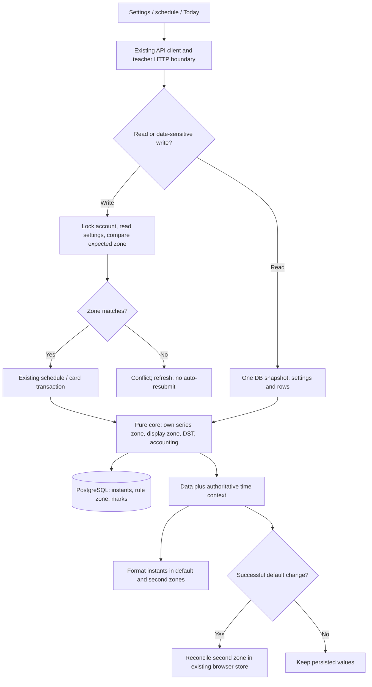

# Phase 21.1: Default Time Zone — Research

**Researched:** 2026-10-11
**Domain:** IANA zones, recurrence identity, teacher settings, accounting dates
**Confidence:** MEDIUM

<user_constraints>

## User Constraints (from CONTEXT.md)

Следующие три подраздела скопированы дословно из принятого контекста. [VERIFIED: .planning/phases/21.1-default-time-zone/21.1-CONTEXT.md:19-36,102-106]

### Locked Decisions

- **D-01:** Основная зона по умолчанию `Asia/Ho_Chi_Minh`; учитель меняет её в Settings → General с подтверждением. Настройка хранится в аккаунте.
- **D-02:** У каждой серии и одиночного урока хранится зона создания. Старые строки получают `Asia/Ho_Chi_Minh`. Новые получают текущую основную зону. Смена настройки не сдвигает существующие уроки и не переписывает правила серий.
- **D-03:** Старые уроки показываются в новой основной зоне с тем же instant. Отличающаяся зона создания видна только в деталях урока и Whole series.
- **D-04:** Today и граница даты остатка следуют текущей основной зоне. Урок около полуночи может перейти на другой календарный день и изменить вычет относительно `opening_balance_on`. Значения payment `paid_on` остаются датами.
- **D-05:** Вторая зона остаётся в localStorage. Если новая основная совпала со второй, после успешного сохранения старая основная становится второй. При отмене или ошибке обе зоны остаются прежними.
- **D-06:** Дизайн Default time zone, ZoneChangeDialog и подписей принят в v37; используем актуальную локальную копию v40. Её старую помету «after 23» заменяет принятый порядок 21 → 21.1 → 24.
- **D-07:** Ничего физически не удаляется. Миграция только аддитивная и генерируется `yarn db:generate`. История отметок, исключения и ключи прошлых вхождений сохраняются.
- **D-08:** Правила отметок и переноса из 21-CONTEXT D-17 сохраняются. Зона не вводит новое ограничение на перенос прошедшего урока.

### the agent's Discretion

- Расчёты дат и вхождений принадлежат `packages/core`. Передавать зону явно через существующие владельцы, без чтения настроек внутри core.
- Настройку читает и пишет `apps/api/src/settings/settings.ts`; HTTP-граница остаётся в `routes/settings.ts`. Частичное изменение зоны не должно перезаписывать Pays soon и наоборот.
- Использовать существующие `TimeZonePicker`, zone labels, Panel и Base UI dialog. Новая зависимость не запланирована.
- Исследование определяет точные сигнатуры и стратегию неоднозначного/несуществующего времени DST. До реализации записать ожидаемый результат для обоих случаев. Скрытый сдвиг или недетерминированный выбор запрещён критерием сохранения времени.
- Во время завершения фазы 21 её source остаётся frozen. Этот worktree не запускает dev, БД, build или E2E до согласованного владения общими портами и базами.

### Deferred Ideas (OUT OF SCOPE)

Google OAuth/синхронизация и публичные homepage/privacy/terms — фазы 24–25. Ручная полная приёмка календаря — после Google sync. Чат — 22–23. Выкатка — отдельное действие оператора.
</user_constraints>

## Summary

Текущее преобразование wall time делает два уточнения offset и всегда возвращает Date. Его возвращаемый тип — `Date`, результат — `return new Date(second)`; результат не различает gap и fold. Основная зона сейчас задана константой `SCHEDULE_TIME_ZONE = 'Asia/Ho_Chi_Minh'`. Это две отдельные точки изменения: политика разрешения wall time и передача контекста отображения. [VERIFIED: packages/core/src/zoned.ts:92-98] [VERIFIED: packages/core/src/schedule.ts:3-15]

Хранить IANA zone отдельно от instant необходимо: PostgreSQL сохраняет timestamptz как UTC и не сохраняет исходное имя зоны. [CITED: https://www.postgresql.org/docs/18/datatype-datetime.html#DATATYPE-DATETIME-INPUT] Существующая модель различает естественную дату серии и фактическое время переноса: контракт ссылки — `{ kind: 'single'; lessonId: string } | { kind: 'series'; seriesId: string; originalOn: string }`. Менять эту идентичность при сохранении настройки не нужно. [VERIFIED: packages/contracts/src/schedule.ts:66-67]

**Primary recommendation — решение исполнителя:** добавить постоянную зону создания к уроку/серии; передавать текущую зону аккаунта явным параметром для окон, Today и остатка; использовать один серверный snapshot настройки и данных. При изменении всей серии создавать новый rule прямо в текущей основной зоне. Не переводить его weekday/time через offset старой зоны.

**Граница результата:** этот документ задаёт реализацию и её доказательства. Runtime, миграции, build и E2E в исследовании не запускались. Текущий write set исследователя — только RESEARCH и ARCH-REVIEW этой фазы. Это ограничение текущего задания, включая запрет Git.

## Architectural Responsibility Map

Таблица — предписание для планов, а не утверждение о выполненной реализации.

| Capability                                               | Primary Tier           | Secondary Tier                | Rationale                                               |
| -------------------------------------------------------- | ---------------------- | ----------------------------- | ------------------------------------------------------- |
| Зона аккаунта, partial update, конфликт устаревшей формы | API / settings         | Database                      | Авторитетное значение и сериализация записей            |
| Зона создания и неизменяемые instants                    | Database / Storage     | API schedule                  | Аддитивная схема; сохранять происхождение правила       |
| Wall time → instant, DST, recurrence/cut/end             | Чистый domain core     | API adapter                   | Один алгоритм; core получает данные и зону              |
| Окна недели, Today, facts карточек                       | API / Backend          | Core + Database               | Один snapshot; сервер раскрывает серии                  |
| Отображение, подтверждение, второй пояс                  | Browser / Client       | SSR для первоначальных данных | Клиент форматирует instants и хранит только вторую зону |
| Google event mapping в фазе 24                           | Будущий API sync owner | Сохранённые refs расписания   | Контракт зависимости ниже; sync в этой фазе не строить  |

<phase_requirements>

## Phase Requirements

Описания требований дословны. [VERIFIED: .planning/REQUIREMENTS.md:69-73]

| ID                    | Description                                                                                                                                                                                  | Research Support                                                              |
| --------------------- | -------------------------------------------------------------------------------------------------------------------------------------------------------------------------------------------- | ----------------------------------------------------------------------------- |
| TZ-01                 | The teacher confirms an account-level default time zone in Settings; new accounts start with Vietnam. Cancel or failed save leaves the value unchanged.                                      | Partial PATCH, account lock, подтверждение без optimistic save                |
| TZ-02                 | Lessons and series persist their creation zone. Existing rows stay in Vietnam; new rows use the default. Changing the setting preserves existing instants, rules and occurrence identities.  | Аддитивная схема, immutable creation zone, стабильные refs                    |
| TZ-03                 | All schedule and lesson displays use the default zone. Different creation zones appear in details; recurrences preserve wall time in their stored zone across daylight saving changes.       | Явная зона, mixed-zone windows, DST policy, Whole series                      |
| TZ-04                 | Today and lesson accounting dates follow the default zone, including the opening-balance boundary. Date-only payment values do not shift.                                                    | Один time context и core accounting predicates                                |
| TZ-05                 | The browser's second zone stays distinct from the default and synchronized between Settings and schedule. On collision, a successful default-zone change swaps in the old default as second. | Существующий localStorage owner, каноническая идентичность, swap после успеха |
| </phase_requirements> |

## Project Constraints (from AGENTS.md)

Применить следующие директивы к планам. Более новое прямое задание пользователя ограничивает полномочия исследования; правила исполнения не разрешают исследователю Git, runtime или дополнительные записи.

- Держать scope, write set, критерии, риски и минимальное доказательство; не повторять доказанные claims. Отчёты — по-русски, UI — по-английски. Не писать комментарии в коде. Перед готовностью к review выполнить simplify. [VERIFIED: user-provided AGENTS.md, Context Discipline / Minimum Sufficient Work / Shared Claude Code Preferences / Mandatory Simplify Pass]
- Сохранить владельцев: core чистый и без зависимостей; contracts только общий контракт и zod; web не импортирует API/DB; API не переносит бизнес-правила в routes. `DbExecutor` остаётся типом базы/транзакции. HTTP ходит через `apiRequest`, авторизация и Origin через существующий middleware. [VERIFIED: AGENTS.md:22-24,59-80]
- Дизайн — принятый вариант A и актуальная копия v40; существующие Base UI-компоненты. Не добавлять Radix/cmdk, новые eyebrows, новые UI-области. Компоненты читать у владельца дизайна; текущий UI-SPEC ведёт отдельный исполнитель. [VERIFIED: AGENTS.md:5-16,90-93] [VERIFIED: user-provided AGENTS.md, UI Design Guardrails] [VERIFIED: .planning/phases/21.1-default-time-zone/21.1-CONTEXT.md:26,34]
- Схему менять аддитивно; миграцию генерировать `yarn db:generate`. Не редактировать сгенерированную миграцию руками, не использовать `drizzle-kit push`, не создавать extensions в миграции. Разделение app/migrator сохранить. Ничего не удалять. [VERIFIED: AGENTS.md:97-106] [VERIFIED: user-provided AGENTS.md, File Deletion Safety]
- Точные версии и возрастной барьер не менять. Новая зависимость не нужна. Нельзя получить новую установку через research или workflow. [VERIFIED: AGENTS.md:108-114] [VERIFIED: .planning/phases/21.1-default-time-zone/21.1-CONTEXT.md:34]
- Новые функциональные проверки — только расширения durable E2E через публичный UI/API и настоящий persistence path; сценарий записать до поведения. Unit/component/contract/integration и одноразовые incident suites не добавлять. Старые тесты сохранить. Evidence: fingerprint, scenario/fixture, expected/observed, original exit и rerun. [VERIFIED: user-provided AGENTS.md, E2E Verification]
- При реализации: CC и cognitive complexity каждой функции/callback `<22`, Halstead Difficulty `<80` с указанным token convention/tool, handwritten file `<500` строк, без подтверждённого dead/redundant code и без any в затронутом коде; unknown только на непроверенной границе. Неполное измерение не PASS. Coverage/mutation не цель. [VERIFIED: user-provided AGENTS.md, Code Quality Gates]
- Реальные имена, суммы, заметки, секреты и адреса серверов не попадают в документы/логи. Не читать vault или env для этой подготовки. Синтетические fixtures — только при отдельном разрешённом исполнении. [VERIFIED: AGENTS.md:124-128] [VERIFIED: current research assignment]
- Один web/runtime owner; не запускать очищающий тестовую БД набор параллельно другому исполнителю. Dispatch/изоляция и metadata принадлежат parent. Устаревшие указания удалить/restore файлы и автоматически коммитить не действуют против текущих ограничений пользователя. [VERIFIED: .planning/EXECUTOR-RULES.md:7-17,23-29] [VERIFIED: current research assignment]
- Общие date predicates и исход урока остаются в core; D-17 разрешает перенос прошлого урока. Не вернуть прежний запрет через новое сравнение дат. Не строить Google sync, OAuth, профильные Stat/NextPayment или deployment. [VERIFIED: .planning/phases/21-lesson-accounting-and-today/21-CONTEXT.md:57-64] [VERIFIED: .planning/phases/21.1-default-time-zone/21.1-CONTEXT.md:13,28]

## Standard Stack

Это сохранение закреплённого стека, не выбор новых пакетов. Registry/latest/publish date не исследуются: фаза не устанавливает и не обновляет зависимости. Версии ниже прочитаны в manifests; утверждения «актуальная latest» нет.

| Слой              | Прочитанное значение                                                                                    | Применение                          |
| ----------------- | ------------------------------------------------------------------------------------------------------- | ----------------------------------- |
| Runtime / manager | `"node": ">=24"`, `"packageManager": "yarn@4.18.1"` [VERIFIED: package.json:6-9]                        | Существующая среда                  |
| TypeScript        | `"typescript": "6.0.3"` [VERIFIED: package.json:35-35]                                                  | Явные типы контекста                |
| Web               | `"next": "16.4.0"`, `"react": "19.3.0"` [VERIFIED: apps/web/package.json:22-24]                         | Существующие экраны                 |
| UI                | `"@base-ui/react": "1.8.0"` [VERIFIED: apps/web/package.json:13-13]                                     | Picker, dialog, Panel               |
| Contracts         | `"zod": "4.6.5"` [VERIFIED: packages/contracts/package.json:13-15]                                      | Partial PATCH и IANA input boundary |
| DB                | `"drizzle-orm": "1.0.0-rc.4"`, `"drizzle-kit": "1.0.0-rc.4"` [VERIFIED: packages/db/package.json:14-23] | Схема, генерация, транзакции        |
| E2E               | `"@playwright/test": "1.63.0"` [VERIFIED: package.json:28-28]                                           | Расширить существующие journeys     |

**Installation:** не требуется. **Package Legitimacy Audit:** N/A; ни одного нового внешнего пакета. Не добавлять Temporal polyfill или календарную библиотеку ради этой фазы. Альтернативы утверждённому стеку не исследовать.

## Architecture Patterns

Все новые поля, сигнатуры и алгоритмы ниже — **решения исполнителя для планов**, не описание уже существующих exports. Они не требуют отдельного пользовательского выбора. Существующие дискретные значения приведены с дословной цитатой источника.

### System Architecture Diagram



### 1. Три разных значения времени

1. **Instant:** сохраняемый момент начала. Смена настройки его не меняет.
2. **Creation zone:** IANA id в каждой серии/одиночном уроке. Серия раскрывает weekday/time именно здесь.
3. **Display/accounting zone:** текущее значение аккаунта; определяет календарный день Today, окно недели, подписи и дату вычета.
4. **Natural key date:** originalOn в creation zone старой серии. Не переводить его в отображаемую дату и не менять при переносе отдельного вхождения.
5. **Date-only:** paidOn и openingOn не проходят через Date/UTC-конверсию. Сравнивать их как валидированные календарные даты; только startsAt урока переводить в текущую account zone.

Основание разделения: текущие ссылки `{ kind: 'single'; lessonId: string }` / `{ kind: 'series'; seriesId: string; originalOn: string }`, поля `startsAt: string`, `startsOn: string`, `endsOn: string | null`. [VERIFIED: packages/contracts/src/schedule.ts:66-67,75-100]

### 2. Аддитивная схема и настройка

**Предписанная схема:** добавить NOT NULL text-поля default_time_zone у teacher settings и time_zone у lesson series / lessons с постоянным default Vietnam. Это сохраняет старые writers и заполняет старые строки без пересчёта времени. Новые API inserts всегда передают актуальную зону явно. Серийные исключения наследуют зону своего rule; отдельную колонку зоны исключения не добавлять.

Значение исходной зоны дословно: `'Asia/Ho_Chi_Minh'`. [VERIFIED: packages/core/src/schedule.ts:3-3] У teacher settings существующие поля — `accountId`, `paysSoonLessons`, `updatedAt`; paysSoonLessons имеет notNull без DB default. Поэтому zone-only создание строки должно также подставить существующий core default Pays soon, а conflict update изменяет только переданные поля. [VERIFIED: packages/db/src/schema.ts:313-323] Текущий контракт: `export type TeacherSettings = { paysSoonLessons: number }`. [VERIFIED: packages/contracts/src/settings.ts:10-12]

**Новый contract:**

- TeacherSettings: paysSoonLessons и defaultTimeZone.
- updateSettingsRequest: strict nonempty partial по двум полям; expectedDefaultTimeZone обязателен, только когда записывается defaultTimeZone. Pays soon не требует zone precondition.
- Возвращать целый SettingsResponse после успешной записи; не делать read/merge/write сохранённого старого объекта.
- Урок/серия/блок получают timeZone. У перенесённого вхождения это creation zone исходного rule, не зона выбранного нового времени.
- Settings owner принимает accountId только от authenticated teacher session.

**Сериализация:** PATCH настройки и date-sensitive write сначала блокируют существующую строку accounts учителя, затем читают settings. Это работает и когда settings row ещё отсутствует. Одинаковый порядок: account → существующий lesson/series/student lock. Не помещать настройку в auth business module: settings читает account row только как стабильную точку блокировки.

Date-sensitive write: создание/перенос урока, move/end series, ввод opening balance и оплата с проверкой «не позже сегодня». Передавать expectedDefaultTimeZone из отображённого контекста; несовпадение возвращает конфликт без записи. Mark/cancel/restore, основанные на instant/ref, сохраняют текущие expectedStartsAt guards и D-17; не добавлять запрет прошлого. Настройка A→B→A не требует revision: исходная семантика зоны восстановлена.

**Новые отказные исходы для contracts:** default_time_zone_changed → HTTP 409; nonexistent_local_time → HTTP 400. Это предлагаемые значения новой реализации. Существующие отказные исходы серии сохранить: `{ kind: 'invalid' }`, `{ kind: 'changed' }`, `{ kind: 'today_passed' }`, `{ kind: 'ends_before_new_day'; endsOn: string }`. [VERIFIED: packages/core/src/schedule.ts:365-370]

### 3. Один контекст для чтения и расчёта

Предписанный контекст: `TeacherTimeContext = { now: Date; defaultTimeZone: string }`. Settings, rows и производные значения получать в одной read-only repeatable-read транзакции. Существующий snapshot helper использует `isolationLevel: 'repeatable read'`, `readOnly: true`. [VERIFIED: apps/api/src/schedule/rows.ts:331-333]

Переместить этот generic helper в DB connection owner с сохранением поведения; не заставлять settings импортировать schedule ради транзакции. API сборщик одного экрана получает settings один раз. Не читать настройку внутри core, в цикле карточек или на каждый formatter.

В ответы schedule week, Today, students list/detail добавить time context: defaultTimeZone и asOf. Клиент форматирует данные зоной ответа. Отдельный параллельный GET settings не является доказательством, что баланс и его подпись рассчитаны в одной зоне. После успешной смены инвалидировать зависимые чтения; не переклеивать новые labels на старый ответ.

Протянуть context через card-facts, card detail/list и ответы карточечных mutations. Импорт карточек не должен приобретать скрытую зависимость от локальной зоны машины: если вызывается сборщик facts, его вызывающая граница передаёт context явно.

### 4. Pure core и mixed-zone windows

Предписанные сигнатуры:

```ts
type TeacherTimeContext = {
	now: Date
	defaultTimeZone: string
}

type LocalTimeCandidates = readonly Date[]

declare function localTimeCandidates(date: string, time: string, zone: string): LocalTimeCandidates
declare function startOfZonedDay(date: string, zone: string): Date
declare function scheduleDate(instant: Date, zone: string): string
declare function scheduleToday(now: Date, zone: string): string
declare function isAfterScheduleToday(date: string, now: Date, zone: string): boolean
```

Это новый sketch, не готовый source. Date strings проходят contracts validation до core. Для SeriesRule, SingleLesson и CutLesson добавить обязательный timeZone; убрать implicit Vietnam у вызовов, которые должны следовать аккаунту. Начальное значение Vietnam оставить только там, где оно означает продуктовый default/backfill.

- occurrenceAt раскрывает естественный старт по rule.timeZone; moved/cancelled с сохранённым startsAt используют сохранённый instant.
- occurrencesInWindow перебирает natural dates каждого rule в его зоне, затем фильтрует по фактическому instant и общему полуоткрытому окну.
- nextLessons начинает поиск natural dates каждого rule в его зоне. Пропущенное DST-вхождение — продолжить следующую неделю, не завершить поиск null-результатом.
- API week window — два startOfZonedDay в current default, а не начало плюс фиксированное число миллисекунд.
- SQL выбирает кандидатов консервативно: UTC-даты краёв окна с запасом по одному календарному дню; точный отбор делает core в каждой зоне. Загрузить также moved/cancelled startsAt в окне и их series owners даже при originalOn вне окна.
- Для nextLessons использовать аналогичную нижнюю границу и существующую загрузку будущих moved exceptions; не ограничивать выборку только natural dates текущей недели.
- countsAfterOpening для payment остаётся date-only. lessonDeduction, markEffect, needsMark, studentBalance и todayCounts получают accounting zone явно. now используется как instant для доступности действий.

Существующие области, которые нужно заменить согласованно: окно использует общую Vietnam-зону, поиск next starts использует общую дату, а dateBounds строит общие пределы. [VERIFIED: packages/core/src/schedule.ts:205-239,254-301] [VERIFIED: apps/api/src/schedule/rows.ts:173-178,337-399] Существующий balance пересчитывает дату startsAt через scheduleDate. [VERIFIED: packages/core/src/balance.ts:19-36,49-75,97-120]

### 5. Детерминированный DST

ECMAScript описывает ноль, один или несколько соответствующих instants для локального времени; в примере New York повторяются 01:30, а 02:30 весеннего перехода отсутствует. [CITED: https://tc39.es/ecma262/multipage/numbers-and-dates.html#sec-getnamedtimezoneepochnanoseconds] RFC 5545 выбирает первое повторение local time и предписывает пропускать несуществующие recurrence instances. Его правило нормализации отдельно указанного gap time не брать для формы приложения: форма обязана отклонять скрытый сдвиг по D-02/DST constraint. [CITED: https://www.rfc-editor.org/rfc/rfc5545.html#section-3.3.5] [CITED: https://www.rfc-editor.org/rfc/rfc5545.html#section-3.3.10]

**Предписанная таблица результата:**

| Ситуация                                                           | Результат                                                                                                |
| ------------------------------------------------------------------ | -------------------------------------------------------------------------------------------------------- |
| Один candidate                                                     | Сохранить его                                                                                            |
| Fold, два candidate                                                | Выбрать самый ранний instant; preview/helper явно показывает offset/label и что выбран первый occurrence |
| Gap при ручном create/move или первом выбранном старте нового rule | 400; поле сохраняет ввод, объясняет отсутствие времени; запись не создаётся                              |
| Gap у последующих weekly occurrences                               | Пропустить только эту natural date; следующая неделя остаётся                                            |
| Существующий instant во втором повторении часа                     | Не пересчитывать; показать именно его и его offset; это другой instant                                   |
| Midnight gap                                                       | startOfZonedDay возвращает первый существующий instant дня, не 00:00 с неявной нормализацией             |
| Полностью пропущенный календарный день                             | Пустой interval, соседние day boundaries совпадают; не создавать phantom day lesson                      |

Алгоритм candidates взять из TC39 reference: получить offsets около wall date до/после перехода, построить возможные UTC значения, проверить каждое обратным formatToParts на точное совпадение wall parts, удалить дубли, отсортировать. Reference также отдельно обрабатывает start of day при midnight gap. [CITED: https://raw.githubusercontent.com/tc39/proposal-temporal/main/polyfill/lib/ecmascript.mjs] Реализовать только нужный bounded adapter в core; не копировать полный polyfill и не поставлять свою tz database. Transition search должен учитывать нечасовой сдвиг; код не должен предполагать ровно 60 минут.

**Oracle для существующих E2E:** New York 2017-11-05 01:30 соответствует 05:30Z и 06:30Z, выбирать 05:30Z при новом вводе; 2017-03-12 02:30 не соответствует instant. Эти примеры приведены в ECMAScript; они не являются результатом запуска приложения. [CITED: https://tc39.es/ecma262/multipage/numbers-and-dates.html#sec-getnamedtimezoneepochnanoseconds]

### 6. Whole series: display, новое правило и граница старого

**Три явных входа:** from/lastOn — дата в current default; weekday/startTime — wall rule в current default; originalOn — natural date в stored zone старого rule. Их нельзя сравнивать как одну календарную шкалу.

**Показ:** описание старой серии переводить через конкретное ближайшее действующее вхождение. Оно показывает weekday/time в main и creation zone отдельно. Не менять stored rule ради показа. UI-SPEC уже задаёт именно это. [VERIFIED: .planning/phases/21.1-default-time-zone/21.1-UI-SPEC.md:233-235]

**Move whole series — предписанный алгоритм:**

1. Под account и series locks проверить expectedDefaultTimeZone; проверить from ≥ today в current default.
2. B = startOfZonedDay(from, current default).
3. Найти первую естественную дату OLD series, чей естественный start instant ≥ B. Это oldCutOn. Ориентироваться на естественный старт, не на отображаемую дату moved exception.
4. Если затрагиваемый естественный урок уже начался сегодня, сохранить существующий today_passed guard. Не отрезать прошлый natural prefix и не молча менять from на завтра.
5. Старой серии назначить endsOn = oldCutOn − один календарный день в её шкале, с существующим empty-series правилом. Старые weekday/time/timeZone/startsOn остаются.
6. Сохранить существующую обработку хвоста moved/marked. Передать в загрузчики исключений/отметок oldCutOn, не UI from. Detached lesson получает прежний instant, duration, outcome/mark и timeZone старой серии.
7. Новый rule получает введённые weekday/startTime **непосредственно в current default**, timeZone = current default. Даже одинаковые числовые weekday/time при другой зоне означают реальное изменение, не invalid/no-op.
8. Первый новый occurrence — на/после from и не в прошлом по now. Если явно выбранный первый wall time находится в gap, вернуть явную ошибку; последующие gaps пропускать.
9. При ограниченном старом rule: E = startOfZonedDay(old endsOn + один день, old timeZone). Последняя natural date нового rule — последняя, чей start instant < E. Если такой даты нет, вернуть существующий ends_before_new_day. Не копировать old endsOn как дату новой зоны.
10. В одной транзакции изменить старый конец, сохранить detached lessons/marks и вставить новый rule. Не удалять исключения или исходные marks.

**End series:** lastOn означает включительно последний день в current default. E = startOfZonedDay(lastOn + один день, current default). Сохранить естественные OLD occurrences со start instant < E; записать соответствующий last natural date OLD rule, либо существующее empty-series значение. Хвост загружать от следующей old natural date. Сохранять moved/marked как сейчас. Запретить выбор lastOn раньше текущего дня; сравнение с existing finite end выполнять через instant boundary, не лексикографией дат разных зон.

**Сохранение истории:** смена настройки сохраняет все refs. Разрез сохраняет natural prefix старой серии; новый tail получает новые refs. Уже принятая D-12g сохраняет moved/marked tail как одиночные lessons с копированием отметок. Это относится и к tail exception, перенесённому в прошлое: факт/instant сохраняется, ссылка становится single по существующей политике разреза. Не заявлять, что ВСЕ refs вечны после cut. [VERIFIED: .planning/phases/21-lesson-accounting-and-today/21-CONTEXT.md:46-46,64-64] [VERIFIED: AGENTS.md:103-104]

Существующий результат core — `{ kind: 'ok'; oldEndsOn: string; newRule: NewSeriesRule; lessons: CutLesson[] }`; CutLesson несёт `originalOn: string`. API создаёт lesson и копирует mark по originalOn. Сохранить эту форму, расширив rule/CutLesson полем timeZone. [VERIFIED: packages/core/src/schedule.ts:332-340,365-370] [VERIFIED: apps/api/src/schedule/series.ts:20-34]

### 7. Web: сохранение, форматирование и вторая зона

- Default picker хранит saved и pending selection отдельно. Confirm выполняет PATCH; cancel/error не меняет saved или localStorage. Busy блокирует выходы. При timeout с неизвестным исходом перечитать settings до повторной записи; не объявлять rollback без ответа сервера.
- Использовать одну canonical-zone функцию на contracts boundary. Сравнивать IANA identities, а не UTC offset/короткую label. Не приравнивать разные зоны только потому, что сегодня их offsets равны. Учитывать признанные runtime aliases.
- После успешного изменения main сравнить новую main с текущей второй зоной; при совпадении записать старую main во вторую тем же existing store owner. Доставить событие в обе подписки. На чужом устройстве/после reload, когда прежняя main неизвестна, коллизию разрешать в None; не угадывать происхождение.
- Заменить фиксированное excludeMain в picker на явную main identity. Удалить Vietnam-only fallback из нормализации второй зоны. Сохранить existing favorites и storage keys.
- У разных экранов main приходит из authoritative response; useSecondZone остаётся shared browser owner. При обновлении ответа main и данных не допускать смешанного кадра.
- Schedule-format/TimePair/tooltip/dialog/Today/ledger helpers получают main явно. Created in показывать только в details/Whole series при отличии creation identity.
- WeekGrid сохранить 24-часовую wall axis и existing overlap layout. Start position брать из wall minutes текущей зоны; duration остаётся elapsed minutes, endpoints форматировать из startsAt + duration. Длинный блок ограничивать рамкой дня; grouping урока — по start date. Не вычислять day/week windows через 24h multiplier. Два instants fold не объединять по строке local time и не терять в overlap/agenda. Новые DST lanes и новый календарный layout не нужны.
- Совпадение main/second через разные aliases проверять и в picker, и при server response; stale форма показывает reload без auto-resubmit.

Текущие ключи: `'dv-lab.schedule.second-zone'`, `'dv-lab.time-zones.favorites'`; browser event — `'dv-lab:time-zones'`, default second — `'Europe/Moscow'`, None sentinel — `'none'`. Эти значения не переименовывать. [VERIFIED: apps/web/components/app/time-zone-picker.tsx:17-22] Existing normalizer отвергает Vietnam, а useSecondZone подписан на storage и собственное событие. [VERIFIED: apps/web/components/app/time-zone-picker.tsx:24-61]

### Component Responsibilities и write set для planner

Это **предлагаемый scope будущей реализации**. Новые пути помечены «новый»; они не выданы за существующие файлы. Barrel exports и типизированные call sites включить в соответствующий план. Не давать двум планам одну строку таблицы одновременно.

| Владелец / файлы                                                                                                                                                               | Изменение                                                                                                 | Критерий    |
| ------------------------------------------------------------------------------------------------------------------------------------------------------------------------------ | --------------------------------------------------------------------------------------------------------- | ----------- |
| packages/db/src/schema.ts; сгенерированный migration output; packages/db/src/connection.ts, index.ts                                                                           | 3 zone columns; generic snapshot helper                                                                   | TZ-01,02,04 |
| packages/contracts/src/settings.ts, schedule.ts, today.ts, students.ts, auth.ts, index.ts                                                                                      | partial settings; metadata зон; context ответа; stale/gap errors в существующем errorCodes; preconditions | TZ-01…05    |
| packages/core/src/zoned.ts, schedule.ts, balance.ts, index.ts; **новый** packages/core/src/schedule-series.ts при выделении cut/end owner                                      | candidates/day boundaries; explicit zones; recurrence/cut/end/accounting                                  | TZ-02…04    |
| apps/api/src/settings/settings.ts, routes/settings.ts                                                                                                                          | read/update/context; account lock; partial upsert                                                         | TZ-01,05    |
| apps/api/src/schedule/rows.ts, schedule.ts, changes.ts, series.ts, marks.ts; routes/schedule.ts                                                                                | mixed-zone rows; explicit creation; guard и транзакции; wire mapping                                      | TZ-02…04    |
| apps/api/src/cards/card-facts.ts, cards.ts; today/today.ts; routes/students.ts, payments.ts, today.ts                                                                          | единый snapshot, dates, ответ facts; передать context в текущие callers                                   | TZ-04       |
| apps/web/components/app/time-zone-picker.tsx, time-pair.tsx, ledger-text.tsx; lib/time-zones.ts, schedule-format.ts, lesson-mark-text.ts                                       | identities/store/formatting; один owner правил                                                            | TZ-03…05    |
| apps/web/app/(app)/settings/page.tsx, _components/settings-screen.tsx, payments-card.tsx; **новый** _components/zone-change-dialog.tsx                                         | default setting, confirmation, независимый Payments                                                       | TZ-01,05    |
| apps/web/app/(app)/schedule/_components: schedule-screen, toolbar, week-grid, lesson-block, tooltip, details/dialogs, new-lesson, move-series, end-series, mutations и preview | explicit main, stale form, новые правила UI и typed calls                                                 | TZ-02,03,05 |
| apps/web/app/(app)/_components Today; students screens и shared payment/opening формы                                                                                          | context ответа, current date, accounting text                                                             | TZ-04       |
| e2e/today.spec.ts, move.spec.ts, marks.spec.ts; e2e/support/data.ts, test.ts, dates.ts, api.ts по необходимости существующих fixtures                                          | durable scenarios и точное восстановление settings                                                        | Все TZ      |

В schedule.ts core сейчас cut/end занимают отдельный связный хвост; при превышении file limit выделять эту ответственность целиком, сохраняя публичный экспорт. Не делить файл механически по числу строк. [VERIFIED: packages/core/src/schedule.ts:330-428]

## Don't Hand-Roll

Предписания, основанные на владельцах выше.

| Задача           | Не строить                                                | Использовать                               |
| ---------------- | --------------------------------------------------------- | ------------------------------------------ |
| Правила зоны     | Собственную tz database, таблицу offsets, «прибавить час» | Intl и bounded candidate adapter по TC39   |
| Авторизация      | Особый settings login/роль                                | Existing teacher middleware и Origin check |
| Recurrence / cut | Второй rule resolver в web или SQL                        | Чистый core                                |
| Второй пояс      | Ещё один localStorage hook/store                          | Existing useSecondZone                     |
| Формы зон        | Новый combobox/calendar framework                         | TimeZonePicker и Base UI                   |
| Accounting       | Новые формулы в Today/profile                             | Existing core predicates с явной зоной     |
| Проверки         | Отдельный DST unit runner / incident script               | Расширения existing public E2E journeys    |

## Runtime State Inventory

Миграционная фаза; проверено состояние source owners. Live state намеренно не обследовалось по запрету текущего задания. «Не проверено» не означает «ничего нет».

| Category                             | Items Found                                                                                                                                                  | Action Required                                                                                                           |
| ------------------------------------ | ------------------------------------------------------------------------------------------------------------------------------------------------------------ | ------------------------------------------------------------------------------------------------------------------------- |
| Stored data                          | Source schema: series, lessons, teacher settings; runtime rows не читались. [VERIFIED: packages/db/src/schema.ts:215-238,270-288,313-323]                    | Аддитивный generated backfill; при исполнении доказать неизменность instants/rules/refs на разрешённых synthetic fixtures |
| Live service config                  | Не проверялось; новая настройка проектируется в существующей БД, не во внешнем сервисе                                                                       | Не менять live services; Google остаётся фазе 24                                                                          |
| OS-registered state                  | Не проверялось; переименования OS services не планируются                                                                                                    | Нет задачи по OS                                                                                                          |
| Secrets/env vars                     | Не читались; предложенный контракт не требует новых env/секретов                                                                                             | Не добавлять конфигурацию зоны через env                                                                                  |
| Build artifacts / installed packages | Live artifacts не проверялись. Web browser state имеет перечисленные выше storage keys. [VERIFIED: apps/web/components/app/time-zone-picker.tsx:17-22,33-45] | Сохранить keys; reconcile после success/reload; build выполняет будущий назначенный owner, без install                    |

## Common Pitfalls

| Ошибка                                        | Причина / видимый симптом                         | Предписание / проверка                                   |
| --------------------------------------------- | ------------------------------------------------- | -------------------------------------------------------- |
| Пересчёт старых startsAt при save             | Zone перепутана с instant                         | Сравнить refs/instants до save и после reload            |
| Потеря Pays soon                              | Whole-object update или insert без required field | Partial upsert + конкурентные две формы                  |
| Пропуск moved occurrence на границе недели    | SQL фильтрует только originalOn в main dates      | Broad candidates + effective instant filter              |
| DST gap превращается в другой час             | Два offset passes всегда выдают Date              | Candidates + explicit 400; проверить reload              |
| nextLessons заканчивается на DST gap          | null трактуется как конец серии                   | Пропустить дату и продолжить правило                     |
| Отрезано прошлое / неверный конец серии       | from/lastOn сравниваются в разных зонах           | Boundary instant → OLD natural date                      |
| Whole series «плывёт» после перехода DST      | Введённый rule один раз перевели в старую зону    | Новый rule хранится в current main                       |
| Баланс и подпись из разных settings snapshots | Независимые fetch/read settings                   | Ответ включает context, один DB snapshot                 |
| Второй пояс потерян при неуспешном save       | Local state меняют до API success                 | Cancel/failure не пишут storage                          |
| Фикстура оставляет изменённую main            | Recovery знает только Pays soon                   | Расширить existing settings snapshot до запуска сценария |

Причины выведены из прочитанных owners, а строки таблицы — failure modes будущей реализации, не результаты тестов. Исходные точки: zonedInstant, settings schema, cutSeries, rows loader, browser normalizer и settings recovery. [VERIFIED: packages/core/src/zoned.ts:92-98] [VERIFIED: packages/db/src/schema.ts:313-323] [VERIFIED: packages/core/src/schedule.ts:372-427] [VERIFIED: apps/api/src/schedule/rows.ts:337-399] [VERIFIED: apps/web/components/app/time-zone-picker.tsx:48-61] [VERIFIED: e2e/support/data.ts:143-183]

## Code Examples

### Сохранить текущую ссылку, не заменять originalOn display date

Дословная текущая форма контракта: [VERIFIED: packages/contracts/src/schedule.ts:66-67]

```ts
export type ScheduleOccurrenceRef =
	{ kind: 'single'; lessonId: string } | { kind: 'series'; seriesId: string; originalOn: string }
```

### Сохранить результат cut и обогатить его, а не добавлять другой cut engine

Дословная успешная ветка текущего результата: [VERIFIED: packages/core/src/schedule.ts:365-370]

```ts
{ kind: 'ok'; oldEndsOn: string; newRule: NewSeriesRule; lessons: CutLesson[] }
```

Предписание: newRule.timeZone — новая main; каждый lessons[].timeZone — старая creation zone; lessons[].originalOn — исходная natural date. Persisted lesson id появляется только в API insert, не в core.

### Единый snapshot

Предписанный вызов: в транзакции readSnapshot сначала readTeacherSettings, затем передать `{ now, defaultTimeZone: settings.defaultTimeZone }` в чтение rows и facts, вернуть тот же defaultTimeZone вместе с asOf и данными. Это sketch, не существующая сигнатура.

## State of the Art

| Текущий owner                                         | Предписанный переход                                     | Основание                              |
| ----------------------------------------------------- | -------------------------------------------------------- | -------------------------------------- |
| Глобальная Vietnam-константа для всех date boundaries | Creation zone у записи и явная account zone у вычисления | TZ-02…04                               |
| Два offset passes → Date                              | Набор кандидатов + явная policy gap/fold                 | TC39 и запрет скрытого сдвига          |
| Один calendar date для cut/end                        | UI date → boundary instant → natural date OLD rule       | Сохранение прошлого и нового wall rule |
| Отдельные данные/настройка                            | Snapshot с authoritative context                         | Согласованный Today/остаток            |

Это переход проекта, не заявление об устаревании стандартов или пакетов. Исходная реализация подтверждена выше; «deprecated API» не объявляются.

## Последовательность планов и минимальное доказательство

Предписание для planner; каждая волна закрывает конкретный criterion. Сначала описать/расширить нужный durable scenario, затем реализовать поведение. Отдельного тестового фреймворка не нужно.

| Волна | Работа и ownership                                                                                                                       | Доказательство                                                                                           |
| ----- | ---------------------------------------------------------------------------------------------------------------------------------------- | -------------------------------------------------------------------------------------------------------- |
| 0     | Уточнить scenario names в существующих journeys; расширить settings recovery owner; оформить разрешённое владение DB/ports перед runtime | Recovery включает зону и прежнее отсутствие строки; source tests описывают failure outcomes до поведения |
| 1     | DB + contracts + core зон/DST/series/accounting; serial ownership общих exports                                                          | typecheck; schema drift; generated migration; E2E ввод/чтение после API wiring                           |
| 2     | API settings/context и schedule/card/Today propagation                                                                                   | Реальный public API/reload: old/new records, partial/concurrent PATCH, stale 409, gap 400                |
| 3     | Один web owner: settings/confirmation, форматирование, series forms, Today/second zone                                                   | Те же journeys через UI в light/dark, browser zone отлична от main                                       |
| 4     | Только оставшиеся сквозные material failures и relevant static gates; simplify                                                           | Focused E2E, точный recovery, fingerprint и исходный exit                                                |

### Failure modes → existing durable E2E

| IDs      | Existing owner                                       | Ожидаемый наблюдаемый результат                                                                                                                                          |
| -------- | ---------------------------------------------------- | ------------------------------------------------------------------------------------------------------------------------------------------------------------------------ |
| TZ-01,05 | e2e/today.spec.ts                                    | Save→reload main; cancel/error не меняют зоны; busy/focus; collision swap; независимый Pays soon                                                                         |
| TZ-01,05 | Тот же public journey с двумя request contexts       | Concurrent zone/Pays soon оба сохраняются; stale default write — 409 без повторной автоматической записи; invalid input — 400; student — отказ без записи                |
| TZ-02,03 | e2e/move.spec.ts                                     | До/после default save одинаковые old instant/ref/rule; новые once/weekly имеют current creation zone; другой browser zone не влияет                                      |
| TZ-02,03 | e2e/move.spec.ts                                     | Gap отказ; fold первый instant + понятный helper; существующие оба fold instants доступны; соседние weekly instances не пропадают                                        |
| TZ-02,03 | e2e/move.spec.ts                                     | Whole series из иной зоны: новые weekday/time постоянны в новой зоне по обе стороны DST; natural prefix неизменен; old finite end не теряется при смене календарной даты |
| TZ-02,04 | e2e/marks.spec.ts                                    | Cut/end сохраняют moved/marked/cancelled хвост, mark и creation zone; originalOn используется для копирования, двойного вычета нет                                       |
| TZ-03,04 | e2e/today.spec.ts + существующие assertions карточки | Один instant по сторонам midnight/week/opening; Today, schedule, students и profile дают один результат; paidOn не меняется                                              |
| TZ-03,05 | Те же UI journeys                                    | 320px, light/dark, keyboard; Created in только details/Whole series; localStorage aliases/collision/reload                                                               |

Команда будущего focused запуска: `yarn test:e2e e2e/today.spec.ts e2e/move.spec.ts e2e/marks.spec.ts --project=light --project=dark`; planner добавляет фильтр по реальным scenario names. Это предложение, не выполненный check. Существующий script дословно: `"test:e2e": "node scripts/dev-checks/wait-dev.mjs up && playwright test"`. [VERIFIED: package.json:20-20]

Новые zone scenarios используют публичный API/интерфейс. Existing recovery owner сохраняет и восстанавливает settings, включая updatedAt и отсутствие строки; расширить его snapshot полем зоны и не подменять исходный snapshot текущими данными. Не расширять разрешения на SQL cleanup. [VERIFIED: e2e/support/data.ts:143-183]

Nyquist-раздел не включён: конфигурация дословно `"nyquist_validation": false`. Это не отменяет E2E и static gates пользователя. [VERIFIED: .planning/config.json:4-11]

## Environment Availability

| Dependency                      | Наблюдение                                                                                                                                                          | Следствие для плана                                                                    |
| ------------------------------- | ------------------------------------------------------------------------------------------------------------------------------------------------------------------- | -------------------------------------------------------------------------------------- |
| Node / Intl                     | Read-only probe: Node v24.17.0, ICU 78.3, tz 2026b, Intl.DateTimeFormat function; Temporal undefined. [VERIFIED: session command, node -p runtime capability probe] | Использовать Intl; не объявлять доступным native Temporal                              |
| Database / dev ports / Chromium | Не проверялись и не запускались по текущему запрету                                                                                                                 | Перед исполнением parent передаёт владельца общего runtime; это не отсутствие среды    |
| Dependencies                    | Версии manifests прочитаны; install не запускался                                                                                                                   | Сохранить pins; будущий executor проверяет уже установленную среду в разрешённом scope |

Нет установленного факта о недостающем blocking dependency. Runtime availability и E2E остаются UNVERIFIED; не объявлять их PASS по manifests.

## Security Domain

Security section включён по default workflow rule. Применять ASVS 5.0.0: названия категорий сверены по официальному документу; старые номера V2 Authentication/V4 Access Control из шаблона не использовать. [CITED: https://raw.githubusercontent.com/OWASP/ASVS/v5.0.0/5.0/docs_en/OWASP_Application_Security_Verification_Standard_5.0.0_en.json]

| ASVS category                             | Применение в этой фазе | Предписанный контроль                                                        |
| ----------------------------------------- | ---------------------- | ---------------------------------------------------------------------------- |
| V2 Validation and Business Logic          | Да                     | IANA validation, strict partial schema, atomic write, stale guard, DST error |
| V3 Web Frontend Security                  | Да                     | Существующий Origin/CSRF boundary; безопасный вывод labels                   |
| V6 Authentication / V7 Session Management | Существующая граница   | Переиспользовать сессию; не менять auth                                      |
| V8 Authorization                          | Да                     | Teacher-only, accountId из session                                           |
| V11 Cryptography                          | Нового механизма нет   | Не вводить crypto для зоны                                                   |

Предписанная threat map: tampering — arbitrary zone/unknown fields → validation; elevation — чужая роль/account id → existing teacher boundary; stale request race → account lock + expected zone; inconsistent ledger → snapshot; information disclosure → не писать реальные данные/секреты в E2E evidence. Существующая settings route использует teacher boundary, middleware проверяет Origin и session/role. [VERIFIED: apps/api/src/routes/settings.ts:18-30] [VERIFIED: apps/api/src/auth/middleware.ts:25-42,75-102]

## Stable Interface for Phase 24

Это стабильная зависимость планирования 24. Реализация ещё не выполнена; имена новых полей предписаны здесь.

| Поверхность                                   | Контракт для 24                                                                                                                                                                                              |
| --------------------------------------------- | ------------------------------------------------------------------------------------------------------------------------------------------------------------------------------------------------------------ |
| TeacherSettings.defaultTimeZone               | IANA identity для новых local inputs, отображения и accounting. Изменение настройки не означает reschedule существующих Google events                                                                        |
| ScheduleSeries / core SeriesRule              | Добавляется timeZone. weekday/startTime/startsOn/endsOn принадлежат этой зоне; rule immutable после insert кроме endsOn                                                                                      |
| ScheduleLesson / SingleLesson / ScheduleBlock | Добавляется timeZone создания; startsAt — instant. При move одного урока timeZone и ref сохраняются                                                                                                          |
| Series occurrence ref                         | Существующая форма `{ kind: 'series'; seriesId: string; originalOn: string }`; originalOn — natural date в timeZone rule, включая перенесённое вхождение                                                     |
| Single ref                                    | Существующая форма `{ kind: 'single'; lessonId: string }`                                                                                                                                                    |
| Default change                                | Никаких новых IDs, новых rule или изменения startsAt; sync не должен пересоздавать события только из-за default change                                                                                       |
| Move whole series                             | Старый prefix остаётся под old seriesId; новый rule получает новый ID и current default timeZone; будущие natural keys меняются                                                                              |
| Cut core success                              | Существующий `kind: 'ok'` с oldEndsOn/newRule/lessons; у newRule и каждого CutLesson добавлен timeZone; CutLesson.originalOn сохраняет связь с источником                                                    |
| Persisted cut mapping                         | Во время keepCutLessons доступны old seriesId + CutLesson.originalOn и новый lessons.id; 24 должен сохранить свой mapping/событие синхронизации в этой транзакционной точке. Не выводить новый id из времени |
| End series                                    | Не удалять old rule/exceptions/marks; detached moved/marked tail получает single ids, прежние instant/mark/timeZone                                                                                          |
| DST                                           | Weekly wall rule сохраняется в stored zone; fold — первый instant, recurrence gap — skip; ручной gap — explicit error                                                                                        |
| Sync scope                                    | Google mapping/outbox, idempotency, cancellation внешних events и provider-specific exception IDs проектируются в 24, не добавляются в 21.1                                                                  |

Дословные существующие ref/result значения подтверждены в Code Examples. Точка появления persisted id и копирования mark — API insert/returning. [VERIFIED: packages/contracts/src/schedule.ts:66-67] [VERIFIED: packages/core/src/schedule.ts:332-370] [VERIFIED: apps/api/src/schedule/series.ts:20-34,37-71]

**Незакрытые инженерные решения 21.1 для этой зависимости:** нет. Для 24 остаётся собственная задача durable mapping при cut; это не блокер 21.1 и не новая задача её реализации.

## Assumptions Log

| #   | Claim                                                                                                                                      | Section                       | Risk if Wrong                                                                                                                     |
| --- | ------------------------------------------------------------------------------------------------------------------------------------------ | ----------------------------- | --------------------------------------------------------------------------------------------------------------------------------- |
| A1  | Live базы соответствуют принятой модели Vietnam до миграции. Source и locked D-02 это предполагают, live rows здесь не читались. [ASSUMED] | Migration / runtime inventory | Нужна проверка миграции на разрешённых fixtures и actual schema перед исполнением; не пересчитывать реальные данные автоматически |

A1 не заменяет принятое решение backfill Vietnam и не требует нового выбора пользователя. Это проверяемое состояние среды. Новые технические решения выше обозначены как предписания, а не непроверенные факты о коде.

## Open Questions

Материальных открытых product/API/DST решений нет. Runtime proof и фактическое применение миграции остаются работой исполнения. Точный generated migration filename и названия E2E scenarios определит planner/генератор; они не выдуманы как существующие пути.

**UI-SPEC consistency:** проверены только пункты 233–255 про creation zone, Whole series, даты и DST. Они совместимы с этим контрактом: показ старого rule через reference occurrence, новая форма через main, exact instants, existing overlap layout. В пункт 251–253 и E09 parent должен подставить принятую здесь конкретную gap/fold policy вместо ссылки на ещё не готовое исследование. Это уточнение зависимости, не UI-review и не новый product decision. [VERIFIED: .planning/phases/21.1-default-time-zone/21.1-UI-SPEC.md:233-255]

## Sources

### Primary documentation — MEDIUM по confidence seam

- PostgreSQL 18 datetime: https://www.postgresql.org/docs/18/datatype-datetime.html — instant storage и отсутствие retained input zone.
- ECMAScript: https://tc39.es/ecma262/multipage/numbers-and-dates.html#sec-getnamedtimezoneepochnanoseconds — gap/fold candidates и точные примеры.
- TC39 reference: https://raw.githubusercontent.com/tc39/proposal-temporal/main/polyfill/lib/ecmascript.mjs — candidates, round trip, start of day.
- RFC 5545 §§3.3.5, 3.3.10: https://www.rfc-editor.org/rfc/rfc5545.html — fold и пропуск invalid recurrence.
- OWASP ASVS 5.0.0 JSON: https://raw.githubusercontent.com/OWASP/ASVS/v5.0.0/5.0/docs_en/OWASP_Application_Security_Verification_Standard_5.0.0_en.json — категории безопасности.

### Repository evidence

Line citations относятся к source, открытому в этой исследовательской сессии; использованы доступные read-only terminal reads. Read connector был недоступен. Цитаты enum/типов/значений даны дословно; новые сигнатуры обозначены как предложения.

Research-plan seam вызван для RFC, ECMAScript/Intl и PostgreSQL. Fetch provider — websearch. `classify-confidence --provider websearch --verified` вернул MEDIUM; общий tier не повышен до HIGH только из-за известного имени источника. Сохранение cache не выполнялось: текущая запись разрешена только в двух документах; digest каждого первичного источника приведён выше. Новые installs/registry legitimacy probes не нужны.

## Metadata and Evidence

- Scope: чтение relevant source cone, CONTEXT/requirements/design reference; 18 source fingerprints ниже. Это не quality audit всего проекта.
- Standard stack: MEDIUM — закреплённые manifests, без latest claim.
- Architecture: MEDIUM — current owners прочитаны, новая реализация предписана, не исполнена.
- Pitfalls: MEDIUM — привязаны к source и официальной DST semantics.
- Research date: 2026-10-11. Recheck при изменении CONTEXT, source cone или tzdata; плановый срок актуальности — 30 дней.
- Проверки исследования: exact copy constraints; presence всех TZ; только два owned Markdown outputs; неизменность source fingerprints. Runtime/build/tests/DB/browser/Git не выполнялись.
- Read-only document validation: original exit 0, `status: PASS`, все восемь проверок true. Точная команда приведена ниже; её выполняют из ROOT этой фазы. Проверка не является E2E или проверкой поведения приложения.

<details>
<summary>Точная команда проверки документов и source fingerprints</summary>

```bash
node -e 'const fs=require("node:fs"),c=require("node:crypto");const paths=[".planning/phases/21.1-default-time-zone/21.1-RESEARCH.md",".planning/phases/21.1-default-time-zone/21.1-ARCH-REVIEW.md"];const docs=paths.map(p=>fs.readFileSync(p,"utf8"));const ctx=fs.readFileSync(".planning/phases/21.1-default-time-zone/21.1-CONTEXT.md","utf8");const sections=[ctx.split("### Решения владельца\n\n")[1].split("\n\n### Технические решения исполнителя")[0],ctx.split("### Технические решения исполнителя\n\n")[1].split("\n</decisions>")[0],ctx.split("## Deferred Ideas\n\n")[1].split("\n</deferred>")[0]];const files=["packages/core/src/zoned.ts","packages/core/src/schedule.ts","packages/core/src/balance.ts","packages/db/src/schema.ts","packages/contracts/src/settings.ts","packages/contracts/src/schedule.ts","apps/api/src/settings/settings.ts","apps/api/src/schedule/rows.ts","apps/api/src/schedule/series.ts","apps/api/src/schedule/schedule.ts","apps/api/src/schedule/changes.ts","apps/api/src/cards/card-facts.ts","apps/api/src/today/today.ts","apps/web/components/app/time-zone-picker.tsx","apps/web/lib/schedule-format.ts","apps/web/app/(app)/schedule/_components/week-grid.tsx","e2e/support/data.ts","playwright.config.ts"];const rows=files.map(p=>[p,c.createHash("sha256").update(fs.readFileSync(p)).digest("hex")]);const digest=c.createHash("sha256").update(JSON.stringify(rows)).digest("hex");const checks={constraints_verbatim:sections.every(s=>docs[0].includes(s)),user_constraints_first:docs[0].match(/^## .+$/m)[0]==="## User Constraints (from CONTEXT.md)",requirements_present:["TZ-01","TZ-02","TZ-03","TZ-04","TZ-05"].every(id=>docs[0].includes("| "+id+" |")),stable_phase24_contract:docs[0].includes("## Stable Interface for Phase 24"),architecture_findings:(docs[1].match(/^## AR-/gm)||[]).length===5,no_write_sentinel:docs.every(s=>!/^<!-- gsd:write-continue -->$/m.test(s)),source_unchanged:digest==="c0512b53336f45fa713ca1120f63382c34e584bd31c759008a008c85b290935f",no_trailing_whitespace:docs.every(s=>s.split("\n").every(l=>!/\s+$/.test(l)))};console.log(JSON.stringify({status:Object.values(checks).every(Boolean)?"PASS":"FAIL",checks,digest,files:paths.map((p,i)=>({path:p,lines:docs[i].trimEnd().split("\n").length,sha256:c.createHash("sha256").update(docs[i]).digest("hex")}))}));process.exit(Object.values(checks).every(Boolean)?0:1);'
```

</details>
- Fingerprint method: SHA-256 raw bytes каждого файла; combined SHA-256 JSON ordered array [path, sha256], UTF-8 без pretty whitespace. Node crypto; runtime v24.17.0.
- Combined digest: `c0512b53336f45fa713ca1120f63382c34e584bd31c759008a008c85b290935f`.

| Source file                                           | SHA-256                                                            |
| ----------------------------------------------------- | ------------------------------------------------------------------ |
| packages/core/src/zoned.ts                            | `5d9ef946749b97446e1d6c2edf70c99c673ee908a146f56dafd661f41a8f7108` |
| packages/core/src/schedule.ts                         | `31c52b395caf57e5461a513d5bca26b185c9f209f7fcee039bf43dd2a331f691` |
| packages/core/src/balance.ts                          | `2eaf9fdd50294079a2873bd403c6bd2d78ba3bf582cc5f88c310242cb545abdf` |
| packages/db/src/schema.ts                             | `534cb2982403d4655fb443641ca4f8b0bcf8dd99a55700c7ba1fa16c12c6e292` |
| packages/contracts/src/settings.ts                    | `bffe93c722dbda99cfd34809cea86128c906f00d8268fb7e8ceca8043a228cf1` |
| packages/contracts/src/schedule.ts                    | `8aca7568586280125042611c28574f5ff79f600132435693aee96c134a306eed` |
| apps/api/src/settings/settings.ts                     | `cb23f0f1e5f22f589babffd68737e34ed529b3de79a591d7bc242bfd208f05d4` |
| apps/api/src/schedule/rows.ts                         | `9b9db2487dc41197c853140a858f9e842eacc0ed80aa82e9fc85dab599f740c9` |
| apps/api/src/schedule/series.ts                       | `b4a1eba21ccad6be1b4ad5b95fedabc8fc9ef86f1afcf6446f64d63455ec4d3b` |
| apps/api/src/schedule/schedule.ts                     | `6ccc98f1616d036e617fbe85fe0ee1232a677047160b1e4fa3ce44921eba0370` |
| apps/api/src/schedule/changes.ts                      | `06df23f218d39b47f5a40cd830b94d3514010c4dfb8799e32f7a1daea3cc1d5a` |
| apps/api/src/cards/card-facts.ts                      | `dfe6f168fdf78715ed8da076c8e09d88adabe3137fedd13886285a6dafb25948` |
| apps/api/src/today/today.ts                           | `dcc5b2f1126b3a9f34f0ffbf076a437651c378ad4318b4170886eef07d2cc11e` |
| apps/web/components/app/time-zone-picker.tsx          | `f696c5b48bedb4e839f3ab894310546620635efa43bb9685c76cb893c78dc02f` |
| apps/web/lib/schedule-format.ts                       | `0ce663fef7f51209c96d40628414edc46b88f6563caf5b2cc020cea081a9a77e` |
| apps/web/app/(app)/schedule/_components/week-grid.tsx | `466c0ec344bb0ebb59f089486efe2dfc0c902992ca8696726488f5d3f6f4bd5b` |
| e2e/support/data.ts                                   | `3b81b170d66b82f9263a37091fc2f2c6acf026749b2fa1ad30a8563d4c85c1c7` |
| playwright.config.ts                                  | `a859f00e3b6ecbe6b318d58ea01e8358085746a58033ed36da28b8b9325539c4` |
