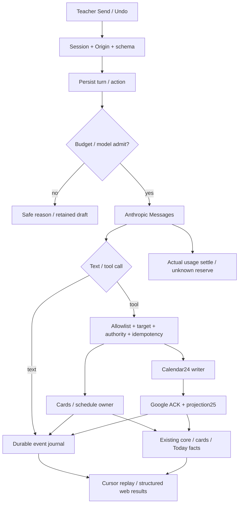

# Phase 22: Chat with Mentions and Quick Marks — Research

**Researched:** 2026-10-12
**Domain:** Anthropic server chat, tool writes, durable streaming, hard budget.
**Confidence:** MEDIUM. Provider/account/runtime evidence UNVERIFIED.

<user_constraints>

## User Constraints (from CONTEXT.md)

Canonical22-CONTEXT, дословные разделы; unreviewed defaults сохранены именно как defaults. [CITED: .planning/phases/22-chat-with-mentions-and-quick-marks/22-CONTEXT.md]
DATA_95bca421_START

## Locked Decisions

- **D-01:** Действующие IDs, history, marks и accounting сохраняются. Calendar mutations используют confirmed writer24 и authoritative projection25. Chat не создаёт второй schedule/accounting engine.
- **D-02:** Model tools обращаются к существующим владельцам приложения. Money/counts/Pays soon вычисляет код. Сохранённый student text — untrusted data, не полномочие выполнить tool.
- **D-03:** Marks/comments/notes применяются с Undo. Calendar Saved появляется только после verified command и projection. Pending/unknown/recovery не становятся success или новым автоматическим write.
- **D-04:** Принят официальный Anthropic SDK с server-side API key. Key не попадает в browser/repository. Vercel AI SDK не добавляется без доказанной необходимости.
- **D-05:** ROADMAP задаёт default `claude-haiku-5-5`, выбор модели и effort. Research проверяет актуальные official capabilities и availability; отсутствие модели не заменяет её молча другой моделью.
- **D-06:** Spike сравнивает Messages API с собственным store и Managed Agents session по tool write, pause for confirmation, reload/resume, usage и месту хранения данных. Каждому tool call нужен result, включая ошибки. Stream replay не повторяет mutations. Dangerous built-in tools отключены.
- **D-07:** Monthly cap приложения отделён от API credits. Spend берётся из actual response usage и проверенного pricing profile. Remaining amount — estimate. Missing budget/capability не означает unlimited spending или доступные credits.
- **D-08:** UI использует variant A/v40 и подготовленную22-UI-SPEC. Technical defaults можно уточнить по evidence без повторного approval. UI не публикует недоказанную model availability, стоимость или provider outcome.
- **D-09:** Владелец разрешил автономные research/planning/UI/check/implementation и согласованные необходимые rollout/tests на существующем сайте. Новые агенты используютthe session agent model. Missing access остаётся UNVERIFIED; независимо выполнимая работа продолжается.

## Unreviewed Defaults

- **UD-01:** Research выбирает transport по проверенным capabilities и минимальному необходимому хранению student data. Paid spike не выполняется в research; его отсутствие явно ограничивает вывод.
- **UD-02:** Conversation/message/tool/undo identities принадлежат server persistence. Reload восстанавливает состояние без повторного dispatch. Browser не хранит student context как источник истины.
- **UD-03:** Модели, доступные effort levels и pricing profile задаёт server configuration. Не придумывать numeric monthly cap, API credit balance, относительные цены или поддержку пяти levels конкретной моделью.
- **UD-04:** Undo проверяет действующую version и authority. Он не перезаписывает более позднюю правку. Calendar undo требует того же Google ACK/recovery пути, что обычная mutation.

Это технические defaults автономной подготовки. Они не просмотрены владельцем. Research может уточнить их до planning по источникам и действующим владельцам.

### Deferred Ideas (OUT OF SCOPE)

Phase23/26, новый test environment, paid calls, provider benchmark/eval, secrets/access changes и production data deletion исключены из research. Удаление conversation — требование будущего приложения, не разрешение удалять файлы или actual server data при подготовке. Numeric budget, actual API credentials/credits и provider observations не подменяются придуманными значениями.

DATA_95bca421_END
</user_constraints>

## Scope Card

Контракт текущего research из задания и CONTEXT. [CITED: user task; 22-CONTEXT.md]

| Поле            | Граница                                                                                                                         |
| --------------- | ------------------------------------------------------------------------------------------------------------------------------- |
| Outcome         | Один исполнимый research для planner22 после24→25                                                                               |
| In scope        | SC1…5/F01…10: owners, signatures/write set/tables, official APIs/costs, minimum public E2E                                      |
| Out of scope    | Source/shared STATE/Git/env/deps/runtime/DB/browser/provider calls/deletion/agents;23/26                                        |
| Acceptance      | Каждый SC/F имеет решение, owner и observable proof                                                                             |
| Verification    | Source reads/SHA-256, current primary docs, package audit, root-pin, verbatim/coverage checks                                   |
| Work map        | Context/DS→scope; source→F03…06/F09; official API/budget→F01/F02/F07/F08; existing journeys→F10; artifact verification→all SC/F |
| Owned write set | Только22-RESEARCH.md; никаких source changes                                                                                    |
| Stop            | Матрица полна, внешние пробелы названы; execution22 не начинается                                                               |

A1: все PROPOSED paths/types/signatures/tables/policies ниже — технические defaults, ещё не source. A2: source24/25 меняется параллельно; rebind до execution22. A3: actual key/model/credits/provider spike/runtime не наблюдались. A4: tighter economical input-token upper bound не доказан. Допущения проверяются source/public E2E/provider evidence; они не подменяют отсутствующие credentials/числовой cap. [ASSUMED:A1] [ASSUMED:A2] [ASSUMED:A3] [ASSUMED:A4]

## Summary

Использовать официальный Anthropic SDK в API server, Messages API с собственным PostgreSQL conversation/run/tool store. Перед каждым запросом резервировать worst-case cost, результаты tools записывать durable. Web показывает server facts/outcomes и восстановление по cursor. Это выбранный технический default, а не результат практического spike. [ASSUMED:A1]

Haiku5.5 существует в текущем официальном каталоге; пять effort levels для него подтверждены отдельной документацией. Account availability не проверена. Default остаётся Haiku, без молчаливого переключения. Missing cap/model/pricing/access закрывает paid Send. [CITED: https://platform.claude.com/docs/en/models/overview] [CITED: https://platform.claude.com/docs/en/build-with-claude/effort] [ASSUMED:A3]

Текущий writer24 положительно ограничен одиночным create; move/cancel/Calendar Undo ещё нельзя считать implemented. Marks и section bodies не имеют CAS revision в прочитанных writers. Для безопасного Undo нужны revision preconditions во всех writers того же объекта, включая обычные формы. [CITED: apps/api/src/calendar/commands.ts:30-43] [CITED: apps/api/src/schedule/marks.ts:45-103] [CITED: apps/api/src/cards/sections.ts:32-48] [ASSUMED:A1]

**Primary recommendation:** persistence/budget admission → один public chat/local-mark/Undo journey → stored facts → Google adapter после24/25 rebind. [ASSUMED:A1]

## Architectural Responsibility Map

Рекомендуемые tier owners, не implemented claims. [ASSUMED:A1]

| Capability                           | Primary tier             | Secondary tier | Rationale                                |
| ------------------------------------ | ------------------------ | -------------- | ---------------------------------------- |
| Auth/role/Origin                     | API auth                 | DB sessions    | Account из session, не model input       |
| Conversation/run/tool/event identity | API chat                 | PostgreSQL     | Reload/idempotency без browser authority |
| Model/effort/usage                   | API provider adapter     | Anthropic      | Key и dispatch server-side               |
| Budget reservation/settlement        | API budget               | PostgreSQL     | Concurrent tabs/workers делят cap        |
| Marks/history/comments               | API schedule             | core/DB        | Existing eligibility/accounting          |
| Notes/card context                   | API cards                | DB             | Revision/append/retract owner            |
| Calendar move/cancel/Undo            | 24 writer +25 projection | Google         | Один writer, Google wins                 |
| Financial facts/counts               | cards/today              | core           | То же вычисление, что screens            |
| Controls/stream/facts UI             | Web                      | safe contracts | Представление подтверждённых данных      |

## Project Constraints (from AGENTS.md)

Применимые actionable directives ROOT AGENTS/EXECUTOR-RULES и user instructions. Старые executor cleanup/commit указания не расширяют текущую authority. [CITED: AGENTS.md:1-136] [CITED: .planning/EXECUTOR-RULES.md] [CITED: user AGENTS instructions]

- UI source variant A/v40: external principles/component README+preview/tokens/reference. Отсутствующий дизайн требует Design owner binding. English UI, Base UI, без Radix/cmdk/eyebrows.
- Node24/Yarn4/Turbo; dependency pins exact; age gate1440 сохраняется; install только отдельно названным authorized plan.
- web не импортирует api/db; contracts только types/zod/constants, core без deps/Node/env. Routes API без proxy prefix; web запросы через api-client.
- loadConfig единственный env owner; request-context единственный logger/error owner; server composition; lifecycle shutdown; app import не запускает runtime.
- Сохранить auth/cards/schedule/core/calendar owners, existing IDs/history. Не добавлять accounting/recurrence engine.
- PostgreSQL18, app/migrator roles; additive migrations generate существующей командой; generated files не менять, push и CREATE EXTENSION в migrations запрещены.
- Schedule/history/mark rows не удалять. Calendar один confirmed writer. Revision/CAS обязателен для безопасного inverse.
- Public repository: никаких secrets/student names/amounts/notes/server addresses в source/research/logs/artifacts. Только synthetic fixtures.
- Functional verification через existing public E2E/real persistence. Никаких новых unit/component/integration suites/incident tests. Docs-only не требует E2E.
- Один web owner/runtime lease; не запускать destructive shared tests/build в параллельной работе. root-pin перед write; только owned file; STATE/ROADMAP чужие.
- Не вызывать dispatch-isolation/worktree; AgentFlow suspended. Source readiness требует simplify, no comments/no any, complexity/cognitive<22, Halstead Difficulty<80 с method, handwritten source<500lines. Research не является full quality audit.
- Не удалять/коммитить/ставить зависимости по workflow-инерции. Текущий task исключает source/Git/runtime/DB/env/provider/agents.

<phase_requirements>

## Phase Requirements

Дословные descriptions из REQUIREMENTS90-100. [CITED: .planning/REQUIREMENTS.md:90-100]
DATA_b1382e5c_START

| ID      | Description                                                                                                                      | Research Support   |
| ------- | -------------------------------------------------------------------------------------------------------------------------------- | ------------------ |
| CHAT-01 | The teacher starts, lists, renames and deletes conversations.                                                                    | P1/P2/P8; E01/E09  |
| CHAT-02 | Typing `@` lists students, and a mention binds the message to that student's card.                                               | P3; E02            |
| CHAT-03 | After a mention the teacher can use quick actions "was", "didn't happen", "no-show" and "moved to <date>" with an optional date. | P3/P4; E03/E05/E06 |
| CHAT-04 | Lesson marks, comments and notes written in chat apply at once and show an "Undo" button.                                        | P4/P5; E03/E04/E07 |
| CHAT-07 | The teacher asks about a student (what was covered, weak points, next lesson ideas) and gets answers from stored data.           | P6; E08            |
| CHAT-08 | Balances, counts and the "pays soon" list in answers are computed by code, not generated by the model.                           | P6; E08            |
| CHAT-09 | Replies stream to the screen as they are generated, and the schedule updates when chat changes data.                             | P2/P7; E03/E09     |
| CHAT-11 | Token usage is recorded per conversation, and a monthly cap stops spending beyond the budget.                                    | P9; E10/E11/E12    |

DATA_b1382e5c_END
</phase_requirements>

## Standard Stack

Existing dependencies из открытого manifest; SDK candidate проверен read-only. Package officialness подтверждена docs, но seam SUS не позволяет VERIFIED tag. [CITED: apps/api/package.json:15-43] [CITED: https://platform.claude.com/docs/en/cli-sdks-libraries/sdks/typescript]

| Library                                                                   | Version                                             | Purpose / disposition                                     |
| ------------------------------------------------------------------------- | --------------------------------------------------- | --------------------------------------------------------- |
| @anthropic-ai/sdk [WARNING: flagged as suspicious — verify before using.] | Candidate0.133.0; published2026-10-09T15:44:11.865Z | Единственная новая dependency; server client; SUS too-new |
| Hono / zod                                                                | 4.13.13 /4.6.5                                      | Existing HTTP/schema/security                             |
| drizzle-orm / pg                                                          | 1.0.0-rc.4 /8.23.1                                  | Existing DB/transactions                                  |
| pg-boss                                                                   | 12.37.1                                             | Existing durable queue, reuse                             |
| @dv-lab/core/contracts/db                                                 | workspace:*                                         | Existing facts/contracts/persistence                      |
| Next/React/Base UI                                                        | Existing project pins                               | Не менять; bind manifests при execution                   |

Future installation only: yarn workspace @dv-lab/api add --exact @anthropic-ai/sdk@0.133.0. Команда НЕ выполнена; revalidate version/gate прежде install. Vercel AI SDK не добавлять: explicit Messages loop закрывает необходимый scope. [ASSUMED:A1] [CITED: 22-CONTEXT D-04]

## Package Legitimacy Audit

Seam: exists=true, publishedAt=2026-10-09T15:44:11.865Z, weeklyDownloads=46456539, repoUrl=git+https://github.com/anthropics/anthropic-sdk-typescript.git, postinstall=null, verdict=SUS, reasons=[too-new]. npm metadata:0.133.0, modified2026-10-09T15:44:12.242Z. Empty engines query — silence, не compatibility proof. Docs positively support TypeScript>=5 and Node20 LTS or later non-EOL; local Node v24.17.0 observed. [CITED: session registry/seam outputs] [CITED: https://platform.claude.com/docs/en/cli-sdks-libraries/sdks/typescript]

| Package           | Registry | Age                      | Downloads       | Repo                                | Verdict     | Disposition                                                                                |
| ----------------- | -------- | ------------------------ | --------------- | ----------------------------------- | ----------- | ------------------------------------------------------------------------------------------ |
| @anthropic-ai/sdk | npm      | ~3days, exact date above | 46,456,539/week | anthropics/anthropic-sdk-typescript | SUS too-new | Keep locked SDK; checkpoint:human-verify before install unless fresh seam OK resolves flag |

SLOP removed: none. SUS: SDK candidate. No install. Recheck authoritative release/exact version/age/gate at execution. Popularity does not convert SUS to OK; current task authorizes technical decisions but supplies no missing package evidence. [CITED: session package audit] [ASSUMED:A1]

## Architecture Patterns

Все new paths/types/tables/signatures/policies ниже — PROPOSED, не существующие Registry definitions. LOW confidence implementation defaults выбранные в пределах technical authority; executor доказывает их, не добавляет ritual approval. [ASSUMED:A1]

### System Architecture Diagram



### Existing Owner Evidence

Read connector returned tunnel-client unavailable; bounded line-numbered filesystem reads succeeded. Local claims remain CITED, not VERIFIED. Quotes below are verbatim definitions, paths below proposals have no creating script yet. [CITED: session Read failure and exec reads]

DATA_38bca715_START

- MARK_KINDS = ['done', 'no_show', 'none']; refs: { kind: 'single'; lessonId: string } | { kind: 'series'; seriesId: string; originalOn: string }. [CITED: packages/contracts/src/schedule.ts:49-56,72-79]
- Sections: 'general_info', 'interests', 'level', 'goals', 'typical_mistakes', 'lesson_ideas'; SECTION_BODY_MAX_LENGTH = 20000. Не объявлять generic notes section существующим. [CITED: packages/contracts/src/students.ts:7-14,30-39]
- Current writer: if (input.operation !== 'create' || input.input.repeats !== 'once') throw new CommandFault('history_only'). Это present restriction, не absence inference. [CITED: apps/api/src/calendar/commands.ts:30-43]
- Calendar existing method types: submitCalendarCommand(context: CalendarReadContext, input: ValidatedCalendarCommand): Promise<CalendarCommandReceipt>; readCalendarCommand(context: CalendarReadContext, commandId: string): Promise<CalendarCommandSnapshot>; resumeCalendarCommand(context: CalendarReadContext, commandId: string): Promise<CalendarCommandReceipt>. Recovery states: ['partial_recovery', 'recovery_required']. [CITED: apps/api/src/calendar/commands.ts:30-33,84-95]
- saveSection(executor: DbExecutor, studentId: string, kind: SectionKind, body: string): Promise<StudentSection | null>; upsert replaces body, sets updatedAt. CAS отсутствует именно в открытой функции. [CITED: apps/api/src/cards/sections.ts:32-48]
- markLesson(db: Database, accountId: string, id: string, input: MarkInput, now: Date): Promise<MarkResult>; markOccurrence добавляет seriesId: string, originalOn: string. Request: kind: z.enum(MARK_KINDS), expectedStartsAt. Current check start-time/eligibility, не mark revision. [CITED: apps/api/src/schedule/marks.ts:45-74,78-103] [CITED: packages/contracts/src/schedule.ts:53-56]
- TeacherSettings = { paysSoonLessons: number; defaultTimeZone: string }; TeacherTimeContext = { now: Date; defaultTimeZone: string }. [CITED: packages/contracts/src/settings.ts:26-28] [CITED: apps/api/src/settings/settings.ts:7-20]
  DATA_38bca715_END

### P1 — Server store and admission

Account-bound conversation, monotonic revision, requestId+payload digest uniqueness. Same identity/different payload refuses; same identity/same payload reads original outcome. Create/list/history/rename never starts model, title is local default/text. One active turn per conversation, budget shared across all conversations. Persist one accepted teacher message and attempt lease before network. No DB transaction spans Anthropic HTTP. [ASSUMED:A1]

Keep normalized content and provider blocks necessary for tool continuation, including opaque thinking/signatures if API requires them; do not display/log internal thinking. Mentions store studentId/text offsets and visible snapshot; text edits invalidate affected binding. Browser draft is not canonical history. Finite title/message/tool-context limits must be introduced in strict chat schema; select bounded values in implementation and reject overflow, do not invent existing limits or silent truncation. [ASSUMED:A1]

### P2 — Durable stream/reload/cancel

Use explicit SDK streaming loop rather than unconstrained toolRunner. SDK retries default2; maxRetries0 for paid requests. message_delta usage is cumulative: replace per-attempt snapshot, do not sum deltas. Persist monotonic events before publication. SSE client cursor replay overlaps with snapshot high-water; dedupe by server event identity. GET/reload/reconnect never invokes generation or mutations. Tool executable only after complete JSON/schema/end-of-block; partial stream is not intent. [CITED: https://platform.claude.com/docs/en/cli-sdks-libraries/sdks/typescript] [CITED: https://platform.claude.com/docs/en/build-with-claude/streaming] [ASSUMED:A1]

PROPOSED app states: accepted, working, awaiting_target, awaiting_calendar, completed, interrupted, failed, usage_unknown. They are not Anthropic enums. Store call result/action transactionally with local effect; calendar commandId stored and read through same command journal. Every call gets result/error/clarification/pending. Lost write response reads original action; worker crash with uncertain provider dispatch does not auto-redispatch. Recovery can continue from persisted complete provider/tool-result boundary after new admission, not replay incomplete model generation. [ASSUMED:A1]

Explicit Cancel stops future dispatch; abort does not prove no charge and does not undo committed changes. Pending command recovery and cost reservations remain. end_turn closes provider turn; tool_use/paused/waiting do not. max_tokens/pause/error continuation requires explicit policy and fresh reservation; no blind retry. Old response cannot finalize another conversation/run. [CITED: https://platform.claude.com/docs/en/build-with-claude/streaming] [ASSUMED:A1]

### P3 — Mention and one-lesson resolution

Add minimal cards search: literal normalized displayName query, stable lower(displayName),id order, six safe candidates. Do not fetch listCards with all facts per keystroke. No assumed handle column: actual existing identity facts must bind display name/id. Duplicates show safe secondary distinction and require selected ID. Validate teacher role/card/binding again at Send; inactive/missing card asks fresh selection. Typed unresolved @name never chooses first match. [CITED: apps/api/src/cards/cards.ts:78-94] [ASSUMED:A1]

One student + actual eligible lesson from explicit date/context. Omitted date allowed only if exactly one eligible occurrence remains; no nearest/latest guessing. Multiple/no matches produces product-chat choices, zero writes. Capture now/defaultTimeZone once. Explicit IANA zone uses existing validation/zoned owner; relative dates use account default. Missing move time/DST gap/ambiguous offset requires exact date/time selection. Keep originalOn distinct from actualStartsAt and stable ref after cut/mapping. Do not substitute old Phase23 VN default for configurable21.1 zone. [CITED: packages/contracts/src/schedule.ts:38-43,72-79] [CITED: apps/api/src/settings/settings.ts:23-37] [CITED: 22-UI-SPEC.md:119-123] [ASSUMED:A1]

Was→done; No-show→no_show with stored deduction policy; Didn't happen→cancel through Google owner, not mark none/no_show; Moved→single actual occurrence destination. Button inserts editable intent; Send uses same typed/clicked resolver. Single Calendar cancel/move uses existing24 exact-target confirmation controls, then verified result. No generic23 Record/Reject, series/bulk/payment/account creation tools. [CITED: 22-UI-SPEC.md:110-123] [CITED: packages/contracts/src/schedule.ts:49-56] [ASSUMED:A1]

### P4 — Tool allowlist and backend authority

PROPOSED tools: read_student_context, read_today_facts, resolve_lesson, set_lesson_mark, append_lesson_comment, append_student_note, propose_single_calendar_change, read_calendar_change. Tool schema and zod strict validation share contracts; unknown input stays unknown until parsed. Server injects account/session and verifies lesson belongs to selected card/current authority. No model-selected account/SQL/URL/module/arbitrary command; no bash/files/MCP/server tools. Student text, titles, imported data and results remain untrusted content. [ASSUMED:A1]

Persist every callId and return matching result including safe errors with is_error. Parallel tool requests each receive result; local writes serialize per entity, Calendar via one writer. Pending command result records identity/status and pauses app processing, rather than automatic model polling loops. Resume uses original journal, not a new command. Product confirmation is stored with intent/preconditions; model assertion of approval grants nothing. UI outcome derives owner receipt, not model prose. [CITED: https://platform.claude.com/docs/en/agents-and-tools/tool-use/overview] [ASSUMED:A1]

### P5 — Versioned Undo / Google wins

Add bigint revisions to mark and section rows. All ordinary/chat writers increment under lock. CAS expected mark revision plus existing temporal/history preconditions protects same-time edits. Factor executor-based mark write from current transaction facade, so effect+action receipt are atomic. Absent mark locks lesson before unique insert. Undo requires current==afterRevision, restores prior mark as new version; no deletion. Start-time equality alone cannot prove unchanged mark. [CITED: apps/api/src/schedule/marks.ts:53-74,85-103] [ASSUMED:A1]

Free student notes and lesson comments use append entries with id/revision/originatingActionId/retractedAt, owned by cards/schedule. Undo retracts only own entry, preserves later separate entries, rejects later edit of same entry. Existing structured section replacement remains separate and gains CAS if exposed as tool. Never guess general_info as free notes store. Normal notes/history view must expose these real entries. [CITED: apps/api/src/cards/sections.ts:32-48] [CITED: packages/contracts/src/students.ts:7-14] [ASSUMED:A1]

Calendar inverse is fresh command with prior applied receipt, target/generation/current etag and unchanged-owner precondition. External Google edit blocks stale inverse; no restoring old snapshot over Google wins. Unknown original/inverse never shows Undo success.24 verified ACK+projection and25 mapping rebind required. Official If-Match refusal412 protects competing edits. Existing direct schedule mutations are not a valid fallback. [CITED: https://developers.google.com/workspace/calendar/api/guides/version-resources] [CITED: .planning/phases/25-google-calendar-two-way-sync/25-RESEARCH.md] [ASSUMED:A1] [ASSUMED:A2]

### P6 — Code-owned answer facts

cardFacts uses studentBalance with context.defaultTimeZone and shared readNextLessons. readToday uses listCards/paysSoonList; core studentBalance returns null for missing opening, counts strictly after opening and does not trim debt. Counts use todayCounts with same now/timeZone. Read selected student's stored sections/notes/comments/history; stale/unavailable next is not no next. DTO includes source/asOf/coverage. [CITED: apps/api/src/cards/card-facts.ts:29-67] [CITED: apps/api/src/today/today.ts:39-90] [CITED: packages/core/src/balance.ts:9-41,104-110]

PROPOSED numeric enforcement: financial/count questions use exclusively server templates/typed fact blocks. Never publish arbitrary model prose for those answers. Pedagogical answers use constrained narrative slots, separate labelled Suggestions; unsupported financial clauses are withheld/replaced with server facts. Buffer/validate narrative clauses before stream publication, not raw token pass-through. Regex alone cannot validate spelled-out totals; invalid/unrestricted response becomes safe failure. Stored excerpts distinguish source text from verified facts. Post-mutation snapshot change causes reread. Suggestions do not create notes automatically. [ASSUMED:A1]

### P7 — UI and open-screen update

Current chat page is teacher placeholder. Mount approved standalone22 composition under /chat; v40 ChatComposer/ChatMessage/ChatModelControls + SettingsAssistant model/budget subset.22 UI-SPEC overrides preview mock model ceilings/amounts/reset dates/23 permission rows. Render only safe bold/linebreaks and known blocks, no HTML/arbitrary action links. Focus/IME/menu/320-375px/reduced motion/light-dark follow E02/E13. [CITED: apps/web/app/(app)/chat/page.tsx:9-16] [CITED: /Users/kdvornichenko/dv-lab-design/phase-22/22-UI-SPEC.md] [ASSUMED:A1]

Use durable account change events after local commit/Calendar applied projection. api-client owns abortable streaming GET/cursor/cookies/no-store/schema parsing. Shared subscriber calls existing useToday.reload/useScheduleWeek reload. BroadcastChannel peers receive invalidation identity only and reread server; peer data is not authoritative. Reconnect/focus compares server high-water so missed notification recovers. Reuse24/25 publication owner if already final; don't add second transport. router.refresh alone cannot prove client hooks reread. [CITED: apps/web/lib/api-client.ts:8-34] [CITED: apps/web/app/(app)/_components/use-today.ts:18-74] [CITED: apps/web/app/(app)/schedule/_components/use-schedule-week.ts:19-86] [ASSUMED:A1] [ASSUMED:A2]

### P8 — Delete and data location

Future explicit conversation deletion blocks unresolved run/mutation/usage uncertainty until outcome known. Transaction removes from active reads and redacts chat content/mentions; retain noncontent usage/control liability to prevent replay/double spend. Use deletedAt/redaction where app role lacks DELETE; no broad grants, lesson/note/mark/Calendar cascade or implicit cancel. No invented TTL or immediate backup/provider erasure claim. Existing privacy owner must describe actual handling before shipping. Research performs no deletion. [CITED: 22-UI-SPEC.md:95-104] [CITED: AGENTS.md:103-109] [ASSUMED:A1]

Messages canonical history stays app DB; minimal bounded context is processed by Anthropic per request. Managed also persists remote sessions/sandbox/outputs, needs separate session/file deletion. Official retention coverage varies by feature/model; this organization's ZDR/agreement/data country was not inspected. Inference geography alone is not whole-data storage location. [CITED: https://platform.claude.com/docs/en/manage-claude/api-and-data-retention] [CITED: https://platform.claude.com/docs/en/managed-agents/overview] [ASSUMED:A3]

### P9 — Hard monthly budget

PROPOSED USD integer nanoUSD with rational rate/1M tokens and upward rounding. App month in captured teacher defaultTimeZone; UTC startsAt/endsAt/zone stored, later zone changes apply next period. resetAt from stored period, not credit billing date. Numeric cap required from actual config/teacher setting; no invented amount/default. Missing cap/model/rate means paid Send closed. Capture model/effort/pricing version/mode/period per attempt. [ASSUMED:A1] [ASSUMED:A3]

Before EACH model request, including tool continuation, lock account-period budget and admit only settled+all reservations+new worst-case reserve<=cap. Unique attempt/dispatch identity commits before network; no long SQL transaction. Different tabs/conversations/workers share gate. Late results reconcile original dispatch period, not current month. Cap reduction doesn't delete liabilities. UI disabled state is not enforcement. [ASSUMED:A1]

Reserve uncached input/cache write/read/output (including thinking/tool arguments), repeated history/tool results, context/region modifiers. Token counting is officially estimate, not guaranteed upper bound. Safe fallback reserves declared full model maximum input at worst applicable tariff plus configured max_tokens output; default has no paid server tools, media/files/compaction/fast mode/Managed runtime. If reserve doesn't fit, reject instead of inventing safety margin. Tighter bound must be proved for complete request, not inferred from average spike or token/character multiplier. No claim that fallback fits an unspecified cap. [CITED: https://platform.claude.com/docs/en/build-with-claude/token-counting] [CITED: https://platform.claude.com/docs/en/models/overview] [ASSUMED:A1] [ASSUMED:A4]

Actual usage upsert per distinct attempt/provider request; cumulative stream snapshots replace, final settle once. Price uncached input/output/cache creation by TTL/cache reads separately without double counting. Timeout/cancel/partial/missing usage retains reserve until authoritative reconciliation. No expiry release for possibly dispatched work. Rate/usage uncertainty blocks new paid admission; no invented actual cost. SDK automatic retries0; any retry is new admitted attempt. Admin historical spend is reconciliation evidence, not synchronous admission/credit balance. [CITED: https://platform.claude.com/docs/en/build-with-claude/streaming] [CITED: https://platform.claude.com/docs/en/manage-claude/usage-cost-api] [ASSUMED:A1]

UI remaining is estimate with reserved/unknown separately; Send uses admission amount. Credit exhaustion→API credits unavailable, not Monthly budget reached. Raise cap doesn't replenish credit. Published credits are shared across org keys/workspaces and expire by billing cycle; no actual credit balance observed. Current Admin docs allow several admin-capable credentials, not only separate admin key as older Notes said; no credentials added here. [CITED: https://platform.claude.com/docs/en/about-claude/api-credits-for-subscribers] [CITED: https://platform.claude.com/docs/en/manage-claude/usage-cost-api] [ASSUMED:A3]

## Models, Effort and Pricing — F01/F07

Official catalogue: claude-haiku-5-5, claude-sonnet-5-5, claude-opus-5-5, claude-fable-5-1. Official effort documentation affirmatively supports low/medium/high/xhigh/max on each; Haiku/Opus default medium, Sonnet/Fable high. Haiku low can skip checks in long prompts; effort is not token budget. [CITED: https://platform.claude.com/docs/en/models/overview] [CITED: https://platform.claude.com/docs/en/build-with-claude/effort]

PROPOSED keep Haiku default/medium baseline. Enabled list intersects configured ordered catalogue with authorized actual Models API observation when available; no such call here. Configured recommendation uses documented baseline, not school-task eval. Settings changes only next turn of unoverridden chat; in-flight captures don't change. Unsupported level refused server-side. Unavailable selected model pauses and offers verified choices; never silent fallback. Five UI ticks do not universally prove five capabilities. [ASSUMED:A1] [ASSUMED:A3]

Use top-level output_config.effort GA per request initially, account for cache reset. Cache-preserving per-message effort needs beta mid-conversation-output-config-2026-07-01; not required initially. Haiku thinking disabled rejects xhigh/max and changing effort midconversation; use adaptive/omit override. Managed supports model.effort at session creation/override; ongoing mutation parity not assumed. [CITED: https://platform.claude.com/docs/en/build-with-claude/effort] [CITED: https://platform.claude.com/docs/en/managed-agents/sessions] [ASSUMED:A1]

Public first-party standard USD per1M tokens, read2026-10-12; versioned pricing profile revalidate before paid dispatch. These are list rates, not per-message estimate or account entitlement. [CITED: https://platform.claude.com/docs/en/about-claude/pricing]

| Profile                 | Input | Output | Cache write5m | Cache write1h | Cache read |
| ----------------------- | ----: | -----: | ------------: | ------------: | ---------: |
| Haiku5.5 prompt<=100000 |  0.10 |   0.50 |         0.125 |          0.20 |       0.01 |
| Haiku5.5 prompt>100000  |  0.50 |   2.50 |         0.625 |             1 |       0.05 |
| Sonnet5.5               |     2 |     10 |          2.50 |             4 |       0.10 |
| Opus5.5                 |     4 |     20 |             5 |             8 |       0.20 |
| Fable5.1                |    10 |     50 |         12.50 |            20 |       0.25 |

Haiku threshold includes input+all cache tokens per request. US-only inference multiplies all categories1.1. Tool schemas/calls/results are billed tokens; server tools may add charges. Managed running runtime0.08USD/session-hour. No fixed relative×3 or sample message cost inferred. [CITED: https://platform.claude.com/docs/en/about-claude/pricing]

## Messages vs Managed Agents / Spike

Docs/source comparison only. Practical tool-write/pause/reload-resume checks, actual usage/storage/provider access: **SPIKE NOT RUN / UNVERIFIED**. Messages selected under technical authority pending execution evidence. [CITED: user task] [ASSUMED:A1] [ASSUMED:A3]

| Check           | Messages                                 | Managed                                    | Minimum future proof                    |
| --------------- | ---------------------------------------- | ------------------------------------------ | --------------------------------------- |
| Write           | App client tool + matching result        | Custom event + app result                  | Same synthetic mark committed once      |
| Pause           | Durable application waiting intent       | requires_action/tool permission            | Decline zero effect; accept same intent |
| Reload/resume   | App cursor/run/action store              | Session history + stream/history dedupe    | Reload before/after result, no replay   |
| Usage           | Distinct request usage ledger            | Cumulative session usage/list cost/runtime | All continuations attributed            |
| Student storage | App history + bounded request processing | Remote session/sandbox/history/output      | Actual handling/delete evidence         |

Managed custom tools/permission responses/persistence documented. agent.message buffered until request complete; event deltas needed for live text. Stream opens before send; requires_action waiting, idle alone not done, budget_reached separate. Session budget checked between requests and final request can exceed; cannot replace strict concurrent monthly app reserve. [CITED: https://platform.claude.com/docs/en/managed-agents/tools] [CITED: https://platform.claude.com/docs/en/managed-agents/events-and-streaming] [CITED: https://platform.claude.com/docs/en/managed-agents/sessions] [CITED: https://platform.claude.com/docs/en/managed-agents/session-observability]

ai-newtab source fixed tree5c8d0b11c3aa5d2eab91dbc48e434233f59faa2b: orchestrator sends error result, opens stream before replay/send, seen-ID dedupe, restores unanswered calls, separate session/upload cleanup; setup caches resources/fingerprints and defaults tools off. Its in-memory dedupe/replayed read-tool dispatch is insufficient for writes. Its non-requires_action idle completion cannot flatten budget/error/interruption. Do not copy raw error/content logs or sandbox read/write grants;22 requires durable receipts and no builtins. [CITED: https://github.com/ThariqS/ai-newtab/blob/5c8d0b11c3aa5d2eab91dbc48e434233f59faa2b/packages/agent-core/orchestrator.ts] [CITED: https://github.com/ThariqS/ai-newtab/blob/5c8d0b11c3aa5d2eab91dbc48e434233f59faa2b/packages/agent-core/setup.ts] [ASSUMED:A1]

## Exact Planned Write Inventory / Public Signatures — F09

All rows **PROPOSED [ASSUMED:A1]**, not current research write authority. Planner assigns nonoverlapping owners after final24/25 rebind. Existing source referenced above; proposed paths are not VERIFIED filesystem facts.

| Module / files                                                                                                                               | Public/cross-module signatures/types                                                                                      | Necessity                     |
| -------------------------------------------------------------------------------------------------------------------------------------------- | ------------------------------------------------------------------------------------------------------------------------- | ----------------------------- |
| contracts/src/chat.ts, chat-events.ts, chat-settings.ts, index.ts                                                                            | ChatConversation/ChatTurn/MentionBinding/ChatEvent/ToolOutcome/UndoReceipt/ModelCapability/BudgetSnapshot; strict schemas | SC1…5                         |
| contracts/src/schedule.ts, students.ts, settings.ts                                                                                          | expectedRevision in affected writes; model/effort/cap preferences                                                         | SC3/5                         |
| db/src/chat-schema.ts, schema.ts, index.ts; generated drizzle files                                                                          | Additive tables below + mark/section revision/settings                                                                    | SC1/3/5                       |
| api/src/chat/conversations.ts, store.ts, events.ts, runs.ts                                                                                  | create/list/rename/deleteConversation; accept/readTurn; readEvents(afterCursor)                                           | SC1 durable CRUD/recovery     |
| api/src/chat/provider.ts, model-config.ts, budget.ts, usage.ts                                                                               | resolveModelChoice; reserveAttempt(tx,period,attempt,bound); settleAttempt(tx,attempt,usage); streamAttempt               | SC5                           |
| api/src/chat/tools.ts, lesson-target.ts, facts.ts, undo.ts                                                                                   | executeTool(context,call); resolveLesson(context,binding,date); readChatFacts; undoAction(context,actionId,revision)      | SC2…4                         |
| api/src/routes/chat.ts, app.ts                                                                                                               | Teacher-only conversations/turns/status/events/undo API; AppDeps.chat                                                     | SC1…5 public interface        |
| api/src/config.ts, server.ts, lifecycle.ts                                                                                                   | Config/secret injection + createChat composition + worker shutdown                                                        | SC1/5                         |
| api/src/cards/mentions.ts, notes.ts, sections.ts; routes/students.ts                                                                         | searchMentionStudents; append/read/retractStudentNote; CAS saveSection                                                    | SC2/3/4                       |
| api/src/schedule/marks.ts, comments.ts; routes/schedule.ts                                                                                   | Executor-based mark CAS; append/read/retractLessonComment                                                                 | SC3                           |
| 24/25 calendar adapter                                                                                                                       | submit/read/resumeCalendarCommand; inverse prepare via same final owner                                                   | SC2/3; PROPOSED until rebind  |
| web/app/(app)/chat/page.tsx; _components/chat-screen.tsx, conversation-list.tsx, composer.tsx, messages.tsx, model-controls.tsx, use-chat.ts | Typed composition/controller props, Send identity/event cursor                                                            | SC1/2/5                       |
| web/lib/api-client.ts, data-changes.ts                                                                                                       | apiEventStream(path,cursor,signal); subscribeDataChanges(callback)                                                        | SC1/3                         |
| web/app/(app)/_components/use-today.ts; schedule/_components/use-schedule-week.ts                                                            | Subscribe existing reload preserving stale guards                                                                         | SC3                           |
| web settings/_components/settings-screen.tsx, assistant-card.tsx                                                                             | Assistant model/effort/budget + usage read                                                                                | SC5                           |
| web students/[id]/_components/notes-tab.tsx; final schedule lesson detail owner                                                              | Note/comment read DTO/display                                                                                             | SC3/4 inspectability          |
| Existing privacy page owner, exact path bind before plan                                                                                     | Actual Anthropic processing/storage/delete text                                                                           | F08/privacy                   |
| API package.json/yarn.lock; deploy env.example/compose by config owner                                                                       | Future single SDK pin/config names/secret injection                                                                       | SC5; separate authorized plan |
| Existing e2e: chat.spec.ts + marks/move/today/calendar.spec.ts; support/chat.ts only if required                                             | One durable chat journey + shared-owner assertions                                                                        | F10                           |

No core accounting changes, payment/account/rate/bulk/essay/palette/profile owner added. Exact lesson-detail/privacy path still must be located after final source; don't claim guessed filename as existing. No migration sequence guessed while24 owns progress. [ASSUMED:A1] [ASSUMED:A2]

### Additive Persistence

PROPOSED table names/invariants, migration generation only, no DROP/rename/broad grants. [ASSUMED:A1] [CITED: AGENTS.md:95-109]

| Addition                        | Keys/invariants                                                                             | Gate  |
| ------------------------------- | ------------------------------------------------------------------------------------------- | ----- |
| chat_conversations              | Account-bound id/title/revision/overrides/deletedAt                                         | SC1/5 |
| chat_turns                      | Conversation/requestId/digest unique, state/lease/model/effort/rates                        | SC1/5 |
| chat_messages + chat_mentions   | Turn/role/content/provider blocks; studentId/offsets/ordinal                                | SC1/2 |
| chat_events                     | Account/run/conversation monotonic unique cursor/safe payload                               | SC1/3 |
| chat_actions                    | CallId unique per turn, target/digest/before-afterRevision/inverse/calendarCommandId/result | SC3   |
| chat_budget_periods             | Account-period unique; finite cap/captured zone/start/end/settled/reserved                  | SC5   |
| chat_usage_attempts             | Attempt unique; reservation/dispatch/providerId/usage/rate snapshot                         | SC5   |
| student_notes/lesson_comments   | Entry/ref/body/revision/retractedAt/originAction                                            | SC3/4 |
| Existing marks/sections columns | Additive revision; all writers increment                                                    | SC3   |
| teacher_settings columns        | Nullable configured model/effort/cap, no numeric budget default                             | SC5   |

Receipt+local effect atomic; journals survive content redaction without raw student payload. Delete chat doesn't erase budget liabilities or independent notes. Split schema at semantic owners to honor source<500lines; migration filenames generated, not handwritten. [ASSUMED:A1]

## SC / F Solution Matrix

All acceptance proofs are future, not executed PASS. E IDs from canonical UI spec. [ASSUMED:A1] [CITED: 22-UI-SPEC.md:204-249]

| Gate | Owner / solution                                                         | Minimum evidence                                  |
| ---- | ------------------------------------------------------------------------ | ------------------------------------------------- |
| SC1  | P1/P2/P8 conversations/store/cursor                                      | E01/E09 CRUD/reload/read failure/zero duplicates  |
| SC2  | P3 cards search/lesson-target                                            | E02/E05 exact identity/date/timezone              |
| SC3  | P4/P5/P7 CAS/Calendar/invalidation                                       | E03/E04/E06/E07 one effect/safe Undo/open screens |
| SC4  | P6 cardFacts/readToday/core/rendering                                    | E08 same facts/no-data/error handling             |
| SC5  | P9 budget/usage/model config                                             | E10/E11/E12 admission race/unknown/model/credit   |
| F01  | Official model/effort/profile + adapter; Messages default, spike NOT RUN | E11/E12 + actual authorized capability/spike      |
| F02  | Run/event/lease/attempt identity                                         | E01/E06/E09 replay/cancel/restart                 |
| F03  | Safe chat/mention DTO + account/card owner                               | E01/E02/E14 duplicate/removed/limits/auth         |
| F04  | Single lesson resolver + settings/core                                   | E03/E05 ambiguous target/DST/relative date        |
| F05  | Registry/CAS/local owners/24 verified command                            | E03…07 every result/Undo/confirmed inverse        |
| F06  | Shared facts/numeric slots/read coverage                                 | E08/E14 wrong model totals/injection/stale        |
| F07  | Budget periods/attempt reservations/price snapshot                       | E10/E11 concurrency/partial categories            |
| F08  | Delete/redaction/privacy owner                                           | E01/E07 pending gate/no business cascade          |
| F09  | Exact proposed inventory + v40 composition                               | E03/E13 two tabs/focus/narrow/themes              |
| F10  | Existing public Playwright target/persistence owner                      | E01…14 groups below, provider separate            |

## Don't Hand-Roll

Prescribed choices close in-scope gates. [ASSUMED:A1]

| Problem          | Don't build                             | Use                             | Gate  |
| ---------------- | --------------------------------------- | ------------------------------- | ----- |
| Balances/counts  | LLM arithmetic/second ledger            | core+cards/today                | SC4   |
| Calendar changes | Chat SQL/direct provider bypass         | 24 writer/25 projection         | SC2/3 |
| Recurrence/zones | Browser series expansion/offset parsing | Existing core/zoned             | F04   |
| Auth/CSRF        | Weaker tool-specific authority          | Existing middleware/session     | F03/5 |
| Framework/UI     | Vercel SDK/new Radix wrapper            | Official SDK/Base UI/api-client | F01/9 |
| Queue            | In-memory request lifecycle             | Existing pg-boss+DB journal     | F02   |

## Common Pitfalls

- Timeout frees reserve → unseen charge overspends: preserve liability until authoritative settlement. P9/E10. [ASSUMED:A1]
- Cumulative usage summed on replay → doubles spend: snapshot replace/unique settle. [CITED: https://platform.claude.com/docs/en/build-with-claude/streaming]
- Managed budget treated as strict cap → final request crosses limit: app reserve still required. [CITED: https://platform.claude.com/docs/en/managed-agents/sessions]
- Undo expectedStartsAt alone → later mark overwritten: revision CAS on ordinary and chat paths. [CITED: apps/api/src/schedule/marks.ts:30-33,93-101] [ASSUMED:A1]
- Receipt/ACK equals Saved → projection/unknown flattened: same command recovery, applied only after owner verification. [CITED: apps/api/src/calendar/dispatch.ts:192-230] [ASSUMED:A1]
- Financial prose/model approval becomes authority → code slots + tool allowlist/session checks. [CITED: 22-CONTEXT D-02] [ASSUMED:A1]
- Preview examples become config → fictitious caps/reset/Haiku ceiling/23 tools rejected by22 spec. [CITED: 22-UI-SPEC.md:54-55]

## Code Examples

SDK skeleton, not executed implementation; adapter symbols PROPOSED, no sample student content. [CITED: https://platform.claude.com/docs/en/cli-sdks-libraries/sdks/typescript] [CITED: https://platform.claude.com/docs/en/build-with-claude/effort] [ASSUMED:A1]

```typescript
const client = new Anthropic({ apiKey: config.apiKey, maxRetries: 0 })
const stream = client.messages.stream({
	...validatedRequest,
	model: choice.modelId,
	max_tokens: choice.maxOutputTokens,
	output_config: { effort: choice.effort },
})
```

PROPOSED sequence: reserve/commit → persist dispatch intent → SDK → durable events/usage → settle. Tool: complete schema/call → lookup durable action → existing owner effect+receipt transaction → result → next paid request only with reserve. Unknown result reads original identity, never blindly executes twice. [ASSUMED:A1]

## State of the Art

| Older claim/pattern                 | Current source / design                                             | Impact                           |
| ----------------------------------- | ------------------------------------------------------------------- | -------------------------------- |
| Five UI ticks universally supported | Positive docs affirm selected four models; account still unobserved | Config capabilities              |
| Only separate admin key for spend   | Current docs allow multiple admin-capable credentials               | No key recovery/credit inference |
| Credit error means app cap          | Different accounts/periods/causes                                   | Distinct UI                      |
| Managed session cap sufficient      | Enforced between requests, can exceed                               | App atomic reserve               |

[CITED: https://platform.claude.com/docs/en/build-with-claude/effort] [CITED: https://platform.claude.com/docs/en/manage-claude/usage-cost-api] [CITED: https://platform.claude.com/docs/en/about-claude/api-credits-for-subscribers] [CITED: https://platform.claude.com/docs/en/managed-agents/sessions]

## Environment Availability

No secret/service/DB/provider probe or runtime launch. Absence of observation is not verified absence. [CITED: user task] [ASSUMED:A3]

| Dependency                  | Required by         | Evidence                            | Fallback                             |
| --------------------------- | ------------------- | ----------------------------------- | ------------------------------------ |
| Node                        | Tooling/SDK         | node --version0: v24.17.0           | —                                    |
| SDK                         | Provider loop       | Registry only, candidate0.133.0 SUS | Future guarded install               |
| Context7/ctx7               | Research seam       | Tool search empty/CLI absent        | Official web primary sources         |
| Read connector              | Source read         | Tunnel-client unavailable error     | Bounded filesystem reads; CITED only |
| PostgreSQL/application      | Real persistence    | Source/harness inspected only       | Runtime UNVERIFIED                   |
| Browser/Playwright          | Public proof        | Existing journeys/config only       | NOT RUN                              |
| Anthropic key/model/credits | Paid Send/spike     | Not accessed                        | Fail closed                          |
| 24/25 calendar final path   | Single changes/Undo | Partial24/proposed25                | Complete/rebind dependency           |

Validation Architecture omitted because workflow.nyquist_validation=false. E2E obligations below remain. Cache writes omitted: only owned artifact permitted. No new dependency environment. [CITED: .planning/config.json] [CITED: user task]

## Minimum Public E2E Evidence — F10

NOT RUN. Existing Playwright config: one worker/retries0/light+dark projects; actual target/persistence binding via support. Existing harness creates private state/results outside repository and can mutate fixtures; it was not launched. New isolated suites forbidden. [CITED: playwright.config.ts] [CITED: e2e/support/data.ts:18-44] [CITED: user task]

One durable chat journey in existing harness before behavior; shared effects extend marks/move/today/calendar journeys. Faults/outcomes first, not incident tests. [ASSUMED:A1]

| Journey group                | Cases                     | Failure → observable                                                                                                                       |
| ---------------------------- | ------------------------- | ------------------------------------------------------------------------------------------------------------------------------------------ |
| History/identity             | E01/E02/E09               | CRUD failure/duplicates/IME/reload/replay → one persisted set/exact card/no unintended Send                                                |
| Local actions/shared screens | E03/E04/E05 + marks/today | Repeat/lost response/ambiguous/stale inverse → one effect/target clarification/own entry retraction/late edit preserved/two screens reread |
| Google/inverse               | E06/E07 + move/calendar   | Lost ACK/pending projection/external edit → no false Saved/Undone/same journal/Google wins                                                 |
| Answers/security             | E08/E14                   | Missing/failure/injection/wrong numbers/student/expired session/23 request → honest error/code totals/no forbidden tools/private DTO       |
| Budget/model                 | E10/E11/E12               | Two-tab race/cap/missing usage/credit/unsupported effort → zero unsafe dispatch/held reserve/distinct reason/config attribution            |
| UI accessibility             | E13                       | 320/375px/long controls/IME/focus/reduced motion/themes → Send visible/viewport controls/accurate focus/no token announcements             |

PROPOSED deterministic provider faults through server adapter selected only by existing authenticated synthetic E2E target authority. Exercise public UI/full executor/real DB; no browser success mock/DB mock. Reuse calendar-fault-control authority pattern after final binding, reject nonfixture/production trigger. Exact mechanism not implemented. Synthetic provider proves application semantics only, not real SDK/model/pricing/quality. Real provider spike separate UNVERIFIED, no paid call authorized here. [CITED: e2e/support/calendar-fault-control.ts] [ASSUMED:A1] [ASSUMED:A3]

Future rerun: yarn test:e2e e2e/chat.spec.ts --project=light --project=dark. Shared proof: yarn test:e2e e2e/marks.spec.ts e2e/move.spec.ts e2e/today.spec.ts e2e/calendar.spec.ts --project=light --project=dark, only exact title filters assigned by planner/leases. Record diff fingerprint, scenario/fixture refs, target/persistence identity, expected/observed, numeric exit/rerun without secrets. No broad suite/runtime calls now. Existing type/lint/build checks follow owned execution plan. [ASSUMED:A1]

## Security Domain

Current ASVS5.0 catalogue verified from official OWASP tree. Old template V2-auth/V3-session/V4-access/V5-validation/V6-crypto labels are not5.0 mappings. Applicability is threat reasoning, not compliance PASS. [CITED: https://owasp.org/projects/asvs] [CITED: https://github.com/OWASP/ASVS/tree/v5.0.0/5.0/en] [ASSUMED:A1]

| ASVS5 category                    | Applies | Control                                                    |
| --------------------------------- | ------- | ---------------------------------------------------------- |
| V1 Encoding / V3 Web Frontend     | yes     | Allowed text/blocks, no HTML/action URL                    |
| V2 Validation and Business Logic  | yes     | Schema/target/budget/idempotency/CAS                       |
| V4 API                            | yes     | Origin/no-store/bounded streams/input                      |
| V6 Auth / V7 Session              | yes     | Existing session, recheck at tools/stream recovery         |
| V8 Authorization                  | yes     | Teacher/account scope, no model-granted rights             |
| V11 Crypto / V13 Config           | yes     | Existing server secret owner, no custom crypto/browser key |
| V14 Data Protection / V16 Logging | yes     | Minimal context, no raw logs, truthful deletion            |

STRIDE: spoofing/elevation via stored instructions→allowlist/session; tampering replay/inverse→idempotency/CAS; disclosure→account filter/minimal DTO; repudiation→noncontent receipt; denial/spend→bounded requests/reserve. Auth enforced on tool/backend, not just UI. [CITED: apps/api/src/auth/middleware.ts:28-42,75-103,113-115] [ASSUMED:A1]

## Assumptions Log

Technical defaults within task authority do not require ritual reapproval; verify them through implementation. Missing cap/access/paid authority cannot be filled by assumption. [CITED: user task]

| ID  | Claim                                                | Section                  | Risk / falsification                                     |
| --- | ---------------------------------------------------- | ------------------------ | -------------------------------------------------------- |
| A1  | Proposed design/write set/schema/defaults close SC/F | All PROPOSED             | Public journey disproves; revise within scope            |
| A2  | Final24/25 signatures may change                     | Calendar/inventory       | Source rebind required                                   |
| A3  | Account/provider/runtime not observed                | Models/spike/environment | No PASS until authorized actual evidence                 |
| A4  | Economical exact input bound unproved                | P9                       | Unsafe margin overspends; conservative reserve may block |

## Open Questions

1. Final24/25 command/inverse/mapping/event signatures: rebind dependency acceptance, not prepared research as proof. [ASSUMED:A2]
2. Actual finite cap/model/access/credits: no secret recovery or invented value; block paid Send until configuration/evidence exists. [ASSUMED:A3]
3. Same-check provider spike: NOT RUN; current docs justify default but not runtime quality. [ASSUMED:A3]
4. Full-input reserve may be impractical: tighter proven upper bound or safe refusal, no guessed multiplier. [ASSUMED:A4]
5. SDK SUS release-age flag: recheck at install; checkpoint if still SUS. [CITED: session seam result]

## Sources

Official URLs opened2026-10-12; no invented publication date. Google version-resources updated2026-09-11. Failed guessed URLs replaced by actual navigation; no absence claims from fetch failure. Confidence code: websearch--verified MEDIUM; not HIGH. [CITED: session web/seam outputs]

- [Models](https://platform.claude.com/docs/en/models/overview), [Effort](https://platform.claude.com/docs/en/build-with-claude/effort).
- [Pricing](https://platform.claude.com/docs/en/about-claude/pricing), [Token counting](https://platform.claude.com/docs/en/build-with-claude/token-counting).
- [SDK](https://platform.claude.com/docs/en/cli-sdks-libraries/sdks/typescript), [Streaming](https://platform.claude.com/docs/en/build-with-claude/streaming), [Tool use](https://platform.claude.com/docs/en/agents-and-tools/tool-use/overview).
- [Managed overview](https://platform.claude.com/docs/en/managed-agents/overview), [Tools](https://platform.claude.com/docs/en/managed-agents/tools), [Sessions](https://platform.claude.com/docs/en/managed-agents/sessions), [Events](https://platform.claude.com/docs/en/managed-agents/events-and-streaming), [Usage](https://platform.claude.com/docs/en/managed-agents/session-observability).
- [Credits](https://platform.claude.com/docs/en/about-claude/api-credits-for-subscribers), [Usage & Cost](https://platform.claude.com/docs/en/manage-claude/usage-cost-api), [Retention](https://platform.claude.com/docs/en/manage-claude/api-and-data-retention).
- [Google versions](https://developers.google.com/workspace/calendar/api/guides/version-resources), [OWASP](https://owasp.org/projects/asvs).
- [ai-newtab fixed source](https://github.com/ThariqS/ai-newtab/tree/5c8d0b11c3aa5d2eab91dbc48e434233f59faa2b) authoritative about its code only.

## Metadata / Commands and Fingerprints

research-plan via /dev/stdin: context7/cache miss, key984b5645f87e8e785f264c954e78a9ad7c68154ec862b4ccb7c97af6ed750be2. Context7/ctx7 unavailable; official web fallback. research-store omitted by write-set. .codegraph/project skill directories absent; no indexing. agent-skills query emitted role text without additional SKILL.md include. No routing/install/baked model repair. [CITED: session discovery/seam outputs]

| Exact command / operation                                                                                                    | Status  | Decisive output                                               |
| ---------------------------------------------------------------------------------------------------------------------------- | ------- | ------------------------------------------------------------- |
| node ~/.claude/gsd-core/bin/gsd-tools.cjs query init.phase-op 22                                           | 0       | phase_found=true, expected root; stale model metadata warning |
| query research-plan --input /dev/stdin through Python subprocess                                                             | 0       | context7/cache miss                                           |
| node ~/.claude/gsd-core/bin/gsd-tools.cjs query classify-confidence --provider websearch --verified        | 0       | MEDIUM                                                        |
| Same classify-confidence --provider webfetch --verified                                                                      | 0       | LOW                                                           |
| node ~/.claude/gsd-core/bin/gsd-tools.cjs query package-legitimacy check --ecosystem npm @anthropic-ai/sdk | 0       | SUS too-new                                                   |
| npm view @anthropic-ai/sdk version time.modified scripts.postinstall repository.url --json                                   | 0       | 0.133.0/official repo; seam postinstall=null                  |
| npm view @anthropic-ai/sdk time.0.133.0 engines --json                                                                       | 0       | Empty output, no compatibility observation                    |
| node --version                                                                                                               | 0       | v24.17.0                                                      |
| bash scripts/gsd/root-pin.sh ~/.claude/worktrees/phase-24-google-calendar-preparation/dv-lab               | 0       | ROOT_PIN_OK before write                                      |
| Connector Read                                                                                                               | error   | Tunnel-client not connected; local claims CITED               |
| Filesystem bounded reads/hashlib                                                                                             | 0       | Source evidence/SHA-256 below                                 |
| Application/browser/DB/provider spike                                                                                        | NOT RUN | Research exclusions                                           |
| Source/Git/shared state/env/dependency mutation                                                                              | NOT RUN | Only research file owned                                      |

Source fingerprints are read snapshot, not runtime proof. Parallel source must be rebound. [CITED: session hashlib output]

| Input                 | SHA-256                                                          |
| --------------------- | ---------------------------------------------------------------- |
| AGENTS.md             | fbef0e319fe49ffb5ab0067e8feac8093172f958b0a70808ff5a376bbb72c9be |
| EXECUTOR-RULES.md     | 1eca1fa30e110bd04658cbf885d1b2189ce854f3cd3ed49664194f6121cbd449 |
| 22-CONTEXT.md         | 1f8e990f50ff18abc01d125b3c410857465efcf0d521d427b46b27b19f9216fa |
| 22-UI-SPEC external   | ad6eeeb4e8d7d7ecc6871e65a3284cd80f4b3b97230ee36aeeb4c48a7a3ed1a1 |
| ROADMAP.md            | a68b5da0d192a3a8c483018b7600f1a9e302684b0fce357950a956d2bda890ed |
| REQUIREMENTS.md       | 183d2ab60912ed68a73bd9d45e36ccb7b08591017a8d265340c0b01779019c45 |
| config.json           | 96efe8c9224af4dcd6883de8104787005a34d274a90a0561526d3cc7dc6ac068 |
| 25-RESEARCH.md        | ade7728c70345e879476c6f2dd2ba684e267b789c537afaee3ece49c56d50828 |
| calendar/commands.ts  | 80a760659f6e43c62967eab99283182e3b3db7d99156b9a8034459f81caf1621 |
| schedule/marks.ts     | c89a86b02d80456ec0bf62b79fa54f0ffeee71cf7af33385db4c8118e97ebb90 |
| cards/sections.ts     | dedaed280bbab5b2aad5e7b1df0ba381acd621fd8c44e658cd2ce933cfb5d1ca |
| contracts/schedule.ts | 19110c5db060b92946cdde9a17ea63ac7db8018a5be80c09d002ec10dee1d9c6 |
| contracts/students.ts | 9569662a23804a1b59e424fd30a63fb8ffbe119b879ea441a4b21153c8e2cb52 |
| card-facts.ts         | d739eef3cc82a2101934626a34072ef41d4d9bfc8bbbe4415a36dc3681a52e44 |
| today.ts              | 58ec98bd5a9cf5666d0998217df05c0bd5454a8840e5dc41644ae23b151ef008 |
| core/balance.ts       | 847b83d7421027aec0852f380cb09c56d959d064281d72f064ab7bf3e15c27f5 |
| db/schema.ts          | 3f190ad368cb89b5cabd7a08c57ab94c4c4c815a9aa09d92cc877cb3218551de |
| playwright.config.ts  | 0154cbcb60ae2c6ff9c7d3127d1cc0fc75c10f5b821f807409113a95a638c420 |

Confidence: stack MEDIUM (official sources/SUS version gate); architecture LOW proposed, MEDIUM inspected boundaries; pitfalls MEDIUM official/LOW inference. API/prices recheck before paid dispatch and within7days; source24/25 immediately before execution. Runtime State Inventory omitted: greenfield additions, no rename/migration performed here. No commit. [CITED: session evidence] [ASSUMED:A1] [ASSUMED:A2]

Document static gate: first content section User Constraints; canonical Locked Decisions/Unreviewed Defaults/Deferred Ideas verbatim; SC1…5/F01…10 rows and eight CHAT requirements present; no false VERIFIED tags, no write sentinel, Nyquist section correctly omitted. Python pathlib/hashlib check exited0, all ten checks True. This is document proof only, not functional PASS. [CITED: session static-check output]

Reproducible final static command (ROOT cwd): [CITED: session executed command]

```sh
python3 -c 'from pathlib import Path; import hashlib; p=Path(".planning/phases/22-chat-with-mentions-and-quick-marks/22-RESEARCH.md"); s=p.read_text(); c=Path(p.parent/"22-CONTEXT.md").read_text(); assert s.index("## User Constraints")<s.index("## Scope Card"); assert c.split("## Locked Decisions\n")[1].split("\n## Unreviewed Defaults")[0] in s; assert all("| F"+str(i).zfill(2)+" |" in s for i in range(1,11)); assert all("| SC"+str(i)+" |" in s for i in range(1,6)); assert chr(91)+"VERIFIED:" not in s; print("RESEARCH_STATIC_OK",hashlib.sha256(p.read_bytes()).hexdigest())'
```

Stop: SC1…5/F01…10 have actionable owners/design/proof; planner may proceed with named external gates. Execution22 waits completed24/25 and UI/source binding. [CITED: 22-CONTEXT.md] [ASSUMED:A1]
