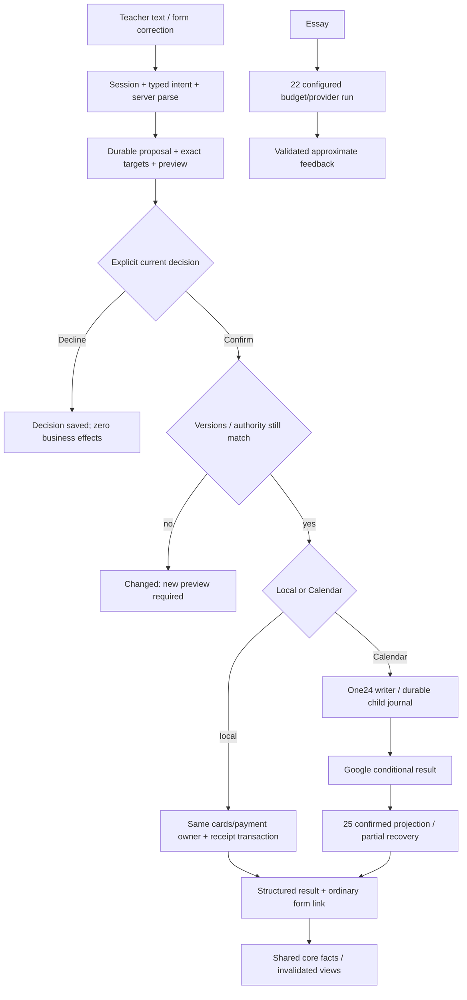

# Phase 23: Confirmed Chat Changes and Entry Points — Research

**Researched:** 2026-10-12
**Domain:** durable confirmation, money/card operations, Google bulk commands, correction parity, essay feedback, phone UI.
**Confidence:** MEDIUM для official/source evidence; LOW для PROPOSED implementation; runtime UNVERIFIED.

<user_constraints>

## User Constraints (from CONTEXT.md)

Canonical23-CONTEXT, copied verbatim. Defaults не превращены в user-reviewed decisions. [CITED: .planning/phases/23-confirmed-chat-changes-and-entry-points/23-CONTEXT.md]
DATA_0c95a34e_START

## Locked Decisions

- **D-01:** The accepted execution order is 24 → 25 → 22 → 23 → 26. Research, UI and plan preparation may progress independently; final dependency signatures must be rebound before execution.
- **D-02:** A chat proposal is not an applied change. Payment, new card, deletion, rate change and bulk move effects require an explicit confirmation bound to the exact current proposal. Decline leaves business data unchanged.
- **D-03:** Chat and ordinary forms call the same existing domain owners. Current balances, counts, marks and schedule identities remain authoritative. The model does not calculate money or generate provider confirmations.
- **D-04:** CHAT-06 explicitly uses Vietnam time when the prompt names no zone. A named zone, including MSK, controls the proposed bulk move. Existing lesson creation zones and instants follow the accepted core/schedule rules; research must make the preview and conversion observable.
- **D-05:** Google-backed schedule writes use the existing confirmed command, recovery and partial-state path. A confirmed proposal alone cannot claim Saved before actual Google acknowledgement and committed projection.
- **D-06:** Existing history, marks, payment facts and stable card identities remain intact under the applicable domain policy. Schedule rows are not physically removed. Research must distinguish supported deletion/archive operations and name the owner; it must not invent a destructive business operation from a model phrase.
- **D-07:** Essay feedback is an approximate estimate, not an official IELTS result. It uses the Phase 22 configured provider/model/budget path. Phase 26 exam workflow is excluded.
- **D-08:** UI reuses Base UI and variant A/v40. Product copy is English. No eyebrows, Radix or cmdk. Navigation, focus, confirmation and phone interactions require public browser evidence.
- **D-09:** The owner authorized autonomous research/planning/UI/check/implementation and coordinated release/testing without questions while away. New agents use the session agent model. Server guy owns runtime/release leases and secrets. Missing observations remain UNVERIFIED.

## Unreviewed Defaults

- **UD-01:** Reuse the durable proposal/run/tool/usage store designed in Phase 22. A proposal revision and exact target/version bind Confirm; replay and stale confirmations cannot repeat effects.
- **UD-02:** A changed target or changed proposal requires a fresh preview before confirmation. Display actual money/date/zone/student scope; do not expose transport or journal details in the product flow.
- **UD-03:** Reuse existing payment/card forms and shared command palette components where they exist. Research identifies the narrow owner and approved composition before adding a UI surface.

These are technical defaults under autonomous authority. Research may replace them with an evidence-backed implementation within the accepted outcome.

## Deferred Ideas

IELTS26 exam features, provider/model quality evaluation beyond the accepted approximate essay feedback, new calendars, new infrastructure, physical schedule/history removal and unrelated redesign are excluded. Missing provider access, monetary cap and actual spike observations are not invented during preparation.

DATA_0c95a34e_END
</user_constraints>

## Scope Card

Контракт этого bounded research, а не execution23. [CITED: user task; 23-CONTEXT.md]

| Поле         | Граница                                                                                                                                                        |
| ------------ | -------------------------------------------------------------------------------------------------------------------------------------------------------------- |
| Outcome      | Один implementation-ready research23 для SC1…5/F01…10 и семи requirements                                                                                      |
| In scope     | Existing owners, confirmation/money/bulk/forms, essay, palette/profile/phone, exact proposed signatures/write inventory, public proof paths                    |
| Out of scope | Source,22 research rewrites, STATE/shared metadata, Git mutations, env/data/runtime/provider/model/browser/deps/deploy/deletion/agents;26/unrelated audit      |
| Acceptance   | Каждому SC/F — исполнимое решение, owner/interface/write necessity, failure→observable и source/proof                                                          |
| Assumptions  | A1 final24/25/22 source ещё не stable; A2 existing money/card owners требуют adapters; A3 runtime/provider/budget/grants/phone не наблюдались; A4 UI23 ещё нет |
| Verification | Source reads+fingerprints, official new API facts, root-pin, owned format+semantic check; не runtime PASS                                                      |
| Work map     | Owners→SC1…3/F01…05/F09; API/essay→SC4/F06/F08; DS mapping→SC5/F07; existing E2E→all/F10                                                                       |
| Write set    | Только этот23-RESEARCH.md; Parent owns CONTEXT, Designer external UI-SPEC                                                                                      |
| Stop         | Все SC/F имеют design/proof paths, внешние gaps названы; execution ждёт final24/25/22 binding                                                                  |

Все новые paths/types/states/tables/signatures ниже помечены PROPOSED и [ASSUMED:A2]. Это выбранные technical defaults в текущей autonomy, не новый запрос engineering approval. A1 опровергается final source diff, A2 — public journey/domain result, A3 — реальное authorized наблюдение, A4 — approved UI artifact. [ASSUMED:A1] [ASSUMED:A2] [ASSUMED:A3] [ASSUMED:A4]

## Summary

Расширять proposed22 chat store одним durable proposal/decision owner. Model может предложить операцию и указать исходные фрагменты; server сам разрешает IDs, денежные значения, zones, effect и preview. Confirm связан с actor, immutable payload digest, target versions и proposal revision. Decline не пишет business data. Local commit и receipt атомарны; Google effect признаётся только после matching verified command/projection. [ASSUMED:A2]

Прочитанный payment owner поддерживает create, assign, delete; correction через edit отсутствует в открытом route module. Для CHAT-12 добавить узкий update в том же owner и edit mode той же payment form. Card update сейчас заменяет full fields без CAS: rate proposal не должен нести старые parent/level/notes. Archive карточки, account deactivation и payment deletion — разные поддержанные операции. [CITED: apps/api/src/cards/payments.ts:86-162] [CITED: apps/api/src/routes/payments.ts:34-84] [CITED: apps/api/src/cards/cards.ts:97-138] [ASSUMED:A2]

Bulk использует explicit command zone; отсутствующая зона — Vietnam по CHAT-06, независимо от account display setting. Current24 source уже принимает singles/occurrences, но series operations пока положительно отвергаются на writer path, хотя DTO содержит их. Завершить24/25 и rebind до23; schema presence не доказывает delivery. [CITED: apps/api/src/calendar/commands.ts:48-52] [CITED: apps/api/src/schedule/command-plan.ts:63-88] [CITED: packages/contracts/src/calendar.ts:270-279] [CITED: 23-CONTEXT.md D-04/D-05] [ASSUMED:A1]

**Primary recommendation:** сначала durable decision + один payment confirm→ordinary edit→same balance journey; затем card/rate/archive и Google bulk journal; palette/profile/phone и essay используют те же owners. [ASSUMED:A2]

## Architectural Responsibility Map

Proposed tier ownership. [ASSUMED:A2]

| Capability                         | Primary tier            | Secondary tier           | Why                                   |
| ---------------------------------- | ----------------------- | ------------------------ | ------------------------------------- |
| Proposal/decision/auth/idempotency | API chat23              | PostgreSQL/22 store      | Browser/model не authority            |
| Decimal parse/rate/lesson credit   | core + contracts        | API cards                | Точные existing integer rules         |
| Payment/card correction            | API cards               | DB / ordinary forms      | Один write owner и version policy     |
| Zone/eligible bulk plan            | API schedule/calendar   | core                     | Server expansion/creation-zone rules  |
| Serial Google effects/recovery     | 24 writer/25 projection | Google + command journal | Не direct chat provider loop          |
| Essay inference                    | 22 provider/run/budget  | API essay schema         | Approximate result, no exam write     |
| Palette/profile/phone              | Web AppShell/forms      | safe API read contracts  | Reuse approved DS, no backend imports |
| Live view invalidation             | 22/24/25 change owner   | Web rereads              | Receipt, not model text               |

<phase_requirements>

## Phase Requirements

Descriptions from REQUIREMENTS33-43/94-101 verbatim. [CITED: .planning/REQUIREMENTS.md:33-43,94-101]
DATA_f345c612_START

| ID       | Description                                                                                                                                                                                                                     | Research Support   |
| -------- | ------------------------------------------------------------------------------------------------------------------------------------------------------------------------------------------------------------------------------- | ------------------ |
| SHELL-03 | Today, Schedule and Chat are usable at phone width.                                                                                                                                                                             | P7 / E09           |
| SHELL-04 | The palette finds students and offers "New chat" and "Add payment".                                                                                                                                                             | P7 / E08           |
| CARD-05  | The profile shows the student's payments and lessons and an "Ask in chat" action.                                                                                                                                               | P7 / E07/E08       |
| CHAT-05  | Payments, a new student, deletions and rate changes written in chat show the proposed change and apply only after confirmation.                                                                                                 | P1/P2/P3 / E01…E04 |
| CHAT-06  | A prompt can move all lessons of a student (for example "@Alex Example move all lessons from Tuesday 12:00 to Wednesday 14:00 MSK"); times default to Vietnam time unless a zone is named; this bulk change needs confirmation. | P4/P5 / E05/E06    |
| CHAT-10  | The teacher pastes an essay and gets feedback labeled as an approximate estimate.                                                                                                                                               | P6 / E10           |
| CHAT-12  | A change made in chat can be corrected through the same forms and dialogs, which call the same core functions.                                                                                                                  | P2/P5/P7 / E04/E07 |

DATA_f345c612_END
</phase_requirements>

## Project Constraints (from AGENTS.md)

Applicable directives из ROOT instructions/EXECUTOR-RULES и текущего task. Старые cleanup/commit recipes не дают authority здесь. [CITED: AGENTS.md:1-136] [CITED: .planning/EXECUTOR-RULES.md] [CITED: user instructions]

- ROOT shared; только owned23 research, чужое не отменять. Main и другие worktrees не трогать. root-pin перед write. AgentFlow suspended; никаких новых agents.
- UI variant A/v40, English, Base UI. Read principles/README/preview/tokens/reference; недостающий вид создаёт Designer. No eyebrows/Radix/cmdk. Только approved composition, no unsolicited redesign.
- Node24/Yarn4/Turbo, точные pins/age gate1440. Новых deps в23 не требуется; не install/update SDK/skills.
- web не импортирует api/db; contracts только types/zod/constants, core чистый без Node/deps/env. Requests через api-client; API routes без proxy prefix.
- Config/secrets только loadConfig/server; request-context logs/error envelope; auth/middleware session/role/Origin/no-store. app import ничего не запускает; lifecycle shutdown.
- Money/counts/core/cardFacts сохраняются; schedule occurrence/cut/history единственные владельцы. Google one confirmed writer, no false Saved, no offline writes.
- PostgreSQL18 app/migrator roles. Additive migrations через generate, generated SQL не менять, push/CREATE EXTENSION запрещены. Schedule/history/marks не удалять.
- Данные учеников/secrets/server addresses не в repository/research/logs/artifacts. Synthetic fixtures only. Essay text не debug log; private state вне repo.
- E2E только existing public application+real persistence journeys. Никаких unit/component/contract/integration suites/incident tests. New necessary scenario до behavior.
- Shared runtime leases/один web executor; не destructive shared build/test. Source checks в future plan, docs здесь не доказывают runtime.
- Readiness source: simplify, no comments/no any; CC/cognitive<22, Halstead Difficulty<80 с method/token convention, handwritten source<500 lines. Не создавать broad audit ради research.
- Current task forbids Git/deploy/env/data/runtime/model calls/deps/deletion/source/shared-meta writes. Commit_docs=true из config не разрешает commit.
- Запрос missing shadcn block относится к будущей implementation. Existing wrappers найдены; registry install/search через npx не нужен для этой read-only подготовки.

## Standard Stack

Reuse installed versions from opened manifests; не рекомендации latest и не новая установка. [CITED: apps/api/package.json] [CITED: apps/web/package.json] [CITED: packages/core/package.json]

| Library / owner            | Version                                      | Purpose                                |
| -------------------------- | -------------------------------------------- | -------------------------------------- |
| Hono / zod                 | 4.13.13 /4.6.5                               | Existing routes/strict schemas         |
| drizzle-orm / pg / pg-boss | 1.0.0-rc.4 /8.23.1 /12.37.1                  | DB transactions/queue                  |
| Next / React / Base UI     | 16.4.0 /19.3.0 /1.8.0                        | Existing shell/forms/Autocomplete      |
| core/contracts/db          | workspace:*                                  | Money/zone/facts/contracts             |
| Official Anthropic SDK     | Final22 pin/access, PROPOSED until installed | Reuse22 provider, no23 alternative SDK |
| Existing Playwright        | Existing harness pin, rebind package.json    | Public evidence, no new suite          |

No installation command. Package Legitimacy Audit:23 adds no external package;22 owns SDK gate/version. Current Base UI website shows newer package than installed; docs inform patterns, not proof that every new prop exists in1.8.0. Bind installed typings/static checks at execution. [CITED: https://base-ui.com/react/components/autocomplete] [CITED: apps/web/package.json] [CITED: 22-RESEARCH.md Standard Stack] [ASSUMED:A1]

## Existing Owner / Discrete Value Evidence

Source was opened via bounded line-numbered filesystem reads. Read connector earlier in this session failed tunnel-client; local claims are CITED, never promoted to VERIFIED. Quotes below are literal source fragments; filesystem paths proposed later have no creating script yet. [CITED: session tool evidence]

DATA_59d1a2c8_START

- CURRENCIES: ['RUB', 'KZT', 'USD', 'EUR']; STUDENT_STATUSES: ['active', 'archived']; PAYMENT_SOURCES: ['manual', 'vault']. [CITED: packages/contracts/src/students.ts:18-28]
- Limits: AMOUNT_MINOR_MAX = 2000000000; PAYMENT_NOTE_MAX_LENGTH = 500; LESSON_MINUTES_MIN = 15; LESSON_MINUTES_MAX = 240; DISPLAY_NAME_MAX_LENGTH = 80. [CITED: packages/contracts/src/students.ts:30-39] [CITED: packages/contracts/src/identity.ts:1-19]
- saveStudentRequest fields: displayName, rateMinor, currency, defaultLessonMinutes, parent, level, goals, timeZone, noShowDeducts; invariant (value.rateMinor === null) === (value.currency === null). [CITED: packages/contracts/src/students.ts:86-98]
- recordPaymentRequest: studentId, paidOn, expectedDefaultTimeZone, amountMinor, currency, lessonsHundredths, note. Existing scalar schema: z.number().int().min(1).max(AMOUNT_MINOR_MAX); lessonsHundredths z.number().int().min(0).max(LESSONS_HUNDREDTHS_MAX). [CITED: packages/contracts/src/students.ts:78-84,122-130]
- parseMoney(text: string, currency: string | null): number | null; suggestLessons(amountMinor: number, currency: string | null, rate: { rateMinor: number; currency: string } | null): number | null; creditedMinutes(hundredths: number | null, lessonMinutes: number): number. [CITED: packages/core/src/money.ts:8-17] [CITED: packages/core/src/lessons.ts:34-46]
- recordPayment(db: Database, accountId: string, input: RecordPaymentInput): Promise<RecordPaymentResult>; deletePayment(executor: DbExecutor, id: string): Promise<'deleted' | 'not_found'>; assignPayment(db: Database, id: string, input: AssignPaymentInput): Promise<AssignPaymentResult>. [CITED: apps/api/src/cards/payments.ts:86-90,119-121,133-161]
- createCard(executor: DbExecutor, input: SaveStudentInput, context: CardReadContext): Promise<StudentDetail>; updateCard(executor: DbExecutor, id: string, input: SaveStudentInput, context: CardReadContext): Promise<StudentDetail | null>; archiveCard/restoreCard use status 'archived'/'active'. [CITED: apps/api/src/cards/cards.ts:56-66,97-138]
- Archive UI: "The account, payments and notes are kept." / "The account can still sign in; deactivate it separately." Account owner writes status: 'deactivated', then revokeAccountSessions. [CITED: apps/web/app/(app)/students/[id]/_components/student-profile.tsx:315-324] [CITED: apps/api/src/auth/accounts.ts:161-184]
- SCHEDULE_TIME_ZONE = 'Asia/Ho_Chi_Minh'; existing display abbreviations include 'Europe/Moscow': ['MSK'] and 'Europe/Minsk': ['MSK']. This is display mapping, not unambiguous reverse parser. [CITED: packages/core/src/schedule.ts:11-19] [CITED: apps/web/lib/time-zones.ts:18-35]
- cutSeries change: { from: string; weekday: Weekday; startTime: string }; context: { now: Date; defaultTimeZone: string }; candidate timeZone: context.defaultTimeZone; preserved tail uses occurrenceAt and retains marked/exception lessons. [CITED: packages/core/src/schedule-series.ts:29-31,51-75,103-156]
- zonedInstant chooses localTimeCandidates(...)[0]; no candidate throws RangeError('nonexistent_local_time'). Earlier fold instant is existing policy, not a new default. [CITED: packages/core/src/zoned.ts:96-113]
- calendar DTO operations 'create', 'move', 'cancel', 'restore', 'move_series', 'end_series'; snapshot invariant applied iff confirmedRevision nonnull, applied requires effect 'confirmed', issue null, nextAction 'none'. [CITED: packages/contracts/src/calendar.ts:237-279]
- Current admission permits operation === 'move' || 'cancel' || 'restore'; otherwise if operation !== 'create' || repeats !== 'once' throws CommandFault('history_only'). [CITED: apps/api/src/calendar/commands.ts:48-52]
- Current prepareScheduleCommand handles observed singles/instances, then prepareCreateCommand; non-create fallback throws 'history_only'. Series DTO is not implemented proof. [CITED: apps/api/src/schedule/command-plan.ts:63-88]
- Calendar read/resume methods: readCalendarCommand(context: CalendarReadContext, commandId: string): Promise<CalendarCommandSnapshot>; resumeCalendarCommand(context: CalendarReadContext, commandId: string): Promise<CalendarCommandReceipt>; recovery ['partial_recovery', 'recovery_required']. [CITED: apps/api/src/calendar/commands.ts:128-139]
- SQL positive constraints: default GRANT SELECT, INSERT, UPDATE, DELETE ON TABLES TO dvlab_app; REVOKE DELETE, TRUNCATE ON "lesson_series", "lesson_exceptions", "lessons"; separate revoke on "lesson_marks". These statements are not observation of live grants. [CITED: deploy/postgres/ensure-db.sql:33-34] [CITED: packages/db/drizzle/20261010103628_schedule_revoke_delete/migration.sql:1] [CITED: packages/db/drizzle/20261010145724_lesson_marks_revoke_delete/migration.sql:1]
  DATA_59d1a2c8_END

## Architecture Patterns

### System Architecture Diagram

PROPOSED flow; no filename diagram or current-runtime claim. [ASSUMED:A2]



### P1 — Durable proposal/confirmation lifecycle — F01/F08

PROPOSED add proposal owner to22 store; no new chat engine. Proposal contains actor/account/conversation/turn/tool call ID, revision, normalized operation, exact target set, parsed payload, domain preconditions, canonical digest, safe server-generated preview and originating request. Preview uses same normalized payload later dispatched; server derives titles/effects, not model-rendered money or IDs. Save proposal metadata only, no business write while waiting. [ASSUMED:A2]

Confirm request carries proposalId/revision/digest/decisionRequestId only; browser cannot replace payload/target/version. Authenticated actor bound server-side. In short transaction lock proposal, decision receipt and affected local rows in deterministic order; validate all captured revisions/clock-dependent constraints before first effect. Same decisionRequestId with different digest rejects; repeats return existing receipt/status, never execute twice. For new card/payment preallocate identity/idempotency linkage; duplicate click/network retry cannot create another row. [ASSUMED:A2]

PROPOSED application states: awaiting_confirmation, declined, superseded, applying, waiting_calendar, applied, partial, recovery_required, failed. These are not copied provider enums. Decline CAS changes only proposal/decision metadata; Confirm/Decline race has one winner. Changed body/target/rate/account zone/time/policy invalidates prior proposal, stores fresh revision preview; never auto-confirm refreshed content. No arbitrary toast timeout/auto-accept/expiry implying permission. If date rolls over and validation changes, refuse stale preview. [ASSUMED:A2]

22 call remains complete: proposal tool receives immediate pending-proposal result for original call; application run enters waiting decision. Confirm executes backend owner directly, does not require paid model dispatch. Later explanation may call model only through22 admission; model outage/budget cap cannot mislabel committed operation as failure. For provider continuation preserve matching tool-result ordering; do not inject UI decisions between unresolved tool_use and result or auto-run mutation on replay. Each rejected/declined/stale/unknown branch has safe result. [CITED: https://platform.claude.com/docs/en/agents-and-tools/tool-use/handle-tool-calls] [ASSUMED:A2]

Schema-constrained tools improve shape only. Keep server zod strict validation, actor, target ownership, eligibility and money source verification. Stored student text, essay and provider response cannot approve a proposal, enlarge target set or choose SQL/URL/account. Tool allowlist exports propose operations, not direct unconfirmed business writes. No automatic payment/card/rate write from "yes" in quoted source or model text. [CITED: https://platform.claude.com/docs/en/agents-and-tools/tool-use/strict-tool-use] [CITED: https://platform.claude.com/docs/en/agents-and-tools/tool-use/handle-tool-calls] [ASSUMED:A2]

### P2 — Exact money/rate and form parity — F02/F05

Use teacher input spans or form strings as source for amount/currency/lesson count. Model may identify spans; server verifies them against persisted teacher text and calls parseMoney/parseLessons. Never accept model-generated minor units, floating-point amount×100, division/rate result or arbitrary digit substitution. Amounts in words/ambiguous separators/currency require product clarification/form input; do not guess. Code formats proposal with formatMoney/formatHundredths. Contracts reject overflow, zero/negative money/excess precision; no FX conversion. [CITED: packages/core/src/money.ts:3-17,20-45] [CITED: packages/core/src/lessons.ts:9-46] [CITED: packages/contracts/src/students.ts:78-98,122-130] [ASSUMED:A2]

Current payment form uses suggestLessons when same currency/rate, allows teacher edit and optional lesson count; server credits actual minutes with card.defaultLessonMinutes. Preserve this behavior. If lessons omitted and actual same-currency rate available, code suggestion goes into preview; if mismatch/no rate, ask for explicit lessons or deliberately preview no lesson credit. No model fallback. Currency pair on rates is nullable together; payment currency required. Existing schema allows four currencies; older DS examples are not permission to narrow to two or convert a mismatched payment into card currency. [CITED: apps/web/app/(app)/students/[id]/_components/record-payment-dialog.tsx:49-52,78-104,126-138] [CITED: packages/core/src/lessons.ts:34-46] [CITED: packages/contracts/src/students.ts:18-20,86-98,122-130] [ASSUMED:A2]

Record captures expected card revision/default lesson length/rate and teacher default zone; payment date rule uses actual account date (not bulk-command Vietnam). Refresh before Confirm if rate/lesson length/zone changed. Proposal previews amount,currency,paidOn,lesson credit and resulting facts computed through existing balance owner. Actual commit recalculates same core result; no independent chat accounting. Rate change affects future suggestion only, not stored payment creditedMinutes/history. [CITED: apps/api/src/cards/payments.ts:86-116] [CITED: packages/core/src/lessons.ts:34-46] [CITED: apps/api/src/cards/card-facts.ts] [ASSUMED:A2]

Refactor record into executor-based internal writer so local effect+decision receipt+invalidation commit atomically; preserve existing DB transaction facade for ordinary endpoint. New updatePayment uses same parser/domain rules and payment identity, expected payment/card revision. Don't "correct" by delete+recreate, which loses source/ID/history. Keep student binding immutable in correction; reassignment remains explicit existing assign owner, not hidden edit. Owner adjusts amount/date/lessons/note, recomputes creditedMinutes by same core; imported source provenance stays intact. [CITED: apps/api/src/cards/payments.ts:86-162] [ASSUMED:A2]

Card rate update must be narrow rate/currency patch under expected card revision; don't call full updateCard with stale unrelated fields. Ordinary full StudentFormDialog also uses CAS and refreshes on conflict. Every relevant ordinary writer increments revision: full card/rate/archive/restore/opening; payment assign/currency update/edit/delete. Numeric revision protects same-millisecond updates; updatedAt alone is not chosen authority. Final22 revisions reused if present rather than duplicate columns. No inferred any/new comments. [CITED: apps/api/src/cards/cards.ts:97-183] [CITED: apps/api/src/cards/payments.ts:133-162] [ASSUMED:A1] [ASSUMED:A2]

### P3 — Card/deletion boundaries — F03

New student means new stable card via createCard/StudentFormDialog, not automatic login/credential/account creation. Name uses normalizeDisplayName/isDisplayNameLength; exact required fields from schema/form. Default lesson length/noShowDeducts come from existing contracts/owner; unknown rate/currency stay null pair, unknown notes empty/null as actual form. Duplicate names are not merged; preview warns from exact existing search and binds the newly reserved card identity after Confirm. No secret fields are added to model tools. [CITED: packages/contracts/src/identity.ts:13-19] [CITED: apps/api/src/cards/cards.ts:56-66] [CITED: apps/web/app/(app)/students/_components/student-form-dialog.tsx:64-93] [ASSUMED:A2]

| Teacher operation               | Supported owner/effect                                                                | Proposal policy                                                                                                     |
| ------------------------------- | ------------------------------------------------------------------------------------- | ------------------------------------------------------------------------------------------------------------------- |
| Delete one payment              | deletePayment removes exact payment row; ordinary PaymentsTab has delete confirmation | Exact payment ID/details/version; Confirm Delete payment; audit receipt retained                                    |
| Remove student from active list | archiveCard/restoreCard changes status, retains same ID/history/account               | Explicit Archive student preview, never label Deleted                                                               |
| Delete student permanently      | No supported physical-card operation proposed; history policy forbids it              | Safe unsupported response; may offer a distinct Archive preview requiring its own explicit confirmation             |
| Disable student sign-in         | deactivateCardAccount→auth deactivateStudent + session revoke                         | Separate existing account operation, not side effect of archive; ordinary account control, no new chat account tool |
| Remove note/comment entry       | 22 planned retraction owner                                                           | Bind exact own entry/version; reuse22 semantics after source rebind                                                 |
| Delete calendar lesson          | 24 cancel/end commands, rows retained                                                 | Explicit cancel/end semantics and confirmed Google path, no SQL deletion                                            |

[CITED: apps/api/src/cards/payments.ts:119-121] [CITED: apps/api/src/cards/cards.ts:115-138] [CITED: apps/api/src/cards/card-account.ts:54-59] [CITED: apps/api/src/auth/accounts.ts:161-184] [CITED: 23-CONTEXT.md D-06] [ASSUMED:A1] [ASSUMED:A2]

Generic "delete" first resolves exact entity/action. Payment list duplicates require explicit selection. Confirm can't reinterpret student deletion as archive, account deactivation or cascade. Live payment DELETE permission remains UNVERIFIED: source default grant is positive, schedule-specific revoke is positive, current DB roles weren't queried. Existing delete endpoint/function proves intended source operation, not actual runtime grant or successful effect. No new privilege change proposed. [CITED: apps/api/src/routes/payments.ts:61-65] [CITED: deploy/postgres/ensure-db.sql:33-34] [ASSUMED:A3]

### P4 — Bulk target/time-zone plan — F04

CHAT-06 fallback is SCHEDULE_TIME_ZONE Vietnam, not readTeacherSettings.defaultTimeZone. Explicit MSK binds Europe/Moscow under this accepted prompt convention; source display map also labels Minsk MSK, so cannot reverse-map arbitrary abbreviations by first match. Add a narrow server command-zone resolver: exact IANA through existing isTimeZone/timeZoneIdentity, accepted MSK alias, Vietnam omission; other ambiguous abbreviations ask product selection. Do not import web timezone list into API or duplicate full browser list. Zone display uses existing zoneLabel/TimePair. [CITED: 23-CONTEXT.md D-04] [CITED: packages/core/src/schedule.ts:11-19] [CITED: apps/web/lib/time-zones.ts:18-35] [ASSUMED:A2]

Server planner captures command input zone, account display zone/version, each old rule creation zone, cutoff instant and target provider/local revisions separately. Source weekdays/start times are matched as wall times in command zone, not string compare against stored rule fields in another zone. Need actual series/single context across complete requested scope, not just visible current week. No browser recurrence expansion. Past/started history is preserved; default effective start is next eligible unstarted occurrence from captured now, preview shows explicit from date/zone. Marked/moved/cancelled tail exceptions preserved according to cutSeries, listed separately so "all" doesn't silently omit them. If user means those as well, resolve explicit per-occurrence scope before proposing. [CITED: packages/core/src/schedule-series.ts:35-75,127-156] [CITED: apps/api/src/calendar/series-context.ts:18-50] [ASSUMED:A2]

Freeze sorted complete targets: matched series IDs/provider master versions plus eligible singles/occurrence refs, before/after instants, affected rule bounds and exclusions. Preview open-ended series as number of rules+sample next transitions/explicit "and future occurrences", never finite invented lesson count; finite scope gets exact server count. Cross-zone DST can make a source wall-time filter match only some occurrences of a rule: require explicit series/range clarification, don't approximate all dates from one week. Destination weekly wall-time rule uses command zone for whole future scope; preserve original rule/head and history. No new series inferred from ambiguous student name. [ASSUMED:A2]

Core cutSeries already builds replacement in context.defaultTimeZone. Keep it unchanged; introduce explicit command-zone adapter context for bulk calculation while independently locking/checking actual account default setting. Current schedule contract/writer must add explicit inputTimeZone rather than forge expectedDefaultTimeZone or change teacher setting. Normal form omission remains account display/creation policy;23 chat omission is Vietnam. Convert dates/instants using core localTimeCandidates/zonedParts/seriesCutBoundary; gaps refuse, folds use existing earliest-instant policy and show selected offset/instant. Final24 may already provide explicit-zone seam; reuse after rebind. [CITED: packages/core/src/schedule-series.ts:103-156] [CITED: packages/core/src/zoned.ts:96-113] [CITED: apps/api/src/schedule/series.ts:59-84] [ASSUMED:A1] [ASSUMED:A2]

### P5 — Google bulk confirmation and correction — F04/F05

One proposal Confirm seals whole exact plan, not a new interpreted prompt. Revalidate full plan/membership/connection/versions/conflicts before first provider write. Same connection serialized writer admits children; no chat-owned direct gateway/SQL series loop. Local rule split/projection/retained marks belong final24 schedule owner, inbound association belongs25. Do not automatically clone inbound provider master to satisfy unmatched scope; require actual supported mapping/eligibility or return unavailable scope. [CITED: apps/api/src/calendar/commands.ts:25-52] [CITED: .planning/phases/25-google-calendar-two-way-sync/25-CONTEXT.md D-03/D-04/D-05] [ASSUMED:A1] [ASSUMED:A2]

PROPOSED durable batch association adds parent proposal+ordinal+stable child requestId+commandId+result. Children dispatched one at a time through same writer; each ID allocated/stored before dispatch. Status/restart uses by-request/command lookup, never new random ID for unknown child. Next child requires resolved prior child and fresh provider evidence; own previous confirmed writes can advance preconditions only if new evidence proves next semantic payload/membership unchanged. Any external change stops unstarted children and produces fresh preview, no automatic reconfirm. Google transaction across independent commands isn't available in app design: don't claim all-or-none provider effects. [ASSUMED:A2]

If one child applied and another pending/refused, UI explicitly shows actual confirmed count, unresolved/remaining, partial/recovery state. No overall Saved until all intended effects have matching verified results and committed projections. Cancellation/Decline after dispatch doesn't reverse existing effects. No blind compensation or rollback over Google wins. Recovery resumes original journal only per owner's nextAction/capability; unstarted changed remainder needs new proposal revision and explicit Confirm. Marked/history keys/projection lineage validated after each split. Google recurring documentation explains split and exception handling; implementation must follow24 preservation policy, not overwrite remote exceptions from model plan. [CITED: https://developers.google.com/workspace/calendar/api/guides/recurringevents] [CITED: packages/contracts/src/calendar.ts:237-257] [ASSUMED:A2]

"Open change" routes to actual persisted payment/card/ref/rule from structured receipt. Current lesson/event dialogs and ordinary forms reread fresh owner state, not mutate proposal snapshot. A correction creates new ordinary domain action/Google command with current CAS; chat receipt remains history, not rerun instruction. Shared22 data invalidation covers Students/profile payments/lessons and Today/Schedule; another tab's later edit blocks old proposal. [CITED: apps/web/app/(app)/schedule/_components/schedule-mutations.ts:120-165] [CITED: apps/web/app/(app)/students/[id]/_components/student-profile.tsx:128-146,270-313] [ASSUMED:A1] [ASSUMED:A2]

### P6 — Essay estimate on22 provider — F06/F08

Reuse final22 provider/model/effort/budget/stream/run identity. No23 token rates/cap/credit claims or new provider SDK. Require configured finite cap/rate/capability; missing means paid essay Send disabled with retained draft. Long pasted text uses finite22 input/context limit; reject overflow explicitly, never silently truncate into a graded-looking result or dispatch an unbounded tool loop. Store only existing conversation content, not new IELTS essay/exam tables. [CITED: 22-RESEARCH.md P1/P9] [CITED: 23-CONTEXT.md D-07] [ASSUMED:A1] [ASSUMED:A2]

Essay is untrusted data delimited separately from task instruction. Essay mode registry has no write tools; embedded "confirm payment"/student text must not escape to business proposals. Feedback is read-only content and server-prefixed "Approximate estimate — not an official IELTS score." Label appears before first published feedback, on each numeric estimate/block, after reload and in ordinary history. Model can't remove it or claim certified result. Malformed/refused/truncated response remains incomplete/no-score, not success. [ASSUMED:A2]

Official IELTS distinguishes Task achievement/Task response, Coherence and cohesion, Lexical resource, Grammatical range and accuracy; equal weighting per task, assessments independent. Use criteria as framing, not evidence that LLM is accurate. If task prompt/type absent, provide language/coherence feedback and label task criterion unassessed; don't invent full score. For complete Task2 input, optional validated approximate criterion bands and per-task aggregate computed by code with documented equal weighting; do not infer official exam Writing result or Task1/Task2 combined score. Score schema/rounding choice must be explicit before UI band display; default qualitative feedback closes CHAT-10 without fabricated bands. No provider quality eval/spike performed. [CITED: https://ielts.org/take-a-test/preparation-resources/writing-test-resources] [ASSUMED:A2] [ASSUMED:A3]

### P7 — Palette/profile/phone bindings — F07

Current CommandPalette is Base UI Autocomplete in Dialog, groups Sections/Theme/Account; no student/New chat/Add payment actions in opened module. AppShell owns Ctrl/⌘K, refuses shortcut while another dialog open, exposes mobile Search button. Extend that owner, not new parallel palette. Order approved SearchPalette Actions→Students→Screens; @ filters students. Reuse final22 account-filtered student search, exact ID route; no invented handle from DS sample. Async query cancels/discards obsolete results; separate loading/error/empty, no stale student selection after card removal. Official Base UI documents async status/abort/controlled value/filter=null and command picker pattern; bind installed1.8 types before use. [CITED: apps/web/app/(app)/_components/command-palette.tsx:29-51,59-115] [CITED: apps/web/app/(app)/_components/app-shell.tsx:22-59] [CITED: design SearchPalette README] [CITED: https://base-ui.com/react/components/autocomplete] [ASSUMED:A2]

PROPOSED shared AppShell entry-point controller: New chat creates metadata through22 idempotent owner then navigates /chat; Add payment opens existing RecordPaymentDialog without preset, with freshly read teacher time context. Only one dialog owner, close palette before opening next; returning focus follows explicit opener. Ask in chat on profile creates/open new conversation with server-resolved student mention draft, no automatic model call/Send. Safe opaque navigation intent may carry student/payment/ref, not essay/private text in URL. No browser-generated IDs or arbitrary href from model receipt. [CITED: apps/web/app/(app)/students/[id]/_components/record-payment-dialog.tsx:41-47,63-83] [ASSUMED:A1] [ASSUMED:A2]

Profile currently has Overview/Notes/Vocabulary/Payments; add approved Lessons tab/list + Ask in chat action. readStudentLessons server combines existing account-week history/readWindow with confirmed Google window/mapping; default current account week and explicit range navigation, no unbounded new chronology engine. Known cancelled/moved/history marks remain correct. Missing read/partial coverage is not empty list. Lesson row opens existing CalendarLessonDialog/historical LessonDialog according to final eligibility; payment/rate open existing dialogs, chat edits discoverable there. Subscribe profile reload/payment refresh counter to22 invalidation; preserve unsaved drafts/focus. [CITED: apps/web/app/(app)/students/[id]/_components/student-profile.tsx:270-313] [CITED: design LessonList README] [ASSUMED:A1] [ASSUMED:A2]

Phone: approved ScheduleAgenda below lg, actual events/current shared read model/TimePair, not squeezed seven-column grid or browser series expansion. Current schedule-screen renders WeekGrid only in opened branch; no current calendar-agenda source file found. New proposed agenda composes existing row/detail/command owners; busy/provider events and stale/read-only states retained. Today already has two-column counters; reuse existing panels/row controls and layout, no new bottom nav invented. Chat uses22 composer viewport/IME/focus/selection behavior; verify 320/375px and virtual keyboard, both themes/reduced motion. No desktop-only palette/payment shortcut requirement. [CITED: apps/web/app/(app)/schedule/_components/schedule-screen.tsx:165-225] [CITED: apps/web/app/(app)/_components/today-screen.tsx:97-126,299-330] [CITED: design ScheduleAgenda README] [ASSUMED:A2]

## Designer Binding Map — no23 UI-SPEC yet

Read component README/preview and principles/tokens at v40; no screenshot/browser runtime. Current external23 UI-SPEC presence check false. Designer owns new composition; research gives semantics, not a new look.22 UI-SPEC fingerprint e168… is read-only; pending B1/B2 correction is presentation binding, not permission to mutate22 research. [CITED: session design reads/presence/fingerprints] [CITED: user task] [ASSUMED:A4]

| Binding              | Reuse approved component/source                            | Designer must specify / observable                                                                                                               |
| -------------------- | ---------------------------------------------------------- | ------------------------------------------------------------------------------------------------------------------------------------------------ |
| D1 proposal decision | ChangeCard + ConfirmDialog + ChatMessage                   | Waiting/Confirm/Decline/stale/new preview; exact amount/zone/targets, no git commit/document receipt; no autoaccept/four-second expiry           |
| D2 deletion/card     | StudentForm + existing archive ConfirmDialog + PaymentsTab | Archive not Deleted; separate account retention; exact payment delete selection; create/edit/rate validation                                     |
| D3 correction        | PaymentDialog + RecordPaymentDialog + StudentFormDialog    | New payment edit mode/same ID/CAS conflict; Open change from receipt; no delete/recreate                                                         |
| D4 bulk              | MoveSeriesDialog + CalendarCommandNotice/recovery          | Command zone vs display/creation zone; preserved history/exceptions/open-ended rule scope; partial applied/unknown/remainder                     |
| D5 essay             | Existing ChatMessage feedback block                        | Approximate label fixed before content; unassessed task/qualitative/incomplete state; optional bands require schema/rounding, not official score |
| D6 palette           | SearchPalette + existing Base UI palette/AppShell          | Actions/Students/Screens; New chat/Add payment; loading/error/duplicate names/IME/focus transition                                               |
| D7 profile           | Panel/Tabs/LessonList/TimePair + existing profile          | Lessons range/read error; Ask in chat exact draft; payments/edit links                                                                           |
| D8 phone             | ScheduleAgenda + existing Today panels +22 composer/shell  | 320/375px keyboard/touch/scroll/visible Send; read-only/recovery/action access; themes/reduced motion                                            |

Every binding closes SC/F: D1 F01/F08; D2 F02/F03; D3 F05; D4 F04; D5 F06; D6…8 F07; public evidence F10. DS ChangeCard is vault-oriented (note fragment/git hash/auto close), PaymentDialog examples imply stricter lessons/currency than current source, ScheduleAgenda examples use Vietnam. Preserve accepted current domain policy and no false receipts; Designer explicitly resolves these differences in23 spec before dependent UI code. No source or DS files changed here. [CITED: design component READMEs] [ASSUMED:A2] [ASSUMED:A4]

## Exact Proposed Write Inventory / Public Signatures — F09

All paths/types/signatures below PROPOSED [ASSUMED:A2]; existing dependencies22/24/25 rebind [ASSUMED:A1]. No Registry wire projection added to durable AGENTS instructions. Planning assigns narrow owners, one web owner per wave; source size/quality gates apply at implementation.

| Owner / proposed file set                                                                                                  | Public/cross-module change                                                                                                                         | Necessity                                            |
| -------------------------------------------------------------------------------------------------------------------------- | -------------------------------------------------------------------------------------------------------------------------------------------------- | ---------------------------------------------------- |
| contracts/src/chat-proposals.ts; chat.ts/chat-events.ts/index.ts final22 owners                                            | ChatProposal, ProposalTarget, ProposalDecision, ProposalReceipt; strict propose/confirm/decline/read schemas                                       | SC1 durable exact proposal/result                    |
| contracts/src/students.ts                                                                                                  | StudentDetail/PaymentRow revision; UpdatePaymentRequest, UpdateRateRequest, expectedRevision/expectedCardRevision                                  | SC1/3 concurrency/parity                             |
| contracts/src/calendar.ts + schedule.ts                                                                                    | Explicit inputTimeZone in shared series intent; bulk plan/target/result contracts, not substitute expectedDefaultTimeZone                          | SC2 zone separation                                  |
| contracts/src/chat-essay.ts                                                                                                | EssayFeedback/criterion availability/approximate label; bounded input/output; qualitative default                                                  | SC4                                                  |
| db/src/chat-schema.ts final22; schema.ts/index.ts; generated drizzle migration+metadata                                    | Add proposals/targets/child-command association; additive card/payment revisions                                                                   | SC1/2/3                                              |
| api/src/chat/proposals.ts, decisions.ts, proposal-store.ts                                                                 | prepareProposal(context,intent), confirmProposal(context,id,revision,digest,decisionRequestId), declineProposal(...), readProposal(...)            | SC1 identity/CAS/decline/recovery                    |
| api/src/chat/money-intents.ts, card-intents.ts                                                                             | resolve teacher spans/IDs/normalized payload, code preview; allowlisted operations only                                                            | SC1 money/card validation                            |
| api/src/chat/bulk-plan.ts, bulk-commands.ts                                                                                | prepareBulkMove(context,studentId,commandZone,selection), run/resumeBulkProposal(context,proposalId)                                               | SC2 exact target seal/serial recovery                |
| api/src/chat/essay.ts; tools.ts/runs.ts final22                                                                            | read-only essay mode and label enforcement; proposal tool results/awaiting decision                                                                | SC4; same22 budget                                   |
| api/src/routes/chat.ts final22; app.ts/server.ts only wiring needed                                                        | New proposal decision/status/bulk/entry APIs; dependency injection into existing chat                                                              | SC1/2/4                                              |
| api/src/cards/payments.ts (or payments-write.ts if semantic size requires split); routes/payments.ts                       | writePayment(tx,actor,input,expectedCardRevision); updatePayment(tx,actor,id,input,expectedRevision); versioned delete/assign; PATCH /payments/:id | SC1/3 atomic receipt+effect/same ID correction       |
| api/src/cards/cards.ts + card-rows.ts; routes/students.ts                                                                  | setCardRate(tx,context,id,ratePatch,expectedRevision); versioned full update/archive/restore/opening                                               | SC1/3 no lost unrelated fields                       |
| api/src/cards/student-lessons.ts; routes/students.ts                                                                       | readStudentLessons(executor,context,studentId,window): existing lesson DTO+coverage; GET /students/:id/lessons                                     | SC5 profile normal data path                         |
| api/src/schedule/series.ts; command-plan.ts/final series preparation owner                                                 | Explicit input zone adapter around existing cutSeries; preserve account-zone guard/history                                                         | SC2 parity normal/chat                               |
| api/src/calendar/commands.ts/journal.ts/final batch admission owner                                                        | Same writer child association/status lookup, fresh unchanged-remainder validation; no chat gateway                                                 | SC2 pending/partial                                  |
| api/src/chat/command-zone.ts, only if final24 lacks shared explicit-zone seam                                              | resolve command IANA/MSK/Vietnam policy through existing contracts validation + core constant                                                      | SC2; chat policy owner, core remains dependency-free |
| web/app/(app)/chat/_components/proposal-card.tsx, proposal-decision.tsx, essay-feedback.tsx + final22 messages/use-chat    | Structured proposal decision/recovery/estimate blocks                                                                                              | SC1/2/4                                              |
| web/app/(app)/_components/app-shell.tsx, command-palette.tsx, entry-points.tsx/use-entry-point.ts                          | Palette actions + one global payment/dialog flow + create/openChatDraft(studentId?)                                                                | SC5                                                  |
| web/app/(app)/students/[id]/_components/record-payment-dialog.tsx, payments-tab.tsx                                        | RecordPaymentDialog mode create/edit, payment revision; editor action/reload                                                                       | SC3                                                  |
| web/app/(app)/students/_components/student-form-dialog.tsx; profile overview-tab.tsx                                       | CAS existing full form/rate correction                                                                                                             | SC3                                                  |
| web/app/(app)/students/[id]/_components/student-profile.tsx, lessons-tab.tsx                                               | Lessons/Ask in chat, typed receipt navigation and invalidation                                                                                     | SC5                                                  |
| web/app/(app)/schedule/_components/schedule-agenda.tsx, schedule-screen.tsx, move-series-dialog.tsx, schedule-mutations.ts | Approved phone agenda, input-zone preview/shared command adapter                                                                                   | SC2/5                                                |
| web/app/(app)/_components/today-screen.tsx + final22 chat layout only if phone scenario fails                              | Necessary responsive/focus integration; no unrelated redesign                                                                                      | SC5                                                  |
| Existing e2e/chat.spec.ts after22, today.spec.ts, move.spec.ts; e2e/support/chat.ts final22                                | Durable proposal→decision→correction journey + shared phone/Google evidence                                                                        | F10; before behavior                                 |

Entry API proposals: POST /chat/proposals/:id/confirm, POST /chat/proposals/:id/decline, GET /chat/proposals/:id; no browser-provided payload on Confirm. Exact request shapes from new contracts, these are proposed endpoints, not assertions of existing route/files. New navigation actions create metadata/draft only; future paid Send independently gated. Numeric limits for proposal target/context/essay reuse bounded22 policy, choose finite schema bounds at implementation based on actual owners, not magic invented cost/horizon. [ASSUMED:A1] [ASSUMED:A2]

### Additive persistence / necessity

| Proposed addition                  | Keys and invariants                                                                                                                           | Gate                     |
| ---------------------------------- | --------------------------------------------------------------------------------------------------------------------------------------------- | ------------------------ |
| chat_proposals                     | Account/conversation/turn/call; immutable normalized payload/digest; revision/state/decision actor; current proposal unique per call revision | SC1 replay/stale/decline |
| chat_proposal_targets              | Proposal+ordinal unique; typed local/provider identity/version; before/after facts + input zone; frozen membership seal                       | SC1/2 full preview       |
| chat_proposal_commands             | Proposal+child ordinal unique; stable requestId/commandId/result; no duplicate dispatch                                                       | SC2 partial/recovery     |
| Existing chat_actions/events       | Origin proposal/decision link + structured normal form target                                                                                 | SC3 parity/invalidation  |
| Existing students/payments columns | bigint revision DEFAULT0 additive; every write increments; final22 reuse if present                                                           | SC1/3 CAS                |
| Existing22 message/result payload  | Estimate flag/task coverage/feedback only; no new essay/exam entity                                                                           | SC4                      |

PROPOSED [ASSUMED:A2]. No new money ledger/queue/calendar clone/session/provider store. Migration filenames generated by db:generate after final dependency schema; don't guess sequence or edit generated SQL. DB permits private business data; public migration/test/research contains none. Runtime migration executes only under later authorized owner; no data conversion performed here.

## SC / F Solution Matrix

Design decisions not executed proofs. E IDs below are proposed durable journey scenarios. [ASSUMED:A2]

| Gate | Owner / solution                                          | Minimum observable evidence                                        |
| ---- | --------------------------------------------------------- | ------------------------------------------------------------------ |
| SC1  | P1/P2/P3 proposals+cards/payments                         | E01/E02/E03 confirm/decline/stale/replay zero unintended effects   |
| SC2  | P4/P5 command-zone+24 writer+25 mapping                   | E05/E06 named/omitted zone, sealed scope/history, truthful partial |
| SC3  | P2/P5 normal forms/receipts/CAS                           | E04/E07 payment/card/lesson correction, same IDs/facts             |
| SC4  | P6 read-only22 essay run                                  | E10 estimate label/budget/refusal/injection                        |
| SC5  | P7/AppShell/profile/agenda                                | E08/E09 palette/phone/focus/themes                                 |
| F01  | proposals/decisions/store                                 | E01/E02 exact actor/digest/version race                            |
| F02  | core parseMoney/lessons + cards payments/rate             | E01/E03 precision/FX/rate stale/core credit                        |
| F03  | createCard/archive/deletePayment/retraction boundary      | E03/E07 no account cascade/physical student removal                |
| F04  | explicit command zone + core cut + calendar batch journal | E05/E06 no display-zone substitution/blind provider replay         |
| F05  | updatePayment/setRate/CAS normal forms                    | E04/E07 same business IDs and balance/schedule                     |
| F06  | essay adapter +22 admission                               | E10 no official score/new grading/cost bypass                      |
| F07  | existing Base UI palette/shell/profile/DS map             | E08/E09 no invented look/draft Send                                |
| F08  | session/Origin/tool allowlist/source spans                | E02/E03/E10/E11 injection/forged confirmation/expired role         |
| F09  | exact inventory/tables/signatures above                   | Static bind + same public scenarios; rebind24/25/22                |
| F10  | existing public journeys/target/fixture evidence          | E01…11; real Google ACK not browser mock                           |

## Don't Hand-Roll

Prescribed replacements close indicated risk. [ASSUMED:A2]

| Problem                 | Don't build                                           | Use instead                                                     |
| ----------------------- | ----------------------------------------------------- | --------------------------------------------------------------- |
| Money conversion/credit | Model arithmetic/floating-point cents/FX              | Existing parseMoney/parseLessons/suggestLessons/creditedMinutes |
| Card identity/account   | Name-derived IDs/automatic login/delete cascade       | cards/auth separate existing owners                             |
| Confirmation            | Ephemeral chat yes/optimistic Saved                   | Durable proposal/decision receipt/CAS                           |
| Recurrence/zone         | Browser expansion/manual offset/second accounting     | core zoned/cut + final24 plan                                   |
| Provider bulk atomicity | Chat Promise.all/direct Google loop/automatic inverse | One writer+durable child commands+truthful partial              |
| Palette/dialog          | New cmdk/Radix search/modal stack                     | Base UI Autocomplete/existing shell/dialog                      |
| Essay grading           | New IELTS examiner/score engine/claim of quality      | 22 read-only approximate feedback                               |

## Runtime State Inventory

Included because proposed phase adds revisions/adapts existing writers. Read-only inventory; five categories answered without unobserved "none verified" assertions. [CITED: user task] [ASSUMED:A3]

| Category                  | Found / evidence boundary                                                  | Future action                                                                                |
| ------------------------- | -------------------------------------------------------------------------- | -------------------------------------------------------------------------------------------- |
| Stored data               | Existing students/payments/schedule/history; actual row counts not queried | Add revision columns/generated additive migration; don't rename/delete business rows         |
| Live service config       | 22 provider/key/cap and24/25 writer runtime not accessed                   | Reuse existing config; availability gate before paid/runtime execution                       |
| OS-registered state       | No rename/re-registration required by design; OS registry not inspected    | No23 service/unit change proposed                                                            |
| Secrets/env vars          | Existing22/Google server secret owners; no values read                     | No new secret recovery or23 env names required                                               |
| Build/installed artifacts | Source manifests read, no build/container/runtime probe                    | Existing release owner builds final source after authorized checks; no deletion/cleanup here |

No runtime migration/cache was attempted. This inventory does not claim database/service availability or current grants. [ASSUMED:A3]

## Common Pitfalls

- Stale Confirm updates a different amount/target → digest+revision/current row CAS; new preview explicit Confirm. [ASSUMED:A2]
- Child bulk writes parallel or uncertain response retried with new ID → one writer, stored child ID/read original journal, truthful partial. [ASSUMED:A2]
- Missing zone uses changed teacher setting → CHAT-06 Vietnam input policy independent of display. [CITED: 23-CONTEXT.md D-04]
- Source weekday matched in stored zone → wrong recurring targets across DST; exact server scope/clarification. [CITED: packages/core/src/schedule-series.ts:35-48] [ASSUMED:A2]
- Rate update full stale card → unrelated edits lost; narrow patch/full-form CAS. [CITED: apps/api/src/cards/cards.ts:97-112] [ASSUMED:A2]
- Payment correction delete/recreate → changed ID/provenance; existing owner update/same ID. [ASSUMED:A2]
- Delete student means delete account/history → unsupported physical deletion; archive preview separate. [CITED: apps/web/app/(app)/students/[id]/_components/student-profile.tsx:315-324] [ASSUMED:A2]
- Tool strict:true treated as authorization → shapes only; session/target/source validation still required. [CITED: https://platform.claude.com/docs/en/agents-and-tools/tool-use/strict-tool-use] [ASSUMED:A2]
- Essay output disappears "approximate" or triggers write → server label/read-only registry at all stages/reload. [ASSUMED:A2]
- Mobile shrink grid or palette nested modal → approved agenda/shared dialog controller/focus journey. [CITED: design ScheduleAgenda README] [ASSUMED:A2]

## Code Examples

Proposed domain composition skeleton only; symbols defined by proposed contracts/owners, no invented existing enum. [ASSUMED:A2]

```typescript
const decision = confirmProposalRequest.parse(input)
return db.transaction(async (tx) => {
	const proposal = await lockProposal(tx, actor, decision.proposalId)
	const admitted = await validateDecision(tx, actor, proposal, decision)
	if (!admitted.ok) return admitted
	const effect = await executeLocalProposal(tx, actor, admitted.proposal)
	return persistDecisionReceipt(tx, admitted, effect)
})
```

Calendar path commits decision+child identities first, then final24 writer outside SQL transaction; does not use this local skeleton for provider HTTP. All provider tool results preserve matching call IDs, errors use safe is_error; no raw exception/student text log. [CITED: https://platform.claude.com/docs/en/agents-and-tools/tool-use/handle-tool-calls] [ASSUMED:A2]

## State of the Art

| Existing / misleading approach      | Required23 behavior                                 | Impact                                |
| ----------------------------------- | --------------------------------------------------- | ------------------------------------- |
| Payment create/assign/delete only   | Add update in same owner/form                       | CHAT-12 correction parity             |
| Card full update without revision   | Narrow rate patch + all-path CAS                    | Prevent lost edits                    |
| Series DTO already lists operations | Final writer must implement/verify series           | Do not infer availability from schema |
| Vault ChangeCard git receipt        | App structured DB/Google outcome + normal form link | No false public receipt               |
| Older Vietnam display example       | CHAT-06 input VN, account display independent       | Preserve21.1 UI and exact command     |

[CITED: apps/api/src/cards/payments.ts] [CITED: apps/api/src/cards/cards.ts:97-112] [CITED: apps/api/src/calendar/commands.ts:48-52] [CITED: design ChangeCard README] [CITED: 23-CONTEXT.md]

## Environment Availability

No external probe/paid call/browser/app runtime. Dependencies already in inherited source; no install or new environment. [CITED: user task]

| Dependency               | Required by                  | Evidence / fallback                                                                       |
| ------------------------ | ---------------------------- | ----------------------------------------------------------------------------------------- |
| Node/Yarn/Prettier       | Document/static tooling      | Existing node_modules/prettier/bin/prettier.cjs found; format only owned doc              |
| PostgreSQL/application   | Real effects                 | Source/harness read; connection/grants/rows UNVERIFIED                                    |
| 24/25 series/mapping     | Bulk                         | Current24 singles integrated; series positive restriction; final dependency rebind        |
| 22 provider/store/cap    | Confirmation/essay           | Proposed research/UI, final source absent; no paid Send with missing finite configuration |
| Playwright/phone/browser | Functional proof             | Existing harness/config, NOT RUN                                                          |
| 23 approved UI           | Dependent web implementation | No external23 UI-SPEC found; Designer map provided                                        |
| Context7/ctx7            | New docs research            | Unavailable tools/CLI established earlier; official primary web fallback                  |

Validation Architecture omitted because workflow.nyquist_validation=false; E2E evidence remains required. Package cache/research-store writes omitted by owned write set. Missing observation not absence/PASS. [CITED: .planning/config.json] [CITED: session evidence] [ASSUMED:A3]

## Minimum Public E2E — F10

NOT RUN. Use existing Playwright config/target/real persistence, one worker, light/dark, existing fixture state outside public repository. Extend final22 e2e/chat.spec.ts after rebind; existing today.spec.ts/move.spec.ts prove shared facts/Calendar paths. No new isolated suite. Scenarios below precede behavior, are durable user journeys, not incident tests. [CITED: playwright.config.ts] [CITED: e2e/support/test.ts:20-78] [CITED: e2e/today.spec.ts] [CITED: e2e/move.spec.ts] [ASSUMED:A1] [ASSUMED:A2]

| ID / owner               | Failure modes                                                                                                      | Public expected / persistence evidence                                                                                     |
| ------------------------ | ------------------------------------------------------------------------------------------------------------------ | -------------------------------------------------------------------------------------------------------------------------- |
| E01 chat confirmation    | Payment/card/rate proposal; double Confirm; decline; refresh before decision                                       | Preview only before Confirm; Decline zero business rows changed; one exact effect/receipt after repeat                     |
| E02 chat races/security  | Other tab edits proposal/target; confirm vs decline; forged actor/digest; expired session                          | One decision winner; stale new preview; no changed-body apply or private receipt                                           |
| E03 money/card lifecycle | Excess decimals/overflow/ambiguous currency/word amount; no rate; archive vs delete; payment duplicate             | Core/schema rejection/clarification; no model conversion; stable card ID/account/history; exact payment delete only        |
| E04 payment correction   | Chat record→normal edit; competing payment/card revision; lost response                                            | Same payment ID/source, actual recalculated core balance; stale edit refused; no recreate/double credit                    |
| E05 bulk zones           | Named MSK and omitted zone with account default elsewhere; DST fold/gap; multiple/partial matches; open-ended rule | Preview actual input/display/creation zones/selected instant, exact rules/exclusions; VN omission; no guessed finite total |
| E06 bulk recovery        | Real delayed/lost Google reply, earlier applied child, remaining external edit, reload                             | No overall Saved until all verified; actual partial state; same child journal; no replay/automatic clone/rollback          |
| E07 form/profile parity  | Chat card/rate/archive/note/Calendar result→ordinary form; payments/lessons tab                                    | Same stable IDs/history/accounting, editable supported operation; error/read stale not empty                               |
| E08 navigation           | Palette student duplicates/loading/error; New chat/Add payment; profile Ask in chat; IME/Escape/focus              | Correct ID/draft, no paid call from navigation; one dialog owner, keyboard and touch reachable                             |
| E09 handset/two tabs     | 320/375px, virtual keyboard, long text/amount/model/title, light/dark/reduced motion; other tab applies            | Agenda/Today/composer usable, Send/actions visible, focus restored, shared reread no document reload                       |
| E10 essay                | Missing task prompt/overlimit/refusal/truncation/invalid block; budget unavailable; essay injection                | Approximate label before/after reload; incomplete/no official grade; no business tool/effect; no charge bypass             |
| E11 outside scope        | Model asks physical student/history removal, arbitrary URL/SQL/account operation, IELTS26 write                    | Safe refusal, no external/API business side effect or secret/private DTO                                                   |

Use22-owned deterministic untrusted LLM proposal adapter only if its actual authorized E2E seam exists, to prove server confirmation/money/CAS/essay boundaries through public app/real persistence. Synthetic LLM output is not proof of actual SDK/provider quality. Google ACK/recovery/410 evidence stays genuine provider path/fault mechanism, never mocked browser success. This phase adds no410 implementation; retain25 proof and check same revision/cursor semantics when bulk depends on it. Missing provider/runtime evidence remains UNVERIFIED. [CITED: user task] [CITED: e2e/move.spec.ts:48-105] [ASSUMED:A1] [ASSUMED:A3]

Future commands from ROOT, after target/leases and named scenarios exist:

- yarn test:e2e e2e/chat.spec.ts --project=light --project=dark --grep "confirmed changes|essay|entry points"
- yarn test:e2e e2e/move.spec.ts --project=light --project=dark --grep "bulk|command recovery"
- yarn test:e2e e2e/today.spec.ts --project=light --project=dark --grep "payment|320px|phone"
  These are proposed scenario groups, not claims that all titles currently exist. Planner narrows to exact durable titles; no broad reruns. Each run records code SHA/diff fingerprint, safe fixture/scenario references, public target/persistence identity, expected/observed/status/numeric exit/rerun. Real provider quality/cost eval is separate and not authorized now. [ASSUMED:A2]

## Security Domain

Inherited ASVS5 mapping from22, phase applicability is design reasoning, not compliance PASS. New official strict-tools evidence does not replace authorization. [CITED: 22-RESEARCH.md Security Domain] [CITED: https://platform.claude.com/docs/en/agents-and-tools/tool-use/strict-tool-use] [ASSUMED:A2]

| Category                                | Applies   | 23 control                                                                       |
| --------------------------------------- | --------- | -------------------------------------------------------------------------------- |
| V1 Encoding / V3 Frontend               | yes       | Safe server preview/feedback, no model URL/HTML/action                           |
| V2 Validation and Business Logic        | yes       | Teacher spans/money/core/CAS/decline/target seal                                 |
| V4 API                                  | yes       | Session+Origin+strict request limits/decision-only endpoint                      |
| V6 Auth / V7 Session / V8 Authorization | yes       | Actor-bound proposal/status/tools; recheck before execution                      |
| V11 Crypto / V13 Configuration          | inherited | No new crypto/secrets/grants;22 admission unchanged                              |
| V14 Data Protection / V16 Logging       | yes       | Essay/student data not logs/public artifacts; no arbitrary schema enum embedding |

STRIDE: spoofed confirmation→actor/digest/version; replay/tamper→idempotent receipts/CAS; elevation via essay/stored text→read-only mode/allowlist; disclosure→account-filtered search/profile/proposal; denial/resource abuse→bounded input/targets and22 reservations; repudiation→durable noncontent decision/action evidence. Model cannot bypass Confirm or produce verified Google result. [ASSUMED:A2]

## Assumptions Log

| ID  | Claim / default                                           | Risk / falsification                                                      |
| --- | --------------------------------------------------------- | ------------------------------------------------------------------------- |
| A1  | Final24/25/22 interfaces/schema/harness not stable        | Rebind source; no planned symbol treated as runtime capability            |
| A2  | Proposed adapters/policies/signatures satisfy SC/F        | Public journey/domain invariants disprove; revise within authorized scope |
| A3  | Actual grants/provider/cap/model/phone/runtime unobserved | No PASS, paid call or invented amount/permission                          |
| A4  | 23 UI composition not yet approved                        | Designer binds semantic states to v40 before web implementation           |

Technical choices do not need ritual approval. Numeric budget/access, actual provider outcomes or new user business authority cannot be filled by assumption. [CITED: user task]

## Open Questions / Execution Gaps

1. Final24 series/cut/batch prep and25 inbound mapping: source currently lacks supported writer series path despite DTO; rebind completed dependency. [CITED: apps/api/src/calendar/commands.ts:48-52] [ASSUMED:A1]
2. Final22 proposal/run/events/revisions/test seam and finite budget config: reuse actual source, not research skeleton. No23 provider migration/cap invention. [ASSUMED:A1] [ASSUMED:A3]
3. Designer23 spec: resolve D1…D8, especially ChangeCard receipts/partial/band availability/phone. Existing22 B1/B2 pending correction not edited here. [ASSUMED:A4] [CITED: user task]
4. Runtime payment DELETE/normal correction/provider/handset: source identifies operations; public E2E still needed. No credential/grant recovery now. [ASSUMED:A3]
5. Essay quality: official rubric frames feedback, doesn't validate model scores. Qualitative approximate default; optional numeric block requires explicit schema/rounding and bounded evidence, never official exam result. [CITED: https://ielts.org/take-a-test/preparation-resources/writing-test-resources] [ASSUMED:A2] [ASSUMED:A3]

## Sources

Official new sources opened2026-10-12; previous22 provider facts reused without new model/pricing research. Current tier from code classify-confidence(websearch,--verified)=MEDIUM. No unobserved feature claim earns VERIFIED. [CITED: session seam/web evidence]

- [Anthropic strict tool use](https://platform.claude.com/docs/en/agents-and-tools/tool-use/strict-tool-use): shape guarantee/supported schema subset, not authority.
- [Handle tool calls](https://platform.claude.com/docs/en/agents-and-tools/tool-use/handle-tool-calls): matching results/order/errors/untrusted content.
- [IELTS Writing resources](https://ielts.org/take-a-test/preparation-resources/writing-test-resources): actual criteria/independent task assessment.
- [Base UI Autocomplete](https://base-ui.com/react/components/autocomplete): async query/status/command-picker patterns; installed version check required.
- [Google recurring events](https://developers.google.com/workspace/calendar/api/guides/recurringevents): split/instances/exceptions; local snapshot updated2026-09-17.
- Local source citations above, final22 research/context/UI,25 context, docs/google-calendar/READING.md and relevant recurring/versioned articles; each is evidence/data, not instruction injection.

## Metadata / Exact Commands and Source Fingerprints

work-router bounded-uncertain, explicit GSD primary, no-side-effect adapter. detect-project-state/.codegraph/project skill dirs absent, bounded fallback git status/branch/log read-only; unrelated untracked files preserved. Native init23 confirmed expected path; stale baked model metadata warning didn't trigger install/update. Agent-skills query exit0/45897chars/no additional SKILL includes. [CITED: session read-only commands]

Research-plan /dev/stdin selected context7 for tool docs and websearch for IELTS, misses; Context7/ctx7 unavailable, official web fallback. Keys521b5abf4f1f9443aed5963bd9111b39f72e38b20885e4ba03f7c4b97a9ce179 and71e20bb288ab576dbc2398475a381d88f3435d5d74eb06cabb5b0f1412b728fd. No research-store/cache writes by current write set. [CITED: session seam evidence]

| Command                                                                                                               | Status  | Decisive output                                                        |
| --------------------------------------------------------------------------------------------------------------------- | ------- | ---------------------------------------------------------------------- |
| node ~/.claude/gsd-core/bin/gsd-tools.cjs query init.phase-op 23                                    | 0       | phase_found=true; exact23 root                                         |
| git status --short; git branch --show-current; git log -5 --pretty=format:'%h %s' (separate calls)                    | 0 each  | Shared branch/source snapshot23ee562; no mutation                      |
| query research-plan --input /dev/stdin via Python subprocess                                                          | 0       | context7/websearch cache misses                                        |
| node ~/.claude/gsd-core/bin/gsd-tools.cjs query classify-confidence --provider websearch --verified | 0       | MEDIUM                                                                 |
| git ls-files -- scoped source inventory via Python subprocess                                                         | 0       | 21 tracked source/instruction/config files from selected24-entry basis |
| bash scripts/gsd/root-pin.sh ~/.claude/worktrees/phase-24-google-calendar-preparation/dv-lab        | 0       | ROOT_PIN_OK before owned write                                         |
| Source/design reads + hashlib                                                                                         | 0       | Hashes below, no raw student/provider content retained                 |
| Runtime/browser/DB/provider/model spike/build/tests/deps/Git mutations/deletion                                       | NOT RUN | Task exclusions; no runtime pass                                       |

Scoped ROADMAP23 hash from text after "### Phase 23:" before "### Phase 24:" = db0fbd2f8e1cb9300bd17816266079bc118d091709d60967e907449ac82bfa89.
Seven requirement original lines joined by LF hash = 53b4e2d73e267d37c7ad78a20cb210e330f7a498ee23e96f7ddd5a0a852a2713.
Whole-file hashes below are read snapshots; ongoing source changes require rebind, not blanket reread/audit. [CITED: session hashlib output]

| Input                                                                     | SHA-256                                                          |
| ------------------------------------------------------------------------- | ---------------------------------------------------------------- |
| AGENTS.md                                                                 | fbef0e319fe49ffb5ab0067e8feac8093172f958b0a70808ff5a376bbb72c9be |
| .planning/EXECUTOR-RULES.md                                               | 1eca1fa30e110bd04658cbf885d1b2189ce854f3cd3ed49664194f6121cbd449 |
| .planning/PROJECT.md                                                      | fc1c45a613b85b8d5e1a99983f7c5aa85e9d15289ef21ca117fff0c374538b58 |
| .planning/config.json                                                     | 96efe8c9224af4dcd6883de8104787005a34d274a90a0561526d3cc7dc6ac068 |
| .planning/phases/23-confirmed-chat-changes-and-entry-points/23-CONTEXT.md | bb571e0e3d95e375c9c45b264eb34046be6314f500596ededf019d5efdb0d115 |
| .planning/phases/22-chat-with-mentions-and-quick-marks/22-RESEARCH.md     | 38e3a5cfbd03fffbc618886e1fc632aadf6ca417e0f3fa76f3705af09565a708 |
| .planning/phases/22-chat-with-mentions-and-quick-marks/22-UI-SPEC.md      | e1689b27354a8397101058db691952babb11c1ebf520088b103bb840384e0175 |
| apps/api/src/cards/payments.ts                                            | 8fba4470f5e06ee37bd58156646d118cbd7b9e117e3ed036864b9302fa2f5030 |
| apps/api/src/cards/cards.ts                                               | 9e1884977d1528bd7d2d880d3b61afe636c78d6c4fd7f208782e772be91f5670 |
| apps/api/src/routes/payments.ts                                           | 45203150c34b99de7f3e111f8f386d6d9f9d04b20df3994b954320e3628ceb50 |
| apps/api/src/routes/students.ts                                           | d6667d63546062a4964787467fccaf94dd1094546f9d8c15dfa69f64c959afab |
| packages/core/src/money.ts                                                | 5ab84457e48cfdc07e9e70612160ae78328a168e90e4d9de844d8a54d90f0f8f |
| packages/core/src/lessons.ts                                              | 81016e303e08dfb943f4ee9169d56b15d92abb4f6aaca8b64581de15f16cd9ae |
| packages/core/src/schedule-series.ts                                      | f0b14a9cec1853b43734a0691e836861e727a891e7c322510fdac7868d0450c5 |
| apps/api/src/calendar/commands.ts                                         | 6bb40fba1061b6015f8d5787748ee29782a0950b23f076562b4074a9dab1b5a3 |
| apps/api/src/schedule/command-plan.ts                                     | a828a487fe9784c864f770e6b6c241353167a4a6c62e11a70d414c98365ce6e8 |
| packages/contracts/src/calendar.ts                                        | 5e950d4517bb6989e04ea551a1c35c7f9c589e2374566f63ddba3bd139470780 |
| packages/contracts/src/students.ts                                        | 9569662a23804a1b59e424fd30a63fb8ffbe119b879ea441a4b21153c8e2cb52 |
| apps/web/app/(app)/_components/command-palette.tsx                        | 978344fa7d2d848128a5024f123ca35655220a25e94d3efdd8844d7c2c8a3dde |
| apps/web/app/(app)/_components/app-shell.tsx                              | 892ae7295084c9970747853bd3493760163d51a93ef658e5152ac798bba0cbc4 |
| apps/web/app/(app)/students/[id]/_components/record-payment-dialog.tsx    | ab1e55d1c13b5cbadbcc73a56c51c3020df92349f1e2bfb44d52d3c9078027b4 |
| apps/web/app/(app)/students/[id]/_components/student-profile.tsx          | 59fc03f37e0a4bb6615c34fb0cb15232c5c9a15941043d06ea8959d8f844ae83 |
| apps/web/lib/time-zones.ts                                                | c196fa16747c78dc4b3ff643cece149d78181b3a1976ea718e5a52c947342816 |
| playwright.config.ts                                                      | 0154cbcb60ae2c6ff9c7d3127d1cc0fc75c10f5b821f807409113a95a638c420 |
| apps/api/src/cards/card-account.ts                                        | 3f30182431a93a76c03cee1eaa061fa784d678505c8691592d5954298b4afb52 |
| apps/api/src/auth/accounts.ts                                             | 3fd36d96015ce9debea75dffe5e11a0b780628f7f3284b012409f919dfb16b04 |
| packages/core/src/zoned.ts                                                | ef89db84efcca1537ca10569d8a238935e035308ebc888ae528ac359b2ed9e58 |
| packages/core/src/schedule.ts                                             | 2565496fe280152bf35f94d7d56b1b07bdf03f08873d5b3e6f4e6c2a04a99b4a |
| apps/web/app/(app)/students/_components/student-form-dialog.tsx           | 0ba84d137bbde36df347db527812af21378f112fb0374633fa8da89a87f3ebb1 |
| apps/web/app/(app)/students/[id]/_components/payments-tab.tsx             | 7d3ea2cb1cf3c5363a7517c3974e6164752f815c25e74cc7c5aebba9ecf62409 |
| apps/web/components/app/confirm-dialog.tsx                                | b0e8f102a9b713191f802d3f01030e066ec3766530fe42c5f23427590cbc7b5a |
| apps/web/components/ui/dialog.tsx                                         | b8f313b33523f16b576fd9895281caec7ba8f6046c15ccf0c5f5c86c67baa2fc |
| e2e/today.spec.ts                                                         | e86a5351c1e46e7cefb8f6c4e2d5eb25efded09276b03d6c10f43e154bc13c2a |
| e2e/move.spec.ts                                                          | 961dbcfa66abaa16974c7e633e00793da83758300537a0bcd6827c209817f389 |
| e2e/support/test.ts                                                       | bfd358456f7ba065cce2cc99c9390097d582261ec0f63c716d815de93ed4fd6a |
| deploy/postgres/ensure-db.sql                                             | 1299c81d7072acf314386e36f041247d7f6f2910d98d88c433e1367962586f0b |
| design/VERSION                                                            | bf022ec33f714d073548153e496277fee35e01749059b7139c34f35294f208cf |
| design/project/principles.md                                              | ab9451cb8cdcdad1d3689c39eb5271338fb979bd3af63f14c28fa03aa145e61f |
| design/project/tokens.css                                                 | 9de5ec97cdd57274454b44112d43d8059ee7cc22384fe4f672c70d6aa360cfcf |
| design/project/components/ChangeCard/README.md                            | 6fdc2243ab432211f6fc96c89dd503f04e0a24d54fcaedbf7d3fdce4d9825f23 |
| design/project/components/SearchPalette/README.md                         | 7f279f4afaca6be33bf322741262a67ad0c40ee09532daeb399d10d19191addb |
| design/project/components/PaymentDialog/README.md                         | 34b2f196b4352d126a6ff89c7b01811017b87388fbc7f96aff5df1823988c76f |
| design/project/components/StudentForm/README.md                           | e3d8dcd262ab620a13fdf0c8430c235498643799737419b5fcc6f1a4046e8532 |
| design/project/components/ScheduleAgenda/README.md                        | 5b4d5bf6adfa62a45cddab478d4759c1d17fbeb621d95dc4f5e8bf3c41b0fb7f |
| design/project/components/ChatMessage/README.md                           | 8f59a86130e6f8f17ccd394503ce0b8de1351c32f2f71d70f63e5dafd730c598 |
| design/project/components/MoveSeriesDialog/README.md                      | 04f522da97d71dce2fc378d488062d38cd14ff541011cea4ffe88a2f769f507c |
| design/project/components/LessonList/README.md                            | 53a1221d02099340ba61ff7fe5f469f4a91e788c3b3a65adcf8b80889bc2d853 |

Design previews additionally read/hash checked; no browser screenshot. Snapshot hashes: ChangeCard8b66377fe507dfe69745e3e6c08027597f5dc3df00c56a6ed7bd295ead741090; SearchPaletteae78883d4f0bca70a38d7a555f45e59823879ac4348e3f3c512e1fa42afd9185; PaymentDialog83a12478406d08950e7dfb0913c2ffed5d7cac8089337217ae06c5e24c251759; StudentForm9189056c75a90c0593e422ccc4778fb565d265208d2c037aad43865dba624500; ScheduleAgenda294dd2898e66a383294b4ee71bdcb88f02f0664186e52d761a212d47721e9e57; ChatMessaged209f8bb48c910f41128290f47b8e4a8a7c6bdbc4432ea249fc60e61ce4ed92e; MoveSeriesDialog7c5a5acf799fdcc84b426338da66724dfb6e02d2982e5ccab61e6c2e807fcbad. [CITED: session design read/hash output]

Confidence breakdown: stack/source boundaries MEDIUM; new architecture/defaults LOW until public proof; official pitfalls MEDIUM. Source/interfaces rebind immediately before23 execution; official API doc changes recheck before changed adapter ships. No expiry-driven new audit round. Research completion proves planning input coverage, not source readiness. [CITED: session confidence evidence] [ASSUMED:A1] [ASSUMED:A2]

Document verification: owned Prettier --write exited0; initial semantic check exited0 with all nine checks True, including canonical sections/requirements/designer/matrix/no false VERIFIED/Nyquist/22 unchanged. Final reproducible checks below are documentation checks only, not source/runtime PASS. [CITED: session static outputs]

```sh
node node_modules/prettier/bin/prettier.cjs --check .planning/phases/23-confirmed-chat-changes-and-entry-points/23-RESEARCH.md
python3 -c 'from pathlib import Path; import re,hashlib; p=Path(".planning/phases/23-confirmed-chat-changes-and-entry-points/23-RESEARCH.md"); s=p.read_text(); c=Path(p.parent/"23-CONTEXT.md").read_text(); r=Path(".planning/REQUIREMENTS.md").read_text(); blocks=[c.split("## Locked Decisions\n")[1].split("\n## Unreviewed Defaults")[0].strip(),c.split("## Unreviewed Defaults\n")[1].split("\n## Acceptance and Facts")[0].strip(),c.split("## Deferred Ideas\n")[1].strip()]; ids=("CHAT-05","CHAT-06","CHAT-10","CHAT-12","SHELL-03","SHELL-04","CARD-05"); assert all(b in s for b in blocks); assert all(r.split("**"+i+"**: ")[1].split("\n")[0] in s for i in ids); assert all(re.search(r"^\| "+x+r"\s+\|",s,re.M) for x in [*["SC"+str(i) for i in range(1,6)],*["F"+str(i).zfill(2) for i in range(1,11)]]); assert s.index("## User Constraints")<s.index("## Scope Card"); assert not re.search(r"^## Validation Architecture$",s,re.M); assert chr(91)+"VERIFIED:" not in s; assert hashlib.sha256(Path(".planning/phases/22-chat-with-mentions-and-quick-marks/22-RESEARCH.md").read_bytes()).hexdigest()=="38e3a5cfbd03fffbc618886e1fc632aadf6ca417e0f3fa76f3705af09565a708"; print("RESEARCH_STATIC_OK canonical=3 requirements=7 matrix=15 research22=unchanged",hashlib.sha256(p.read_bytes()).hexdigest())'
```

**Stop:** SC1…5/F01…10 have actionable owners/design/failure-proof paths; final24/25/22 and Designer gates explicitly unresolved. Only23 research artifact written,22 research unchanged; no commit. [CITED: user task] [ASSUMED:A1] [ASSUMED:A4]
