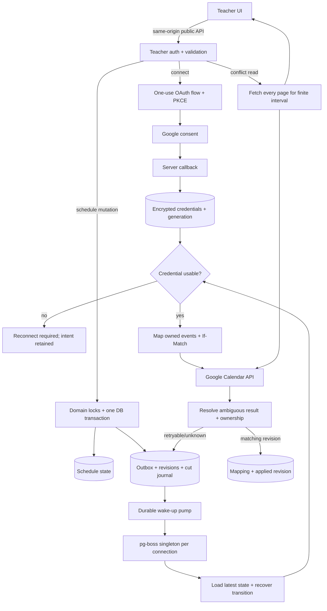

# Phase 24: Google Calendar Connection and Outbound Sync — Research

**Researched:** 2026-10-11
**Domain:** server OAuth, durable outbound Calendar synchronization, recurring-event identity.

**Local API documentation:** начать с `docs/google-calendar/READING.md`. Полные статьи находятся в `docs/google-calendar/articles/`, точные wire-схемы — в `docs/google-calendar/calendar-v3.discovery.json`. При составлении PLAN читать соответствующие статьи и указывать локальные разделы, на которых основаны решения. Снимок от 2026-10-11 сохраняет исходные URL для проверки актуальности перед исполнением.
**Confidence:** MEDIUM — результат `classify-confidence --provider websearch --verified`; реальные Google calls не выполнялись. [VERIFIED: confidence seam, 2026-10-11]

<user_constraints>

## User Constraints (from CONTEXT.md)

Следующий блок скопирован дословно из CONTEXT. [CITED: .planning/phases/24-google-calendar-connection-and-outbound-sync/24-CONTEXT.md:19-36]

## Implementation Decisions

### Принятые границы

- **D-01:** Google Calendar — источник истины в завершённой интеграции; фазы идут 21 → 21.1 → 24 → 25 → 22 → 23 → 26. Полная ручная приёмка календаря проводится после двухсторонней синхронизации.
- **D-02:** OAuth обрабатывает API. Refresh token хранится зашифрованным; браузер, URL логов и публичные артефакты его не получают. Calendar OAuth не заменяет существующий вход в приложение.
- **D-03:** Callback уже задан как `https://dv-lab.dev/api/google/callback`. Его нельзя молча заменить. Calendar API включён; заявленные scopes — `calendar.events` и `calendar.calendarlist.readonly`. Client credentials сохранены вне репозитория. При подготовке секреты не требуются и не читаются.
- **D-04:** Приложение OAuth пока в Testing. Runtime подключения не реализован. Публикация Production и проверка через 8 дней остаются настоящими внешними критериями, а не результатами локальной имитации.
- **D-05:** Каждый локальный объект получает детерминированный Google event ID. Один владелец очереди пишет актуальное состояние; клиент не запускает параллельную синхронизацию. Принята очередь `pg-boss` в PostgreSQL; исследование проверяет актуальный API, точную версию и семантику сериализации до предложения установки.
- **D-06:** Серия представлена одним recurring event, исключения — его instances. Перенос вхождения не создаёт одновременно независимое событие и изменённый instance. Cut/end сохраняют историю; прошлые уроки не размножаются.
- **D-07:** Зона берётся из урока/серии, а не из сервера. Фаза 21.1 владеет схемой зоны, core recurrence и семантикой cut. Фаза 24 потребляет их контракт и не дублирует расчёты.
- **D-08:** Локальные уроки, серии, исключения и отметки физически не удаляются. Предложение disconnect/revocation должно явно описать судьбу токенов, очереди и Google events. Подготовка не выполняет такие действия.
- **D-09:** Homepage публично описывает продукт и ведёт на privacy/terms. Privacy отражает фактические доступ, использование, хранение и передачу Calendar data. Нельзя обещать несуществующие механизмы удаления или retention. Тексты и маршруты подготавливаются локально, без публикации и смены Branding.
- **D-10:** Существующий SettingsCalendar v40 относится сразу к 24–25. В Phase 24 нельзя показывать работающие Live updates, Last full check или Events to review до реализации соответствующего поведения Phase 25.
- **D-11:** Пользователь выбрал только основной Google Calendar: «Только основной календарь». Selector и автоматическая смена target не входят в Phase 24. После подключения UI показывает фактический основной календарь. Reconnect сохраняет прежнюю identity; другой аккаунт или календарь не подменяет её молча.
- **D-12:** Disconnect останавливает dispatch, отзывает grant и очищает действующие credentials. Локальные данные, Google events, mappings и незавершённые intents сохраняются. Ошибка revoke остаётся видимым состоянием; reconnect к прежнему календарю продолжает актуальную работу.

### Инженерные решения подготовки

Исследование должно определить transaction/outbox boundary, очередь и порядок версий, restart/retry reconciliation, ID mapping серии/instance/cut, OAuth state/PKCE/session binding, envelope encryption и rotation, reconnect/refresh coordination, paginated conflict windows и E2E через реальные границы приложения. Новые внешние записи, пакеты или окружение сейчас не создаются.

</user_constraints>

## Summary

**Рекомендация:** хранить connection, encrypted credentials, mapping и durable outbox в PostgreSQL. Schedule mutation фиксирует domain change и sync intent одной транзакцией. Один worker на connection читает актуальный domain snapshot и выполняет Calendar writes. Это проектное решение на основе принятого queued writer и существующих транзакций cut/end. [CITED: .planning/phases/24-google-calendar-connection-and-outbound-sync/24-CONTEXT.md:27-30] [CITED: apps/api/src/schedule/series.ts:37-71]

Различать детерминированный ID standalone/master event и идентичность recurring instance. Google возвращает instance ID; immutable originalStartTime обозначает исходное вхождение даже после переноса. Поэтому exception получает устойчивый local key и сохранённый provider ID, а не независимый event. [CITED: https://developers.google.com/workspace/calendar/api/guides/recurringevents] [CITED: https://developers.google.com/workspace/calendar/api/v3/reference/events]

Проектирование не заблокировано реализацией 21.1. Реальное исполнение и приёмка остаются отдельными: dependency gate 21.1, package install gate, разрешённый Google test calendar, deployment/Production и проверка через восемь дней. Эти условия сейчас не доказаны. [VERIFIED: current user instruction] [CITED: .planning/phases/24-google-calendar-connection-and-outbound-sync/24-CONTEXT.md:13-15,66-70]

## Architectural Responsibility Map

Предписанная карта; rationale следует границам проекта и принятому CONTEXT. [CITED: AGENTS.md:42-95] [CITED: .planning/phases/24-google-calendar-connection-and-outbound-sync/24-CONTEXT.md:23-36]

| Capability                             | Primary Tier                        | Secondary Tier       | Rationale                                                             |
| -------------------------------------- | ----------------------------------- | -------------------- | --------------------------------------------------------------------- |
| Consent, state/PKCE, callback, refresh | API / Backend                       | PostgreSQL           | API связывает OAuth с существующей teacher session                    |
| Credential encryption и rotation       | API / Backend                       | Secret configuration | Ключи остаются вне БД; БД хранит ciphertext                           |
| Atomic domain change + sync intent     | PostgreSQL transaction              | Schedule owner       | Commit не должен оставлять изменение без durable intent               |
| Outbound reconciliation и retries      | API worker                          | pg-boss / PostgreSQL | Сериализация, версии и recovery принадлежат одному owner              |
| Calendar resource serialization        | API calendar gateway                | Google Calendar      | Google DTO не проникает в core или web                                |
| Natural dates, zones, cut/end          | Pure core / existing schedule owner | API transaction      | Контракт 21.1 уже определяет эти правила                              |
| Connection UI и conflict presentation  | Browser / Client                    | API read DTO         | Browser не хранит токены и не вызывает Google                         |
| Homepage/privacy/terms                 | Frontend Server / public routes     | Caddy                | Public routes открываются без session; private routes сохраняют guard |

## Project Constraints (from AGENTS.md)

Применять перечисленные директивы при планировании; текущий запрет исполнения задан запросом пользователя. [CITED: AGENTS.md:1-132] [CITED: .planning/EXECUTOR-RULES.md:1-45] [VERIFIED: current user scope]

- Подготовка меняет только этот RESEARCH и соседний ARCH-REVIEW. Не менять source, Git, dependencies, env, БД, Google или сервер. Не запускать build/runtime/browser/tests.
- Отчёт пользователю — по-русски. До постоянных изменений зафиксировать scope, критерии, write set, доказательство и stop condition. Каждый новый файл/проверка должен закрывать критерий.
- Сохранить module owners: environment читает loadConfig; DB URL — resolveDatabaseUrl; request/error logging — request-context; startup — server; shutdown/resources — lifecycle. Не запускать worker при импорте app.
- Core остаётся чистым, без dependencies/Node/DB. Contracts содержит только shared types/zod/constants; web не импортирует API/DB. Client обращается через apiRequest. API routes не содержат внешний proxy prefix.
- Расписание использует existing transaction/row-lock owners. Local lessons, series, exceptions и marks не удаляются. Не дублировать recurrence, cut, accounting или zone algorithms.
- PostgreSQL roles разделены. Drizzle migration генерируется штатной командой; не править generated SQL и не использовать push. Изменения релиза аддитивны. Создание extensions и DB grants принадлежит provisioning script.
- Точные версии без диапазонов; сохранить суточный Yarn age gate. Не обновлять существующий stack ради этой фазы.
- UI — существующие Base UI компоненты и утверждённый дизайн. Не добавлять Radix/cmdk/eyebrows. SettingsCalendar не объявляет готовыми функции Phase 25.
- Не публиковать credentials, callback query, ученические имена/заметки/суммы, Calendar event bodies и screenshots с такими данными в repository/evidence.
- Новые функциональные проверки — durable E2E через public interface и real persistence. Не создавать unit/component/contract/integration suites; existing tests сохраняются. Новые сценарии пишутся до проверяемого поведения.
- Для кода: simplify pass, scoped static checks; cyclomatic/cognitive <22, Halstead Difficulty <80 с методом, handwritten file <500 lines, без any и подтверждённого dead code. Не добавлять code comments. Не расширять gate до чужого кода.
- Не удалять файлы и не создавать новые окружения/платные provider calls без отдельной authority. AgentFlow suspended. Не выполнять Git/внешние действия из полномочий одного только workflow.
- Evidence содержит fingerprint, scenario/fixtures, expected/observed, статус и точную rerun command. Недоступная проверка — UNVERIFIED. Остановиться после доказанного контракта.

<phase_requirements>

## Phase Requirements

Descriptions below are verbatim. [CITED: .planning/REQUIREMENTS.md:76-86]

| ID      | Description                                                                                                                                        | Research Support                                                            |
| ------- | -------------------------------------------------------------------------------------------------------------------------------------------------- | --------------------------------------------------------------------------- |
| GCAL-01 | The teacher connects Google Calendar through a server-side OAuth flow with calendar scopes, and the refresh token is stored encrypted.             | OAuth/envelope encryption; SC1,6 и настоящий external acceptance            |
| GCAL-02 | Each lesson, series and occurrence exception has a deterministic Google event id derived from its own id, so a retry never creates a second event. | Deterministic master/single IDs; canonical instance mapping; уточнение ниже |
| GCAL-03 | Writes to Google go through a queue with a single writer per lesson.                                                                               | Atomic outbox, singleton connection worker, version/ETag guards; SC3        |
| GCAL-09 | The connection screen shows expired or revoked authorization and offers reconnect.                                                                 | Typed connection state, auth generation, refresh recovery; SC4              |
| GCAL-10 | The conflict check lists overlaps with calendar events beyond the first page of results.                                                           | Complete finite window, all pages, self-exclusion; SC5                      |

**Уточнение GCAL-02 для planner:** literal «own Google event id» для exception нельзя реализовать отдельным insert и одновременно сохранить D-06. Использовать deterministic local occurrence key → Google canonical instance ID. Не конструировать недокументированный suffix instance ID. В coverage/plan закрепить эту интерпретацию: единственное matching instance после retry. Google описывает получение instance до его изменения. [CITED: https://developers.google.com/workspace/calendar/api/guides/recurringevents]
</phase_requirements>

## Standard Stack

### Core

Это предложения установки, не установленные зависимости. Названия подтверждены official repositories; строгий VERIFIED registry tag удержан из-за SUS verdict. [CITED: https://github.com/timgit/pg-boss] [CITED: https://github.com/googleapis/google-api-nodejs-client]

| Library                                                              | Exact proposal | Purpose                                             | Published / evidence                                 |
| -------------------------------------------------------------------- | -------------- | --------------------------------------------------- | ---------------------------------------------------- |
| `pg-boss` [WARNING: flagged as suspicious — verify before using.]    | 12.37.1        | PostgreSQL queue, worker leases/retry/maintenance   | 2026-10-08T15:56:14.199Z; npm view; package gate SUS |
| `googleapis` [WARNING: flagged as suspicious — verify before using.] | 185.0.0        | Official OAuth2 client and typed Calendar v3 client | 2026-10-08T17:11:09.982Z; npm view; package gate SUS |

### Supporting — retain existing pins

Manifest baseline, не предложение обновления: `"node": ">=24"`, `"packageManager": "yarn@4.18.1"`, `"@playwright/test": "1.63.0"`, `"typescript": "6.0.3"`; API: `"hono": "4.13.13"`, `"drizzle-orm": "1.0.0-rc.4"`, `"pg": "8.23.1"`, `"zod": "4.6.5"`. [CITED: package.json:6-8,27-35] [CITED: apps/api/package.json:14-24]

Use Node crypto for authenticated encryption/randomness; preserve PostgreSQL/Drizzle and existing Playwright. Do not add a second queue, Redis, ORM, date package, OAuth browser SDK or crypto wrapper. Это решение минимального write set; Node supplies authenticated cipher primitives. [CITED: https://nodejs.org/docs/latest-v24.x/api/crypto.html]

### Alternatives Considered

| Instead of            | Rejected alternative                           | Decision                                                                                              |
| --------------------- | ---------------------------------------------- | ----------------------------------------------------------------------------------------------------- |
| Official client       | Handwritten OAuth/token and Calendar transport | Сохранить official SDK; app code владеет policy, не реализацией OAuth                                 |
| Explicit outbox       | Отдельный boss.send после domain commit        | Может потерять wake-up; сохранять intent в domain transaction                                         |
| Latest-state worker   | FIFO полных event payloads                     | Старый payload не должен откатывать новое local state                                                 |
| One connection writer | Независимые workers master и occurrence        | Cut пересекает несколько identities; connection serialization проще и достаточно для teacher calendar |

Решения основаны на CONTEXT и documented singleton policy. [CITED: .planning/phases/24-google-calendar-connection-and-outbound-sync/24-CONTEXT.md:27-36] [CITED: https://raw.githubusercontent.com/timgit/pg-boss/12.37.1/docs/api/queues.md]

**Installation — only after dependency authority and package checkpoint:**

```sh
yarn workspace @dv-lab/api add --exact pg-boss@12.37.1 googleapis@185.0.0
```

Это будущая команда, сейчас не выполнялась. Before execution repeat registry/legitimacy/age checks; do not disable Yarn age gate. [VERIFIED: current user scope]

## Package Legitimacy Audit

Executed seam and npm metadata queries on 2026-10-11; no install. Official repositories identify both packages, but seam returned SUS for latest publication age. Absence of postinstall metadata is recorded only as that observation, not a safety or compatibility guarantee. [CITED: https://github.com/timgit/pg-boss] [CITED: https://github.com/googleapis/google-api-nodejs-client] [VERIFIED: package-legitimacy seam output, 2026-10-11]

| Package    | Registry | Package age / release age                | Weekly downloads | Source Repo                                    | Verdict      | Disposition                                           |
| ---------- | -------- | ---------------------------------------- | ---------------: | ---------------------------------------------- | ------------ | ----------------------------------------------------- |
| pg-boss    | npm      | Created 2016-03-18; release about 3 days |        2,615,763 | github.com/timgit/pg-boss                      | SUS: too-new | Keep proposed; checkpoint:human-verify before install |
| googleapis | npm      | Created 2012-09-18; release about 3 days |       10,854,397 | github.com/googleapis/google-api-nodejs-client | SUS: too-new | Keep proposed; checkpoint:human-verify before install |

**SLOP removed:** none. **SUS flagged:** both. These verdicts do not assert maliciousness. Declared Node constraints are respectively `>=22.12.0` and `>=22.0.0`; Node >=24 satisfies these present ranges. No runtime compatibility probe was permitted. [CITED: https://registry.npmjs.org/pg-boss/12.37.1] [CITED: https://registry.npmjs.org/googleapis/185.0.0]

Verification commands:

```sh
node /Users/kdvornichenko/.codex/gsd-core/bin/gsd-tools.cjs query package-legitimacy check --ecosystem npm pg-boss googleapis
npm view pg-boss version engines repository.url scripts.postinstall time --json
npm view googleapis version engines repository.url scripts.postinstall time --json
```

All completed exit 0. Postinstall field absent for both in returned metadata; no scripts were executed. [VERIFIED: command results, 2026-10-11]

## API Capability Coverage — plan:pre

Proposed application endpoints below are NEW contracts. Google endpoint facts and scope names come from official references. Every Calendar write, including instance cancellation and retry recovery patch, passes the queued writer; OAuth token exchange/revoke is a separate connection protocol owner. [CITED: https://developers.google.com/workspace/calendar/api/v3/reference] [CITED: https://developers.google.com/identity/protocols/oauth2/web-server]

Full requested scopes: `https://www.googleapis.com/auth/calendar.events` and `https://www.googleapis.com/auth/calendar.calendarlist.readonly`. Do not add broad calendar, identity, Drive, or Gmail scopes. [CITED: https://developers.google.com/workspace/calendar/api/auth] [CITED: .planning/phases/24-google-calendar-connection-and-outbound-sync/24-CONTEXT.md:25-25]

| App entry / owner                                 | Google capability                                                        | Scope                          | SC / disposition                                                              |
| ------------------------------------------------- | ------------------------------------------------------------------------ | ------------------------------ | ----------------------------------------------------------------------------- |
| POST /google/connect                              | GET accounts.google.com/o/oauth2/v2/auth; server creates flow/state/PKCE | Both requested scopes          | SC1                                                                           |
| GET /google/callback                              | POST oauth2.googleapis.com/token; authorization code + verifier          | Granted scopes checked         | SC1; external callback remains https://dv-lab.dev/api/google/callback         |
| Connection credential owner                       | POST oauth2.googleapis.com/token; refresh grant                          | Existing grant                 | SC1,4                                                                         |
| GET /google/connection                            | Local DTO; CalendarList list during connection validation                | calendar.calendarlist.readonly | SC4; resolved calendar identity/accessRole                                    |
| POST /google/disconnect; connection control owner | POST oauth2.googleapis.com/revoke                                        | OAuth grant                    | SC4; preserve Google events/intents, stop dispatch and clear live credentials |
| Worker ensure standalone/master                   | POST /calendar/v3/calendars/{calendarId}/events                          | calendar.events                | SC2,3; deterministic ID                                                       |
| Worker resolve/retry/update                       | GET and PATCH /calendar/v3/calendars/{calendarId}/events/{eventId}       | calendar.events                | SC2,3; ownership, ETag, idempotency                                           |
| Worker occurrence lookup                          | GET /calendar/v3/calendars/{calendarId}/events/{eventId}/instances       | calendar.events                | SC2; canonical ID/originalStartTime; all pages                                |
| POST /google/conflicts                            | GET /calendar/v3/calendars/{calendarId}/events                           | calendar.events                | SC5; timeMin/timeMax, singleEvents, pageToken                                 |
| Public /welcome, /privacy, /terms                 | No Google API call                                                       | None                           | SC6; /welcome is proposed Branding homepage; deployed links verified later    |

Methods supported by the cited references: CalendarList.list, Events.insert/get/patch/instances/list; conditional modification is documented separately. [CITED: https://developers.google.com/workspace/calendar/api/v3/reference/calendarList/list] [CITED: https://developers.google.com/workspace/calendar/api/v3/reference/events/insert] [CITED: https://developers.google.com/workspace/calendar/api/v3/reference/events/get] [CITED: https://developers.google.com/workspace/calendar/api/v3/reference/events/patch] [CITED: https://developers.google.com/workspace/calendar/api/v3/reference/events/instances] [CITED: https://developers.google.com/workspace/calendar/api/v3/reference/events/list] [CITED: https://developers.google.com/workspace/calendar/api/guides/version-resources]

| Explicit exclusion                                                                                                         | Owner / reason                                        |
| -------------------------------------------------------------------------------------------------------------------------- | ----------------------------------------------------- |
| events.watch, channels.stop/renewal, syncToken/410 full resync                                                             | Phase 25; no webhook or inbound scheduler in 24       |
| Inbound title matching, assign/ignore, Google-wins merging, nightly full reconciliation                                    | Phase 25; do not expose active controls now           |
| events.import/move/quickAdd, calendars/ACL management, attendees/invitations, Meet creation, attachments, Gmail/Drive APIs | Outside product scope in this phase                   |
| events.delete for disconnect or bulk cleanup                                                                               | Not planned; disconnect must not erase remote history |
| Generic «whole Google API coverage» implementation                                                                         | Not required; this table covers accepted SC only      |

Exclusion scope is from CONTEXT, not an assertion that Google lacks these APIs. [CITED: .planning/phases/24-google-calendar-connection-and-outbound-sync/24-CONTEXT.md:15,30-32] This table is input for the parent-owned canonical COVERAGE.md; no third file is created here. [VERIFIED: current user instruction]

## Architecture Patterns

All NEW signatures, tables, state names and proposed paths below are implementation prescriptions, not claims about existing source. Official/source citations explain their basis.

### System Architecture Diagram



### 1. OAuth, encryption and reconnect

**Protocol facts:** Google web-server flow supports offline access; refresh credentials must remain server-side. OAuth security BCP describes PKCE and exact redirect matching. Google recommends secure token storage and handling revocation. [CITED: https://developers.google.com/identity/protocols/oauth2/web-server] [CITED: https://www.rfc-editor.org/rfc/rfc9700.html] [CITED: https://developers.google.com/identity/protocols/oauth2/resources/best-practices]

Prescribe:

1. POST connect requires existing teacher session and normal Origin guard. Store a random state digest, session binding, account identity/epoch, expiration and encrypted PKCE verifier in a one-use DB flow.
2. Use exact configured callback, S256 PKCE, offline access and the two scopes. Reconnect may request consent when a new refresh token is needed; normal reads must not start a consent loop.
3. GET callback is cross-site navigation: verify teacher session, one-use state, expiration, binding, exact redirect and granted scopes before saving credentials. Atomically consume the flow before exchange; an ambiguous exchange requires a new flow. Return a fixed application redirect with no OAuth query.
4. Keep the old working connection until a replacement grant is validated against the bound calendar. A failed reconnect must not overwrite it. Omitted refresh_token must not clear a valid bound refresh token.
5. Envelope-encrypt refresh/access credentials and PKCE secret: random data key, authenticated encryption with fresh nonce per write, wrapped data key plus key ID. Bind ciphertext to account, connection, purpose and format version using AAD. Keys exist only in secret config. Rewrap data keys during KEK rotation; retain old decrypt keys until migration is verified.
6. Serialize credential refresh per connection using a DB-coordinated owner, not an in-process promise alone. Use a short bounded network timeout and generation compare-and-set. Revoked/invalid grant pauses Calendar dispatch and exposes reconnect; transient transport errors retain pending work.
7. Reconnect to the same bound calendar keeps connection/mapping identity and increments auth generation. Stale workers cannot persist tokens or ack a new generation. Switching calendar/account requires an explicit UI decision; never silently adopt the new primary calendar.

Node provides authenticated cipher/tag/AAD APIs; app policy must define storage and key rotation. This is not a claim of certified compliance. [CITED: https://nodejs.org/docs/latest-v24.x/api/crypto.html]

**Logging seam:** API request logger writes `path: c.req.path`; Caddy currently enables `log { format json }`. Redact callback query in proxy access logs as well as API errors; never serialize raw SDK request/response/error objects. Caddy supports URI query filtering. [CITED: apps/api/src/request-context.ts:47-54] [CITED: deploy/caddy/Caddyfile:16-19] [CITED: https://caddyserver.com/docs/caddyfile/directives/log] Set callback no-store and no-referrer; expose only sanitized error codes and request ID.

**Disconnect engineering decision:** explicit Disconnect pauses dispatch immediately, increments generation and retains mappings/history/unsent intents. Drain or resolve the in-flight connection operation, revoke the grant through the connection owner, then clear stored credential ciphertext and in-memory credentials. A failed revoke remains a visible disconnecting/error state with encrypted credentials usable only for revocation retry; do not continue Calendar writes or report completion. No Google event or local lesson is deleted. A later authorized reconnect to the same bound calendar reconciles latest local state and unfinished transitions, not stale queued payloads. Token clearing does not promise immediate removal from backups. This is the conservative implementation of the existing Disconnect design and no-delete boundary; it needs no separate choice between retaining and deleting calendar history. Calendar target policy alone remains A1. [CITED: .planning/phases/24-google-calendar-connection-and-outbound-sync/24-UI-SPEC.md:151-164,335-335] [CITED: .planning/phases/24-google-calendar-connection-and-outbound-sync/24-CONTEXT.md:30-30]

### 2. Atomic outbox and latest-state writer

**Facts:** pg-boss singleton policy limits active work; localConcurrency is process-local. Default start can install/migrate pg-boss schema. Queue completion does not make a remote HTTP side effect part of a PostgreSQL transaction. [CITED: https://raw.githubusercontent.com/timgit/pg-boss/12.37.1/docs/api/queues.md] [CITED: https://raw.githubusercontent.com/timgit/pg-boss/12.37.1/docs/api/workers.md] [CITED: https://raw.githubusercontent.com/timgit/pg-boss/12.37.1/docs/api/ops.md]

Prescribe:

- Add app-owned connection, OAuth-flow, mapping, sync-intent and transition-journal tables. Unique constraints bind a local identity and selected calendar to one provider identity. Mapping records desired/applied revisions, provider ID, ETag and payload digest; outbox carries IDs/revisions only.
- In every relevant schedule transaction increment the aggregate revision and upsert durable intent. Include create/move/cancel/restore, cut/end and any change to fields projected to the event. Marks remain local accounting; they trigger Calendar work only when cut detaches an occurrence.
- Do not acknowledge durable intent merely because boss.send succeeded. A pump re-wakes pending/in-flight/unknown intents at startup and after incomplete attempts; it is scoped delivery recovery, not Phase 25's provider-wide nightly reconcile.
- Queue policy singleton; singletonKey is stable connection ID. This serializes master, instances, detached lessons and reconnect transitions together. Start with batchSize 1 and localConcurrency 1, while relying on DB policy for multiple API processes.
- Job data selects work; it does not contain the event payload to replay. Worker reads current revision/domain projection. Coalesce obsolete ordinary revisions, but never discard unapplied cut-journal steps.
- Use conditional provider writes and compare-and-set ack for the same connection generation/revision. If state advances during a request, keep dirty and reconcile again. An old response must not clear a new pending revision.
- Treat timeouts/lost responses as unknown outcome. Resolve by deterministic ID/ownership/ETag before proceeding. Bounded retry with backoff and jitter lives in this owner; disable independent mutation retry loops in browser and SDK transport.
- Record transition progress before/after each remote stage. Exhausted retries expose a sanitized actionable state and retain the intent. Reconnect wakes all unresolved work.
- Stop worker/pump before pool close through existing lifecycle resources. Pass abort/deadline through Google calls; provider success after local timeout still requires reconciliation.

### 3. pg-boss role and lifecycle boundary

Existing DB role names are `'app' | 'migrator'`; their env mapping is `{ app: 'DATABASE_URL', migrator: 'MIGRATOR_DATABASE_URL' }`. Provisioning currently grants app table privileges in schema public. [CITED: packages/db/src/connection.ts:5-7] [CITED: deploy/postgres/ensure-db.sql:31-34]

Prescribe a dedicated pg-boss schema owned by the migrator. The migration CLI installs/upgrades its schema and creates queues under the migration role. Runtime uses the app role with scoped DML/sequence privileges and with migrate/createSchema/reindex disabled; do not grant runtime CREATE/ownership to make defaults work. Do not weaken existing lesson/mark deletion restrictions. Inventory the selected version's functions/maintenance privileges before applying grants. A clean DB E2E must show runtime startup and retry/maintenance under these roles.

Relevant options `migrate`, `createSchema`, `reindex`, `supervise` are documented; migrate false rejects an outdated schema instead of upgrading it. Do not use supervise false in production merely to avoid permission failures: that also disables maintenance. [CITED: https://raw.githubusercontent.com/timgit/pg-boss/12.37.1/docs/api/constructor.md] Lifecycle already accepts `resources: Closable[]` and closes them in order. [CITED: apps/api/src/lifecycle.ts:3-3,21-25,71-77]

### 4. Deterministic Google identities and event representation

Google accepts event IDs with lowercase a–v and digits 0–9, length 5–1024; recurrence expansion uses the named zone. originalStartTime remains the natural occurrence identity after a move. [CITED: https://developers.google.com/workspace/calendar/api/v3/reference/events]

Prescribe:

- Standalone/master ID = a fixed valid prefix plus SHA-256 hex of a canonical length-safe serialization of stable connection identity, bound calendar ID, entity kind and immutable local ID. Hex is within Google's alphabet. Auth generation/default zone/time/title never enter this identity.
- Store a small private ownership marker, local identity, schema version and revision/digest. No student names or secrets in markers. A 409 insert is not success until GET confirms matching ownership; an unrelated event with that ID is an error, not an overwrite.
- Single: start instant, end = instant + duration, stored creation zone. Master: first actual canonical occurrence, stored rule zone, weekly RRULE and optional UTC UNTIL for the final canonical occurrence. Do not put DTSTART/DTEND into recurrence array; use start/end.
- Instance: lookup using parent ID plus original natural instant; persist returned instance ID/originalStartTime. instances lookup must include moved/cancelled exceptions and pagination; use originalStart when supported by the endpoint rather than assuming effective time equals natural time.
- Move/cancel/restore modifies this canonical instance with conditional PATCH. Cancellation uses provider status and restore supplies full intended temporal fields; cancelled resources can be sparse.
- Initial connect/reconnect scans existing canonical local entities and pending transitions to fill missing mappings. It does not title-match or import externally created events. Skip invisible historical exceptions under core rules; never manufacture a second event for a moved instance.

Provider fields/methods above are documented by Events resource, insert and instances references. [CITED: https://developers.google.com/workspace/calendar/api/v3/reference/events/insert] [CITED: https://developers.google.com/workspace/calendar/api/v3/reference/events/instances] Payload conventions and hash input are NEW design choices.

### 5. Exact dependency on Phase 21.1

Canonical dependency: sibling worktree `phase-21-1-default-time-zone/dv-lab`, research sections 4–6 and Stable Interface, plus AR-03. These are accepted planning prescriptions, not implemented types. Paths below are relative to this worktree root. [CITED: ../../phase-21-1-default-time-zone/dv-lab/.planning/phases/21.1-default-time-zone/21.1-RESEARCH.md:171-246,414-432] [CITED: ../../phase-21-1-default-time-zone/dv-lab/.planning/phases/21.1-default-time-zone/21.1-ARCH-REVIEW.md:68-88] [VERIFIED: current user instruction]

| Exact contract                                                                                | Phase 24 consumption                                                                                          |
| --------------------------------------------------------------------------------------------- | ------------------------------------------------------------------------------------------------------------- |
| TeacherSettings.defaultTimeZone                                                               | Current account input/display/accounting zone only. Setting change creates no sync reschedule or ID changes   |
| SeriesRule/ScheduleSeries.timeZone                                                            | Immutable creation/rule zone. Serialize RRULE in this zone                                                    |
| SingleLesson/ScheduleLesson/ScheduleBlock.timeZone                                            | Immutable creation zone; startsAt remains an instant                                                          |
| `{ kind: 'series'; seriesId: string; originalOn: string }`                                    | originalOn is natural date in stored series zone, even when moved                                             |
| `{ kind: 'single'; lessonId: string }`                                                        | Stable standalone identity until an explicit new lesson is created                                            |
| Cut success `{ kind: 'ok'; oldEndsOn: string; newRule: NewSeriesRule; lessons: CutLesson[] }` | Extend newRule and CutLesson with timeZone; preserve CutLesson.originalOn lineage                             |
| `type LocalTimeCandidates = readonly Date[]`                                                  | Canonical proposed alias from 21.1                                                                            |
| `localTimeCandidates(date: string, time: string, zone: string): LocalTimeCandidates`          | Core resolver owns DST; Calendar adapter consumes its result                                                  |
| `startOfZonedDay(date: string, zone: string): Date`                                           | Convert selected display-day boundaries through core; never use server zone                                   |
| Cut/end preserved tail                                                                        | New lesson IDs, same previous instant/duration/mark/old zone; old natural key maps to each inserted lesson ID |
| DST                                                                                           | Manual gap rejected; fold chooses first instant; recurrence gap skipped. No zone algorithm in sync            |

Existing ref union is quoted verbatim above from source; its future timeZone additions come only from the accepted dependency. [CITED: packages/contracts/src/schedule.ts:66-67]

**Cut/end mapping algorithm — Phase 24 owner:**

1. 21.1 interprets from/lastOn in current default, resolves boundary instant, then finds old natural cutoff. New weekly rule uses entered weekday/time directly in current default. Finite old end is carried through an exclusive instant boundary. Do not recalculate any of these inside calendar sync.
2. In the same transaction, make keepCutLessons return inserted IDs paired with CutLesson.originalOn. Persist lineage: old series ID + originalOn → new lesson ID + old creation zone + preserved instant. Append old master boundary and optional new series ID to a durable transition journal.
3. Before trimming the old remote master, resolve relevant old instances and capture owned exception state/ETags needed by the transition. Preserve old natural prefix under the old master ID. Existing moved/marked tail can have effective time in the past; its effective instant does not change which side of the natural cutoff owns it.
4. Serialize the transition per connection. First remove/cancel old tail representations that must become standalone; then shorten the old master; then ensure detached standalone events and the new master using deterministic IDs. Checkpoint each stage. A temporary pending gap is recoverable; do not insert the new representation while the old ambiguous representation can still be active.
5. Re-read after master patch and replay still-valid owned prefix exceptions if provider behavior changed them. End with a provider read proving one active representation per canonical entity and preserved prefix history. If the old local series is empty, cancel its master rather than emitting an invalid recurrence.
6. Retry resumes the journal; it never re-runs the local cut or creates more local lessons. Coalesce later edits only after this identity transition is reconciled.

The persistence seam is concrete: current keepCutLessons inserts lessons and copies a mark using originalOn but returns no mapping; moveSeries/endSeries invoke it inside their transactions. [CITED: apps/api/src/schedule/series.ts:20-34,37-71] Google warns against updating every instance individually for a whole-series change. The staged split above is this research's design; the consulted guide does not prove its history-retention behavior. Real provider history/exception retention remains the A3 E2E gate. [CITED: https://developers.google.com/workspace/calendar/api/guides/recurringevents]

### 6. Conflicts and error recovery

events.list uses timeMin as lower bound for event end and timeMax as upper bound for event start. A result page may contain fewer than maxResults while still having nextPageToken. [CITED: https://developers.google.com/workspace/calendar/api/v3/reference/events/list]

Prescribe a finite half-open instant interval and fetch every page with fixed query parameters. Expand recurrence with singleEvents; compare strict overlap; exclude only exactly mapped own events/instances for the edited ref. Do not exclude an entire series when moving one occurrence. Ignore cancelled and transparent events for blocking; respect all-day date boundaries in the calendar's zone. Return checked interval and completeness. On page failure return unavailable/incomplete, never «no conflicts».

For an unbounded local series, request a finite check-through date and display it. The UI-SPEC resolves this engineering input: empty Check through, explicit inclusive last date, no hidden horizon; bounded series use their whole finite range. Before selection, no Google check and no clean result; local saving remains available under the accepted nonblocking rule. Use core occurrences for proposed local intervals, and include the full end of each candidate lesson in the fetched union interval. Do not copy weekly math into the gateway. A2 is resolved by this UI contract. [CITED: .planning/phases/24-google-calendar-connection-and-outbound-sync/24-UI-SPEC.md:176-198,341-341]

| Response / condition                                               | Prescribed behavior                                                                     |
| ------------------------------------------------------------------ | --------------------------------------------------------------------------------------- |
| 401 access failure                                                 | One coordinated refresh, then retry through owner; persistent invalid grant → reconnect |
| 403 rateLimitExceeded or userRateLimitExceeded; 429; transient 5xx | Bounded backoff/jitter; preserve intent and optional server Retry-After                 |
| 403 insufficient permission/scope                                  | Connection/calendar access error; no blind rate-limit loop                              |
| 409 insert                                                         | GET deterministic ID; verify ownership and reconcile latest                             |
| 412 If-Match                                                       | GET latest; distinguish acknowledged own write from unknown external edit               |
| 404 mapped resource                                                | Resolve identity/calendar access; do not silently insert a new random ID                |
| Timeout/connection loss                                            | Unknown outcome, read/reconcile before ack                                              |
| Unexpected external edit                                           | Preserve data, show actionable sync error; Google-wins import is Phase 25               |

HTTP/error semantics and conditional update come from Google; the handling policy is the proposed owner contract. [CITED: https://developers.google.com/workspace/calendar/api/guides/errors] [CITED: https://developers.google.com/workspace/calendar/api/guides/version-resources]

### 7. Public homepage without moving Today

Current root page renders Today; its route-group layout requires a session and also owns student landing. Route groups do not add a URL segment, and two pages resolving to the same URL conflict. [CITED: apps/web/app/(app)/page.tsx:14-17] [CITED: apps/web/app/(app)/layout.tsx:11-27] [CITED: https://nextjs.org/docs/app/api-reference/file-conventions/route-groups]

Use the UI-SPEC's public /welcome, /privacy and /terms pages outside the authenticated route group. Use https://dv-lab.dev/welcome as the proposed OAuth Branding homepage URL; keep Today at its existing root URL. Add these exact public paths to the proxy allowlist; do not make the root or the authenticated group public. Public pages are static and must not depend on a working session API. The homepage links privacy/terms and sign-in. Deployment/Branding acceptance remains SC6 external evidence. Google requires an accessible application homepage describing the app and linked policy pages; the application selects its route. [CITED: .planning/phases/24-google-calendar-connection-and-outbound-sync/24-UI-SPEC.md:253-263] [CITED: https://developers.google.com/identity/protocols/oauth2/production-readiness/brand-verification] [CITED: https://developers.google.com/identity/protocols/oauth2/policies]

### 8. Safe UI snapshot and exact privacy data flows

This closes engineering dependencies D2/D3/D4 in the UI draft. It defines future contracts, not observed production behavior. UI-owned files remain unchanged. The UI already requires two separate axes for connection and sync, safe calendar labels, complete conflict results and no raw provider content. [CITED: .planning/phases/24-google-calendar-connection-and-outbound-sync/24-UI-SPEC.md:137-198,277-294,330-341]

**New proposed DTOs** belong to packages/contracts. Loading/read failure/consent navigation are browser states, not fabricated successful snapshots. Validate all provider data at the gateway; no `any` or raw provider DTO escapes.

```ts
type CalendarIssue =
	| 'consent_denied'
	| 'invalid_callback'
	| 'scope_missing'
	| 'wrong_calendar'
	| 'provider_unavailable'
	| 'external_change'
	| 'write_failed'
	| 'disconnect_failed'

type GoogleConnectionSnapshot = {
	asOf: string
	connection: {
		state: 'not_connected' | 'connected' | 'reconnect_required' | 'permission_required' | 'disconnecting'
		calendar: { id: string; label: string; timeZone: string } | null
		issue: CalendarIssue | null
	}
	sync: {
		state: 'idle' | 'queued' | 'writing' | 'paused' | 'error'
		pendingCount: number
		issue: CalendarIssue | null
	} | null
}

type GoogleConflictInterval =
	| { kind: 'timed'; startsAt: string; endsAt: string; timeZone: string }
	| { kind: 'all_day'; startsOn: string; endsBefore: string; timeZone: string }

type GoogleConflictResult = {
	inputKey: string
	checkedRange: { startsAt: string; endsAt: string; displayTimeZone: string }
	complete: true
	conflicts: { id: string; title: string | null; interval: GoogleConflictInterval }[]
}
```

All string literals above are NEW proposed wire values. Dates/instants use the existing contracts validation conventions; future declarations must use the authoritative validated date schemas. These types do not prescribe an identity scope or a Google account email.

- GET /google/connection returns the snapshot from one consistent DB read. Not connected has calendar/sync null; it never invents zero pending work during a failed read. A disconnected record may retain internal mappings/intents, hidden from this UI state.
- pendingCount counts distinct current connection sync-intent rows not fully acknowledged, including paused/failed rows. Coalesced edits are one pending target; wake-up jobs are not changes. A transition keeps its parent intent pending until every required stage is reconciled.
- Connected with sync error is distinct from revoked credentials. Reconnect-required/permission-required keeps the bound calendar and paused pending work. Disconnecting disables new dispatch and remains visible until revocation/credential clearing finishes.
- POST /google/disconnect is a teacher/Origin-protected NEW endpoint. It starts the generation-bound control operation; GET snapshot reports its progress. Completing it does not discard unsent intents. Reconnect reuses stable mapping identity only for the same calendar.
- Callback returns only a fixed /settings?tab=calendar destination with a server-selected safe outcome. No arbitrary return URL, code/state/token/provider description. UI reads snapshot to prove connected; no success flag alone grants that state.
- POST /google/conflicts returns GoogleConflictResult only after every page and every requested candidate interval is covered. inputKey identifies the current validated form projection. Error/incomplete/not-connected uses the normal typed API error path, never a partial result with complete true. All-day endsBefore and checkedRange.endsAt are exclusive.
- Filter fetched results against the union of proposed lesson intervals, not merely their enclosing span; an unrelated event between weekly lessons is not a conflict. A busy event overlapping several candidate lessons retains the corresponding dates in presentation. Calendar lookup reads only the selected bound calendar.

**Payload/storage/recipient contract for privacy copy:**

| Data / flow                 | Exact proposed content and destination                                                                                                                                                        | Persistence/lifecycle                                                                                                                                                                                                  |
| --------------------------- | --------------------------------------------------------------------------------------------------------------------------------------------------------------------------------------------- | ---------------------------------------------------------------------------------------------------------------------------------------------------------------------------------------------------------------------- |
| Consent and token exchange  | OAuth client ID, exact callback, two scopes, random state, S256 challenge; code/verifier to Google token endpoint                                                                             | Browser sees consent URL/code redirect only; server consumes flow; callback query is removed and redacted                                                                                                              |
| Flow record                 | State digest, bound session/account epoch, expiration, encrypted verifier, consumed flag                                                                                                      | Verifier ciphertext cleared after consumption or expiration handling; expired/used flow never authorizes another exchange                                                                                              |
| Credentials                 | Refresh/access token ciphertext, wrapped data key, nonce/tag, key ID, expiry, generation                                                                                                      | Server DB only; plaintext exists only for bounded crypto/HTTP work; reconnect CAS replaces validated credentials; Disconnect clears live stored credentials after revocation                                           |
| Calendar discovery          | Calendar ID, summary label, timeZone, primary flag, accessRole                                                                                                                                | Keep bound target metadata only; unselected list entries remain request-scoped; no identity/profile scope                                                                                                              |
| Outbound lesson event       | summary from the canonical student display name; start/end instants and stored creation zone; weekly recurrence when applicable; cancellation status; opaque local ownership/revision markers | Sent to Google Calendar and stored there. Student notes, payment amounts, balances, passwords and lesson marks are not event fields                                                                                    |
| Excluded event fields       | No description, attendee list/email, location, attachments, conference links, payment/ledger data or copied student notes                                                                     | Do not serialize these fields merely because the SDK permits them                                                                                                                                                      |
| Mapping and delivery state  | Opaque local/provider IDs, natural occurrence identity, ETag, revision/digest, timestamps, cut lineage and per-stage result                                                                   | Server DB; retain mapping/history across disconnect for idempotency; one current intent per target, no stale event-body jobs                                                                                           |
| Queue payload/output/error  | Connection/target/transition identifiers and revisions; sanitized result/error category                                                                                                       | PostgreSQL queue; no token, student title/note or provider response body. Catch and sanitize SDK exceptions before handing errors to pg-boss. Queue maintenance is operational; no invented universal retention period |
| Conflict/verification reads | Event ID, permitted summary, start/end or all-day dates, calendar zone, status/transparency, originalStartTime/recurringEventId; ETag/ownership only when needed for write verification       | Request/worker memory only for raw event bodies; no persistent full-event cache in this design. Mapping/journal stores normalized identity/temporal/ETag facts needed for recovery                                     |
| Browser conflict DTO        | Permitted plain-text title or null/Busy, event ID, timed/all-day interval, checked range                                                                                                      | Only teacher session; no description, attendees, conference URL, raw payload, credentials or provider error text                                                                                                       |
| Logs and evidence           | Request ID, operation class, duration/status, sanitized error category and bounded counts                                                                                                     | No OAuth query, token, student name, Calendar title/body or email-shaped calendar ID. Retention must follow verified deployment settings                                                                               |
| Backup/operator boundary    | Server persistence may enter the existing backup/operations boundary                                                                                                                          | No promise of immediate backup erasure or zero operator access; verify actual operator/backup facts before publishing the policy                                                                                       |

Outbound summary uses the existing canonical display field `studentName: string`, whose source contract is quoted here; this is a deliberate minimal Calendar payload choice for the planned feature. [CITED: packages/contracts/src/schedule.ts:75-83] Calendar resource fields and private extended properties are documented by Google; the application chooses this subset. [CITED: https://developers.google.com/workspace/calendar/api/v3/reference/events] UI conflict presentation explicitly excludes description/attendee/conference/raw data. [CITED: .planning/phases/24-google-calendar-connection-and-outbound-sync/24-UI-SPEC.md:190-198]

Privacy must explicitly disclose that student display names and lesson timing/recurrence are sent to Google. Server stores credentials and linkage/delivery records; raw conflict bodies are not persisted by the proposed feature. Named recipients of this feature are Google, the authenticated teacher's browser and the app's server/database operations boundary. Do not claim global “no sharing”, an arbitrary retention period, automatic backup erasure or legal certification. Reconcile actual deployed logging/backups before publication; this is an execution disclosure check, not another product choice. Google requires policy content to match actual data access, use, storage and sharing. [CITED: https://developers.google.com/identity/protocols/oauth2/production-readiness/brand-verification] [CITED: https://developers.google.com/identity/protocols/oauth2/policies]

Proposed Disconnect disclosure basis for the UI owner: local lessons and Google events stay; synchronization stops; live credentials are cleared after revoke; unsent changes wait and the latest state resumes only after authorized reconnect to the same calendar. Do not say pending changes were sent, deleted, or immediately removed from backups. A1 chooses the initial calendar target only.

### Component Responsibilities and Planned Write Set

All new paths below are proposals. Existing-owner paths identify extension points, not permission to edit during research.

| Owner / proposed files                                                    | Signature or invariant                                                                                          | Criteria              |
| ------------------------------------------------------------------------- | --------------------------------------------------------------------------------------------------------------- | --------------------- |
| packages/contracts/src/calendar.ts; index/auth exports                    | New strict request/response schemas and sanitized error codes; no tokens/Google DTOs                            | SC1,4,5               |
| packages/db/src/schema.ts; generated migration                            | Connection/flow/mapping/outbox/journal constraints, encrypted fields, generation/revisions                      | SC1–4                 |
| apps/api/src/calendar/connection.ts, credentials.ts                       | Begin/complete consent, coordinated refresh, encrypted storage, generation checks                               | SC1,4                 |
| apps/api/src/calendar/gateway.ts, event-mapping.ts                        | Sole Google client; local projection → provider; conditional writes and instance identity                       | SC2,5                 |
| apps/api/src/calendar/outbox.ts, worker.ts, transitions.ts                | recordCalendarChange(tx, accountId, refs, transition); start/close worker; latest state and staged cut recovery | SC2,3                 |
| apps/api/src/schedule/{schedule,changes,series}.ts                        | Same-transaction intent; keepCutLessons returns lineage using new persisted IDs                                 | SC2,3                 |
| apps/api/src/routes/google.ts; app.ts                                     | Teacher-only entry points and callback; no startup side effects                                                 | SC1,4,5               |
| apps/api/src/{config,server,lifecycle,migrate}.ts                         | Validated config, explicit resource ownership, migration role setup, orderly shutdown                           | SC1,3                 |
| deploy/postgres/ensure-db.sql; env examples; compose wiring               | Queue schema privileges and names-only config wiring; no live action                                            | SC1,3                 |
| deploy/caddy/Caddyfile                                                    | OAuth query redaction without changing address trust/proxy ownership                                            | SC1                   |
| apps/web settings/schedule existing screen owners; lib/api-client.ts      | Connection DTO/reconnect, explicit conflict range/completeness                                                  | SC4,5                 |
| Proposed apps/web/app/{welcome,privacy,terms}/page.tsx; existing proxy.ts | Public homepage/policy allowlist; preserve root Today and authenticated layout                                  | SC6                   |
| e2e existing journeys and public-flow fixture owner                       | Add scenarios before behavior; no new isolated suite                                                            | All local SC evidence |
| apps/api/package.json; yarn.lock                                          | Only approved exact dependencies after package checkpoint                                                       | SC1–3                 |

Actual current shutdown hook is `type Closable = { name: string; close: () => Promise<void> }`. New worker exposes this shape. [CITED: apps/api/src/lifecycle.ts:3-3] Actual existing DB transaction boundary is `type DbExecutor = Database | Transaction`; proposed outbox function receives it, not its own connection. [CITED: packages/db/src/connection.ts:28-32]

### Anti-Patterns to Avoid

- No Google call inside a schedule transaction or from the browser.
- No generic event bus/platform, separate cron service or Redis.
- No token refresh in multiple uncoordinated SDK instances.
- No success ack on queue insertion, 409 or a partial conflict page.
- No recurrence conversion using current default after creation.
- No current code claim for 21.1's proposed fields.
- No «connected email» derived from an unrequested identity scope; show resolved calendar label/ID.
- No public privacy promise that differs from implemented storage/revocation behavior.

These are prescribed guards for the accepted failure modes, not claims that the current code already has those faults. [CITED: .planning/phases/24-google-calendar-connection-and-outbound-sync/24-CONTEXT.md:57-68]

## Don't Hand-Roll

| Problem                            | Don't build                                  | Use instead                                                          | Why                                 |
| ---------------------------------- | -------------------------------------------- | -------------------------------------------------------------------- | ----------------------------------- |
| Queue acquisition/retry            | Timer-only or in-memory queue                | pg-boss plus small transactional intent record                       | Documented distributed queue policy |
| OAuth protocol/Calendar wire types | Ad hoc grant client and browser SDK          | Official googleapis OAuth2/Calendar client                           | Official typed interface            |
| Encryption primitive               | Custom cipher/hash-based encryption          | Node authenticated crypto plus explicit envelope policy              | Standard primitive/API              |
| DST/cut/ledger rules               | Google-specific parallel schedule engine     | Accepted Phase 21.1 core and schedule owner                          | One canonical domain                |
| Schema deployment                  | Runtime DDL or handwritten Drizzle migration | Existing generated migration/role pipeline plus pg-boss migrator API | Preserve privilege boundary         |

Sources: pg-boss official queue docs, Google client README, Node crypto and accepted 21.1 contract. [CITED: https://raw.githubusercontent.com/timgit/pg-boss/12.37.1/docs/api/queues.md] [CITED: https://github.com/googleapis/google-api-nodejs-client] [CITED: https://nodejs.org/docs/latest-v24.x/api/crypto.html] [VERIFIED: current user dependency instruction]

## Runtime State Inventory

Phase 24 adds synchronization and DB schema to existing schedule state; the five categories below distinguish source work from external state. No runtime inventory was authorized. [VERIFIED: current user scope]

| Category                             | Items found / evidence limit                                                                       | Required action                                                                                                     |
| ------------------------------------ | -------------------------------------------------------------------------------------------------- | ------------------------------------------------------------------------------------------------------------------- |
| Stored data                          | Local schedule/marks exist in schema; production rows and prior Google mapping are NOT inspected   | Additive migration; bootstrap canonical local entities; preserve marks/history; runtime audit before real migration |
| Live service config                  | Existing OAuth client/scopes/callback and Testing status supplied by CONTEXT; Console not reopened | Keep callback; future authorized Production/Branding verification                                                   |
| OS-registered state                  | Not inspected; do not claim none                                                                   | Use existing API lifecycle; no new OS service required by proposed design                                           |
| Secrets/env vars                     | Credentials outside repo per CONTEXT; values not read                                              | Plan config names and key storage; future deployment supplies secrets                                               |
| Build artifacts / installed packages | Dependency manifests read; installed tree, container images and deployed version not inspected     | Exact install only after gate; build/deploy evidence later                                                          |

[CITED: packages/db/src/schema.ts:215-310] [CITED: .planning/phases/24-google-calendar-connection-and-outbound-sync/24-CONTEXT.md:25-26,49-55]

## Common Pitfalls

| Failure mode                                       | Cause                                                   | Prevention / decisive evidence                                                |
| -------------------------------------------------- | ------------------------------------------------------- | ----------------------------------------------------------------------------- |
| OAuth code leaks despite safe app logs             | Proxy logs full request URI                             | Inspect redacted proxy and sanitized app logs during callback E2E             |
| Connected state with no durable refresh capability | First/offline consent handling or overwritten token     | Reconnect journey verifies actual refresh after access expiration             |
| Two Google writers after restart                   | localConcurrency mistaken for global serialization      | Singleton key + two-process/crash journey through public app                  |
| Lost update between DB commit and queue send       | Non-atomic wake-up                                      | Restart after commit; pending intent delivers once                            |
| Old payload wins                                   | Replaying job data as current state                     | Rapid edits, delayed response, CAS revision and final provider read           |
| Detached marked history disappears or doubles      | No cut lineage; new insert before old identity resolved | Cut/end moved/marked tail journey with provider read                          |
| Forever unchecked series / false clean result      | Implicit horizon or incomplete pagination               | Visible finite interval; overlap after first page; failed page is unavailable |
| New DB cannot start                                | pg-boss default DDL under app role                      | Fresh migration-role setup then runtime-role E2E                              |
| Eight-day requirement falsely passed               | Local clock/emulator substitutes external observation   | Timestamped real Production connection and refresh at day 8                   |

Rows are planned failure-mode checks, not reported failures of the new feature. Bases: accepted CONTEXT, queue docs, Google protocol/errors/pagination and current persistence seam. [CITED: .planning/phases/24-google-calendar-connection-and-outbound-sync/24-CONTEXT.md:57-66] [CITED: https://raw.githubusercontent.com/timgit/pg-boss/12.37.1/docs/api/workers.md] [CITED: https://developers.google.com/workspace/calendar/api/v3/reference/events/list]

## Code Examples

### Queue API shape

Adapted API shape, not production configuration or executed code. Queue name and connection ID are parameters; policy is documented verbatim `'singleton'`. [CITED: https://raw.githubusercontent.com/timgit/pg-boss/12.37.1/docs/api/queues.md] [CITED: https://raw.githubusercontent.com/timgit/pg-boss/12.37.1/docs/api/jobs.md]

```ts
await boss.createQueue(queueName, { policy: 'singleton' })
await boss.send(queueName, { connectionId }, { singletonKey: connectionId })
```

Creation belongs to the migration owner; send belongs to the durable pump. Configure retries/deadline explicitly in implementation. No claim that the two calls form one transaction.

### Existing local identity, preserved verbatim

```ts
export type ScheduleOccurrenceRef =
	{ kind: 'single'; lessonId: string } | { kind: 'series'; seriesId: string; originalOn: string }
```

[CITED: packages/contracts/src/schedule.ts:66-67] Use this ref in intent and lineage; display date and moved start never replace originalOn.

### Future cut lineage contract

Proposed type; not existing source. It contains no provider identifier guessed from time.

```ts
type DetachedOccurrence = {
	seriesId: string
	originalOn: string
	lessonId: string
}

declare function recordDetachedOccurrences(
	tx: DbExecutor,
	accountId: string,
	detached: readonly DetachedOccurrence[]
): Promise<void>
```

The existing insert returns `{ id: lessons.id }` before mark copying. This is where the future list is assembled and recorded atomically. [CITED: apps/api/src/schedule/series.ts:20-34]

## State of the Art

| Old assumption                                                     | Current documented behavior                                                    | Planning impact                                                   |
| ------------------------------------------------------------------ | ------------------------------------------------------------------------------ | ----------------------------------------------------------------- |
| Testing refresh grant is sufficient for long-running Calendar sync | Testing external apps have seven-day refresh-token expiration for these scopes | Production + real day-8 evidence are separate gates               |
| Worker concurrency 1 is globally unique                            | localConcurrency is per process; queue policy provides shared constraints      | Use singleton key and recovery/fencing                            |
| Instance is just another independently inserted event              | Google exposes canonical instances/originalStartTime                           | Stable mapping, no independent exception insert                   |
| Old auth-library repository is current development home            | Official old repository points to google-cloud-node-core                       | Use current official client docs; pin/compile exact installed API |

[CITED: https://developers.google.com/identity/protocols/oauth2] [CITED: https://raw.githubusercontent.com/timgit/pg-boss/12.37.1/docs/api/workers.md] [CITED: https://developers.google.com/workspace/calendar/api/guides/recurringevents] [CITED: https://github.com/googleapis/google-auth-library-nodejs]

## Планирование и минимальное доказательство

Это предложенный порядок волн; каждый пункт закрывает указанный SC. Нет разрешения исполнять их в текущем исследовании.

| Wave                | Outcome                                                    | Prerequisite / proof                                                                                  |
| ------------------- | ---------------------------------------------------------- | ----------------------------------------------------------------------------------------------------- |
| 0                   | Contracts, E2E scenarios, additive schema, dependency gate | Accepted 21.1 source contract at execution; SUS review; enumerate failure modes before implementation |
| 1                   | OAuth/encryption/config + connection states                | SC1,4; public consent/callback/reconnect E2E; negative state/session/scope paths                      |
| 2                   | Outbox/queue/lifecycle and standalone delivery             | SC2,3; commit/network/restart/rapid edits; final provider single-event proof                          |
| 3                   | Recurring/instances/cut/end lineage                        | SC2,3; old prefix and moved/marked tail, zone/DST cases, replay each stage                            |
| 4                   | Paged conflict check and approved connection UI            | SC4,5; all pages, all-day, self-exclusion, finite range and failure                                   |
| 5                   | Public homepage/privacy/terms                              | SC6; anonymous pages and authenticated private routes; content matches actual data flow               |
| External acceptance | Deployed Branding/Production, day-8 working refresh        | SC1,6; explicit external authority and timestamped observations                                       |

### Failure modes → durable public E2E

Existing harness has `workers: 1`, `retries: 0`, light/dark projects and `test:e2e` waiting for the dev stack. [CITED: playwright.config.ts:10-17,28-42] [CITED: package.json:20-20] Extend existing move/marks schedule journeys; create a durable connection journey only for new OAuth/public-page behavior. Do not invent unit or provider-contract suites.

| Scenario / expected observable                                                                                                                | Existing journey owner or new durable scenario | Requirement |
| --------------------------------------------------------------------------------------------------------------------------------------------- | ---------------------------------------------- | ----------- |
| Connect succeeds; bad/replayed state, student or missing session cannot bind credentials; denial preserves old connection                     | New connection flow in existing E2E harness    | GCAL-01     |
| Expire access → coordinated refresh; revoke → reconnect UI; reconnect drains pending work without duplicate                                   | Same connection journey                        | GCAL-01,09  |
| Create, move twice, cancel/restore; interrupt API after DB commit and after Google accepted write; exactly one final owned provider event     | Extend move journey                            | GCAL-02,03  |
| Series move/cancel/restore one instance; cut/end moved/marked tail including effective-past tail; same instants/marks and correct new mapping | Extend move/marks journeys                     | GCAL-02,03  |
| Default-zone change sends no reschedule; series zone retained; gap/fold matches accepted 21.1 oracle                                          | Extend existing zone/move journey              | GCAL-02     |
| Conflict beyond first page; page failure; all-day crossing boundary; only edited instance excluded                                            | Schedule planning journey                      | GCAL-10     |
| Anonymous homepage/privacy/terms accessible; private Today/settings still protected                                                           | Public-route branch of connection journey      | SC6         |

Proposed targeted command after authorized setup: `yarn test:e2e e2e/move.spec.ts e2e/marks.spec.ts --project=light`; planner adds the actual new connection scenario filename to its command. No runtime evidence is claimed now. Provider mutations require an explicitly authorized test calendar/environment; an emulator or local fault adapter alone cannot prove Google behavior or Production/day-8 criteria. Evidence must include diff fingerprint, fixture/scenario identity, expected/observed provider count/fields, exit status and exact rerun command, without event bodies/secrets.

## Environment Availability

| Dependency                      | Required by       | Observation                                                     | Fallback / gate                                  |
| ------------------------------- | ----------------- | --------------------------------------------------------------- | ------------------------------------------------ |
| Node/Yarn                       | App/queue         | Manifest declares Node >=24, Yarn 4.18.1; runtime not probed    | Executor checks actual runtime                   |
| PostgreSQL / roles              | Persistence/queue | Repo declares PostgreSQL 18 and split roles; service not probed | Authorized clean DB migration/runtime-role proof |
| pg-boss / googleapis            | New integration   | Registry metadata obtained; install not performed               | Package checkpoint then exact install            |
| OAuth client / keys             | Real flow         | Supplied context says configured outside repo; not read         | Secure deployment setup; no values in research   |
| Public HTTPS callback / pages   | SC1,6             | Callback fixed in context; deployment not tested                | Authorized deploy/Branding step                  |
| Google test calendar            | Real provider E2E | Not selected or accessed                                        | Must be authorized; cannot substitute mock PASS  |
| Production / elapsed eight days | SC1,6             | Not observed                                                    | External evidence remains pending                |

[CITED: package.json:6-8] [CITED: AGENTS.md:95-118] [CITED: .planning/phases/24-google-calendar-connection-and-outbound-sync/24-CONTEXT.md:25-26,66-70] No environment limitation blocks planning; these gates block only corresponding execution/proof.

## Security Domain

Security enforcement was not disabled in config, so this section is required. Validation Architecture is omitted because the explicit setting is `"nyquist_validation": false`; the scoped E2E map above follows user policy. [CITED: .planning/config.json:4-11]

Use ASVS **5.0.0** categories, whose numbering differs from the legacy template. Category names below are verified against the official versioned document; applicability is a phase-design assessment, not a certification. [CITED: https://raw.githubusercontent.com/OWASP/ASVS/v5.0.0/5.0/docs_en/OWASP_Application_Security_Verification_Standard_5.0.0_en.json]

| Category                                 | Applies | Standard control / prescribed owner                                             |
| ---------------------------------------- | ------- | ------------------------------------------------------------------------------- |
| V2 Validation and Business Logic         | Yes     | Strict schemas, finite conflict intervals, revision and mapping invariants      |
| V6 Authentication; V7 Session Management | Yes     | Existing app teacher session remains authoritative; bind OAuth flow to it       |
| V8 Authorization                         | Yes     | Teacher-only routes and connection ownership; calendar accessRole checked       |
| V10 OAuth and OIDC                       | Yes     | One-use state, PKCE, fixed callback, granted scopes, generation-bound reconnect |
| V11 Cryptography                         | Yes     | Authenticated envelope encryption; managed key IDs; no custom primitive         |
| V12 Secure Communication                 | Yes     | HTTPS provider/callback; no token URL logging                                   |
| V14 Data Protection                      | Yes     | Minimal markers, encrypted credentials, private evidence, truthful privacy text |
| V16 Security Logging and Error Handling  | Yes     | Sanitized errors/request IDs; proxy URI query redaction                         |

| Threat                                             | STRIDE                 | Mitigation / proof                                               |
| -------------------------------------------------- | ---------------------- | ---------------------------------------------------------------- |
| Login-CSRF / flow replay / cross-account reconnect | Spoofing, elevation    | Session/state/PKCE/generation checks; negative public E2E        |
| Token leak through callback, SDK error or DB       | Information disclosure | Encryption, proxy/app redaction, safe DTOs                       |
| Old job overwrites new schedule                    | Tampering              | Latest revision, ETag, CAS ack; rapid-edit recovery journey      |
| Retry storm / huge interval / partial pagination   | Denial of service      | Bounded requests/backoff, finite inputs, typed incomplete result |
| Wrong event overwritten after collision            | Tampering              | Private ownership marker + immutable mapping before patch        |

Controls are recommendations grounded in OAuth BCP, official best practices and Calendar conditional modification. [CITED: https://www.rfc-editor.org/rfc/rfc9700.html] [CITED: https://developers.google.com/identity/protocols/oauth2/resources/best-practices] [CITED: https://developers.google.com/workspace/calendar/api/guides/version-resources]

## Assumptions Log

| #   | Claim                                                                                                                                               | Section     | Risk if wrong / disposition                                                                                                                        |
| --- | --------------------------------------------------------------------------------------------------------------------------------------------------- | ----------- | -------------------------------------------------------------------------------------------------------------------------------------------------- |
| A1  | [VERIFIED: user decision 2026-10-11] Product selects only the teacher's primary calendar                                                            | OAuth/UI    | Accepted: «Только основной календарь». CONTEXT D-11. No selector or silent calendar/account replacement                                            |
| A3  | [ASSUMED] Real Google recurring expansion and recurrence trimming preserve the required gap/fold/prefix semantics under the selected representation | Mapping/E2E | Official protocol supports the representation; real provider behavior has not been run. Keep targeted Google E2E gate; do not claim runtime parity |

No assumption changes the accepted 21.1 contract. SUS package checks are explicit installation gates, not hidden assumptions.

## Open Questions

No open product questions. The user selected primary-only on 2026-10-11 (CONTEXT D-11). Disconnect preservation/revocation/pending-work behavior is an engineering contract above (CONTEXT D-12).

A2 is resolved by UI-SPEC's explicit Check through. D2 Disconnect and D3 safe snapshot/data flows are specified in this research; parent can bind them into UI-SPEC without another design review. A3, package legitimacy and day-8 acceptance are verification gates. None require waiting for 21.1 implementation to write the plan.

## Sources

Primary authoritative sources; confidence tier MEDIUM from the mandated seam:

- Google OAuth web-server flow, general OAuth limitations, security best practices, policies and brand verification: https://developers.google.com/identity/protocols/oauth2/web-server ; https://developers.google.com/identity/protocols/oauth2 ; https://developers.google.com/identity/protocols/oauth2/resources/best-practices ; https://developers.google.com/identity/protocols/oauth2/policies ; https://developers.google.com/identity/protocols/oauth2/production-readiness/brand-verification .
- Calendar Events resource, recurring guide, list/instances/get/insert/patch, CalendarList.list, errors and version-resources: cited at individual findings above.
- pg-boss pinned 12.37.1 docs, npm metadata and official release: https://github.com/timgit/pg-boss/releases/tag/12.37.1 ; https://raw.githubusercontent.com/timgit/pg-boss/12.37.1/docs/api/queues.md ; workers.md, jobs.md, ops.md and constructor.md under that same directory.
- Google client: https://github.com/googleapis/google-api-nodejs-client ; OAuth client reference https://docs.cloud.google.com/nodejs/docs/reference/google-auth-library/latest/google-auth-library/oauth2client .
- RFC 9700, Node 24 crypto and OWASP ASVS 5.0.0: cited at security findings.
- Repository source read directly in this session; accepted 21.1 dependency pinned below. CODE-AUDIT AUD-CAL-1…10 is historical motivation, not current-source findings. [CITED: .planning/phases/24-google-calendar-connection-and-outbound-sync/24-CONTEXT.md:78-79]

No secondary blog/package-discovery recommendation is used. [VERIFIED: research source inventory]

## Metadata and Evidence

- Confidence: stack MEDIUM (official names/registry checked; SUS install gate); architecture MEDIUM (read source and accepted future dependency); pitfalls MEDIUM (primary sources; runtime UNVERIFIED).
- Research date 2026-10-11. Refresh external/package facts before install or after seven days; this is a planning freshness rule, not a provider guarantee.
- Research-plan seam was executed for OAuth, pg-boss and Calendar identity/pagination. Provider plan resolved to websearch; official documents were opened directly. `classify-confidence --provider websearch --verified` returned MEDIUM.
- Source reading used bounded exec reads because the Read connector was unavailable. Local discrete definitions are quoted with CITED path/ranges; no claim receives VERIFIED merely from grep. Files were written with the available patch editor because no working Write tool was exposed.
- Cache writes, commits and third artifacts were omitted to respect the explicit two-file write boundary. No application source, env, DB, Google, dependency installation, runtime, tests or Git changed.
- Canonical 21.1 RESEARCH SHA-256: `3db87f2370abb6cbfd6b94e563b8bc7d67eb42b23a4e09bf09647f7efeded657`; ARCH-REVIEW: `070199aad27d8bf7e00f0cead2a0a4a6fb77d5e54f7c10449551dcd19a3f0009`. Read only signatures, cut/end and Stable Interface / AR-03.
- Source fingerprints below were captured before document creation; final check compares source bytes and exact copied decisions. Mutable parent-owned planning metadata is not a source-code gate.

### Reproducible document check

Run from the Phase 24 worktree root; this reads files only and preserves the exit status. It is a documentation check, not application E2E.

```sh
python3 -c 'from pathlib import Path
import hashlib,json,re
root=Path.cwd()
phase=root/".planning/phases/24-google-calendar-connection-and-outbound-sync"
research=(phase/"24-RESEARCH.md").read_text()
arch=(phase/"24-ARCH-REVIEW.md").read_text()
context=(phase/"24-CONTEXT.md").read_text()
decisions=context.split("<decisions>\n",1)[1].split("\n</decisions>",1)[0]
fingerprints=re.findall(r"^([a-f0-9]{64})  (.+)$",research,re.M)
changed=[name for digest,name in fingerprints if hashlib.sha256((root/name).read_bytes()).hexdigest()!=digest]
dependency=root/"../../phase-21-1-default-time-zone/dv-lab/.planning/phases/21.1-default-time-zone"
dependency_hashes={"21.1-RESEARCH.md":"3db87f2370abb6cbfd6b94e563b8bc7d67eb42b23a4e09bf09647f7efeded657","21.1-ARCH-REVIEW.md":"070199aad27d8bf7e00f0cead2a0a4a6fb77d5e54f7c10449551dcd19a3f0009"}
checks={
 "constraints_verbatim":decisions in research,
 "constraints_first":re.findall(r"^## .+$",research,re.M)[0]=="## User Constraints (from CONTEXT.md)",
 "requirements":all(k in research for k in ["GCAL-01","GCAL-02","GCAL-03","GCAL-09","GCAL-10"]),
 "capability_coverage":"## API Capability Coverage" in research and all(k in research for k in ["SC1","SC2","SC3","SC4","SC5","SC6"]),
 "zone_contract":all(k in research for k in ["TeacherSettings.defaultTimeZone","CutLesson.originalOn","originalStartTime","keepCutLessons"]),
 "ui_contract_binding":all(k in research for k in ["/welcome","GoogleConnectionSnapshot","GoogleConflictResult","POST /google/disconnect"]),
 "five_arch_findings":len(re.findall(r"^## AR-0[1-5] ",arch,re.M))==5,
 "dependency_unchanged":all(hashlib.sha256((dependency/name).read_bytes()).hexdigest()==digest for name,digest in dependency_hashes.items()),
 "source_unchanged":len(fingerprints)>0 and not changed,
 "nyquist_disabled":not re.search(r"^## Validation Architecture",research,re.M),
 "fences_balanced":all(t.count(chr(96)*3)%2==0 for t in [research,arch]),
 "no_sentinel":not re.search(r"^<!-- gsd:write-continue -->$",research+arch,re.M),
 "no_trailing_spaces":all(line==line.rstrip() for t in [research,arch] for line in t.splitlines())
}
print(json.dumps({"status":"PASS" if all(checks.values()) else "FAIL","checks":checks,"source_files":len(fingerprints),"changed_sources":changed},ensure_ascii=False))
raise SystemExit(0 if all(checks.values()) else 1)'
```

### Source fingerprint baseline (SHA-256)

```text
446c32b4066455ad2a9146430e6ebb9ce3ceb09a6e790efed9c4101c01f33571  apps/web/app/(app)/page.tsx
eb03accff8990ffba3b7032274cc173a0bf6346b91bd92e99e4ba15e111e58db  apps/web/app/(app)/layout.tsx
bb813b3002e28ccaa24d9ca93ba03f61d1187e377cf054fe0a5e5aeea754d5e1  apps/web/lib/session.ts
fbef0e319fe49ffb5ab0067e8feac8093172f958b0a70808ff5a376bbb72c9be  AGENTS.md
8c6c46f764d8efd745b66bc0039a356ad993fc54a6c592ea9d3615f8eca6c9f7  .planning/phases/24-google-calendar-connection-and-outbound-sync/24-CONTEXT.md
b4a1eba21ccad6be1b4ad5b95fedabc8fc9ef86f1afcf6446f64d63455ec4d3b  apps/api/src/schedule/series.ts
6ccc98f1616d036e617fbe85fe0ee1232a677047160b1e4fa3ce44921eba0370  apps/api/src/schedule/schedule.ts
06df23f218d39b47f5a40cd830b94d3514010c4dfb8799e32f7a1daea3cc1d5a  apps/api/src/schedule/changes.ts
8aca7568586280125042611c28574f5ff79f600132435693aee96c134a306eed  packages/contracts/src/schedule.ts
534cb2982403d4655fb443641ca4f8b0bcf8dd99a55700c7ba1fa16c12c6e292  packages/db/src/schema.ts
fac3b0ddb9b85fa2aaed028b30a54d034d053d749e76f8c635424a525ffaca90  packages/db/src/connection.ts
86e78399ebe845a36f60008e808a34ea9a2bece1e052cae1f621d90a1af88bcf  apps/api/src/auth/middleware.ts
3a48addc2d39e15b5a9f46e8bb61a7dfaa9e5892314bdba84a5f6e1c87de87c5  apps/api/src/auth/sessions.ts
6861bf8626bae3f022ce50854b1c068e65d19c55e1740018c5d7c97fc4e34270  apps/api/src/request-context.ts
5d184125f67458196791fcbfe61c96d257003f26d629f65e7d4cf941eba33831  apps/api/src/app.ts
3eb713ebcbb41326df4b916935b6d802af8e6e0eedb451849251469aecce5ace  apps/api/src/config.ts
81eebd2f099c80b943689f6f19b38048372cf2741062bf27b0a2630494a705a1  apps/api/src/lifecycle.ts
9dd2688bc134ca0af0923eb6e9031bbaa89d2434e893d6619844c13d81c173c3  apps/api/src/server.ts
ae807d1215ca0d6fc8c3fd39f4312dea7f9aeac4e1da35afced919302adc0f49  apps/api/src/migrate.ts
22f16473b22504e9309dd3a7641f7b5737de058c3163f4bd6770cdefc6c529bf  apps/web/proxy.ts
477bf69482f540f00602bc8f73cb241a6247407730e9bc9f7c66e1b3aa1aae54  deploy/caddy/Caddyfile
1299c81d7072acf314386e36f041247d7f6f2910d98d88c433e1367962586f0b  deploy/postgres/ensure-db.sql
a859f00e3b6ecbe6b318d58ea01e8358085746a58033ed36da28b8b9325539c4  playwright.config.ts
bc9cf52234fcc3fb194e04c805af0bb9264cc69f69d3b236c3541aa013d3b62a  package.json
a5366a1a4f6119444c5f46280955b762a79cc349ab6a114ed6e840d225ba793d  apps/api/package.json
```

**Document check result:** command above completed with exit 0: PASS, 13 checks, 25 fingerprinted source/input files, changed_sources = []. Registry/seam commands also completed with exit 0; their package verdicts remain SUS as recorded above. Application/runtime/provider checks were not run. [VERIFIED: completed command output, 2026-10-11]

**Stop condition:** two documents written; accepted constraints/dependency/capabilities/SC/waves/E2E gates present; source unchanged. Research readiness does not assert implementation, provider E2E, Production or day-8 success.
