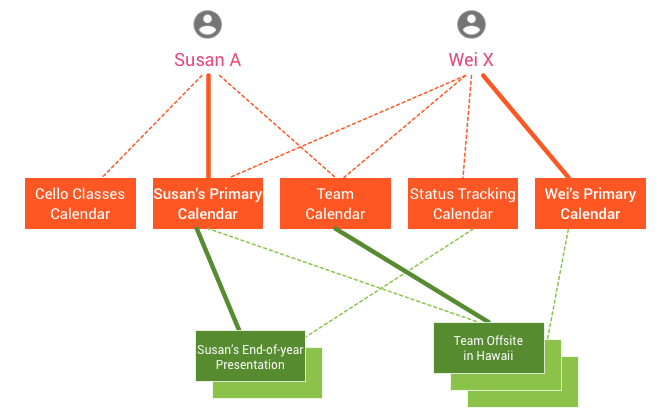

# Concepts overview

Source: https://developers.google.com/workspace/calendar/api/concepts

Snapshot: 2026-10-11T09:59:04.482060+00:00; Google updated: 2026-09-03.

Google documentation: CC BY 4.0; code samples: Apache 2.0. [License](<../LICENSE.md>). Converted to Markdown from the preserved [HTML](<../pages/concepts.html>); no article content intentionally omitted.

---

Each Calendar user is associated with a primary calendar and a number of other calendars that they can also access. Users can create events and invite other users, as shown in the following diagram:

This example shows two users, Susan A and Wei X. Each has a primary calendar and several other associated calendars. The example also shows two events: an end-of-year presentation and a team offsite.

Here are some facts shown in the diagram:

- Susan's calendar list includes her primary calendar as well as calendars for her team and cello lessons.

- Wei's calendar list includes his primary calendar as well as the team calendar, a status tracking calendar, and Susan's primary calendar.

- The end-of-year presentation event shows Susan as the organizer and Wei as an attendee.

- The team offsite in Hawaii event has the team calendar as an organizer (meaning it was created in that calendar) and copied to Susan and Wei as attendees.

These concepts—calendars, events, attendees, and others—are explained in detail in the following sections of this guide:

- [Calendars and events](concepts/events-calendars.md)

- [Calendar sharing](concepts/sharing.md)

- [Invite users to an event](concepts/inviting-attendees-to-events.md)

- [Reminders and notifications](concepts/reminders.md)

- [Domain resources, rooms, and calendars](concepts/domain.md)
