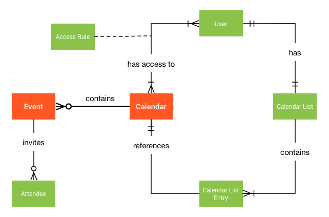
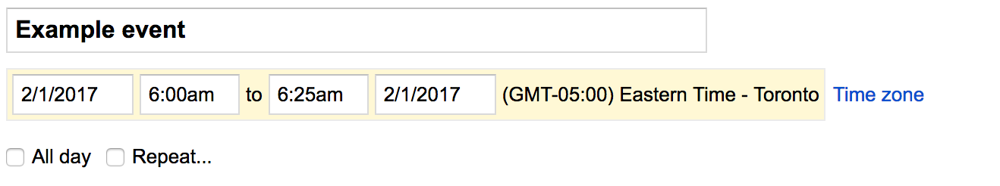

# Calendars and events

Source: https://developers.google.com/workspace/calendar/api/concepts/events-calendars

Snapshot: 2026-10-11T09:59:04.482060+00:00; Google updated: 2026-09-03.

Google documentation: CC BY 4.0; code samples: Apache 2.0. [License](<../../LICENSE.md>). Converted to Markdown from the preserved [HTML](<../../pages/concepts/events-calendars.html>); no article content intentionally omitted.

---

This guide describes calendars, events, and their relationship to each other.

<a id="calendars"></a>

## Calendars

A [calendar](../v3/reference/calendars.md#resource-representations) is a collection of related events, along with additional metadata such as summary, default time zone, and location. Each calendar is identified by an ID, which is an email address. Calendars can be shared with others. Primary calendars are owned by their associated user account; other calendars are owned by a single data owner.

<a id="events"></a>

## Events

An [event](../v3/reference/events.md#resource-representations) is an object associated with a specific date or time range. Events are identified by a unique ID. Besides a start and end date-time, events contain other data such as summary, description, location, status, reminders, and attachments.

<a id="types-of-events"></a>

### Types of events

Google Calendar supports *single* and *recurring* events:

- A *single* event represents a unique occurrence.

- A *recurring* event defines multiple occurrences.

Events may also be *timed* or *all-day*:

- A *timed* event occurs between two specific points in time. Timed events use the `start.dateTime` and `end.dateTime` fields to specify when they occur.

- An *all-day* event spans an entire day or consecutive series of days. All-day events use the `start.date` and `end.date` fields to specify when they occur. Note that the timezone field has no significance for all-day events.

The start and end of the event must both be timed or both be all-day. For example, it is **not valid** to specify `start.date` and `end.dateTime`.

<a id="organizers"></a>

### Organizers

Events have a single *organizer* which is the calendar containing the main copy of the event. Events can also have multiple [attendees](sharing.md#inviting_attendees_to_events). An attendee is usually the primary calendar of an invited user.

The following diagram shows the conceptual relationship between calendars, events, and other related elements:



<a id="primary-calendars-and-other-calendars"></a>

## Primary calendars and other calendars

A *primary* calendar is a special type of calendar associated with a single user account. This calendar is created automatically for each new user account and its ID usually matches the user's primary email address. As long as the account exists, its primary calendar can never be deleted or "un-owned" by the user. However, it can still be shared with other users.

In addition to the primary calendar, you can explicitly create any number of other calendars. These calendars can be modified, deleted, and shared with others. Such calendars have a single data owner with the highest privileges, including the exclusive right to delete the calendar. The data owner's access level cannot be downgraded. The data owner is initially determined as the user who created the calendar, however the data ownership can be transferred in the Google Calendar UI.

**Important:** When creating a calendar, we recommend that your app authenticate as the intended data owner of the calendar. You can use [domain-wide delegation of authority](https://developers.google.com/workspace/cloud-search/docs/guides/delegation) to allow applications to act on behalf of a specific user. Don't use a service account for authentication. If you use a service account for authentication, the service account is the data owner, which can lead to unexpected behavior. For example, if a service account is the data owner, data ownership cannot be transferred.

<a id="calendar-and-calendar-list"></a>

## Calendar and calendar list

The [Calendars](../v3/reference/calendars.md) collection represents all existing calendars. It can be used to create and delete calendars. You can also retrieve or set global properties shared across all users with access to a calendar. For example, a calendar's title and default time zone are global properties.

The [CalendarList](../v3/reference/calendarList.md) is a collection of all calendar entries that a user has added to their list (shown in the left panel of the web UI). You can use it to add and remove existing calendars to or from the user's list. You also use it to retrieve and set the values of user-specific calendar properties, such as default reminders. Another example is foreground color, since different users can have different colors set for the same calendar.

**Note:** The data owner of a calendar cannot remove this calendar from their calendar list.

The following table compares the meaning of operations for the two collections:

| Operation | Calendars | CalendarList |
| --- | --- | --- |
| `insert` | Creates a new secondary calendar. This calendar is also added to the creator's calendar list, and cannot be removed, unless the calendar is deleted or transferred. | Inserts an existing calendar into the user's list. |
| `delete` | Deletes a secondary calendar. | Removes a calendar from the user's list. |
| `get` | Retrieves calendar metadata, for example, title and time zone. | Retrieves metadata **plus** user-specific customization such as color or override reminders. |
| `patch`/`update` | Modifies calendar metadata. | Modifies user-specific calendar properties. |

<a id="recurring-events"></a>

## Recurring events

Some events occur multiple times on a regular schedule, such as weekly meetings, birthdays, and holidays. Other than having different start and end times, these repeated events are often identical.

Events are called *recurring* if they repeat according to a defined schedule. *Single* events are non-recurring and happen only once.

<a id="recurrence-rule"></a>

### Recurrence rule

The schedule for a recurring event is defined in two parts:

- Its start and end fields (which define the first occurrence, as if this were just a stand-alone single event), and

- Its recurrence field (which defines how the event should be repeated over time).

The recurrence field contains an array of strings representing one or several `RRULE`, `RDATE` or `EXDATE` properties as defined in [RFC 5545](http://tools.ietf.org/html/rfc5545).

The `RRULE` property is the most important as it defines a regular rule for repeating the event. It is composed of several components. Some of them are:

- `FREQ` — The frequency with which the event should be repeated (such as `DAILY` or `WEEKLY`). Required.

- `INTERVAL` — Works together with `FREQ` to specify how often the event should be repeated. For example, `FREQ=DAILY;INTERVAL=2` means once every two days.

- `COUNT` — Number of times this event should be repeated.

  You can use either COUNT or UNTIL to specify the end of the event recurrence. Don't use both in the same rule.

- `UNTIL` — The date or date-time until which the event should be repeated (inclusive).

- `BYDAY` — Days of the week on which the event should be repeated (`SU`, `MO`, `TU`, etc.). Other similar components include `BYMONTH`, `BYYEARDAY`, and `BYHOUR`.

The `RDATE` property specifies additional dates or date-times when the event occurrences should happen. For example, `RDATE;VALUE=DATE:19970101,19970120`. Use this to add extra occurrences not covered by the `RRULE`.

The `EXDATE` property is similar to RDATE, but specifies dates or date-times when the event should *not* happen. That is, those occurrences should be excluded. This must point to a valid instance generated by the recurrence rule.

`EXDATE` and `RDATE` can have a time zone, and must be dates (not date-times) for all-day events.

Each of the properties may occur within the recurrence field multiple times. The recurrence is defined as the union of all `RRULE` and `RDATE` rules, minus the ones excluded by all `EXDATE` rules.

Here are some examples of recurring events:

- An event that happens from 6:00 AM to 7:00 AM every Tuesday and Friday starting from September 15, 2015 and stopping after the fifth occurrence on September 29, 2015:

  ```JSON
  ...
  "start": {
    "dateTime": "2015-09-15T06:00:00+02:00",
    "timeZone": "Europe/Zurich"
  },
  "end": {
    "dateTime": "2015-09-15T07:00:00+02:00",
    "timeZone": "Europe/Zurich"
  },
  "recurrence": [
    "RRULE:FREQ=WEEKLY;COUNT=5;BYDAY=TU,FR"
  ],
  ...
  ```

- An all-day event starting on June 1, 2015 and repeating every 3 days throughout the month, excluding June 10 but including June 9 and June 11:

  ```JSON
  ...
  "start": {
    "date": "2015-06-01"
  },
  "end": {
    "date": "2015-06-02"
  },
  "recurrence": [
    "EXDATE;VALUE=DATE:20150610",
    "RDATE;VALUE=DATE:20150609,20150611",
    "RRULE:FREQ=DAILY;UNTIL=20150628;INTERVAL=3"
  ],
  ...
  ```


<a id="instances-and-exceptions"></a>

### Instances and exceptions

A recurring event consists of several *instances*: its particular occurrences at different times. These instances act as events themselves.

Recurring event modifications can either affect the whole recurring event (and all of its instances), or only individual instances. Instances that differ from their parent recurring event are called *exceptions*.

For example, an exception may have a different summary, a different start time, or additional attendees invited only to that instance. You can also cancel an instance altogether without removing the recurring event (instance cancellations are reflected in the event [`status`](../v3/reference/events.md#status)).

For examples of how to work with recurring events and instances using the Google Calendar API, see [Recurring events](https://developers.google.com/workspace/calendar/recurringevents).

<a id="time-zones"></a>

## Time zones

A time zone specifies a region that observes a uniform standard time. In the Google Calendar API, you specify time zones using [IANA time zone](http://www.iana.org/time-zones) identifiers.

You can set the time zone for both calendars and events. The following sections describe the effects of these settings.

<a id="calendar-time-zone"></a>

### Calendar time zone

The time zone of the calendar is also known as the *default time zone* because of its implications for query results. The calendar time zone affects the way time values are interpreted or presented by the [`events.get()`](../v3/reference/events/get.md), [`events.list()`](../v3/reference/events/list.md), and [`events.instances()`](../v3/reference/events/instances.md) methods.

Query result time-zone conversion

Results of the [`get()`](../v3/reference/events/get.md), [`list()`](../v3/reference/events/list.md), and [`instances()`](../v3/reference/events/instances.md) methods are returned in the time zone that you specify in the `timeZone` parameter. If you omit this parameter, then these methods all use the calendar time zone as the default.

Matching all-day events to time-bracketed queries

The [`list()`](../v3/reference/events/list.md), and [`instances()`](../v3/reference/events/instances.md) methods let you specify start- and end-time filters, with the method returning instances that fall in the specified range. The calendar time zone is used to calculate start and end times of all-day events to determine whether they fall within the filter specification.

<a id="event-time-zone"></a>

### Event time zone

Event instances have a start and end time; the specification for these times may include the time zone. You can specify the time zone in several ways; the following all specify the same time:

- Include a time zone offset in the `dateTime` field, for example `2017-01-25T09:00:00-0500`.

- Specify the time with no offset, for example `2017-01-25T09:00:00`, leaving the `timeZone` field empty (this implicitly uses the default time zone).

- Specify the time with no offset, for example `2017-01-25T09:00:00`, but use the `timeZone` field to specify the time zone.

You can also specify event times in UTC if you prefer:

- Specify the time in UTC: `2017-01-25T14:00:00Z` or use a zero offset `2017-01-25T14:00:00+0000`.

The internal representation of the event time is the same in all these cases, but setting the `timeZone` field attaches a time zone to the event, just as when you [set an event time zone using the Calendar UI](https://support.google.com/calendar/answer/37064?ref_topic=6272668):



For single events, you can specify different time zones for an event's start and end times. (This can help with events—such as travel—that actually start and end in different time zones.) For recurring events, see \[Recurring event time zone\](#recurring-event-time-zone).

<a id="recurring-event-time-zone"></a>

### Recurring event time zone

For recurring events, you must always specify a single time zone to expand the recurrences of the event.
