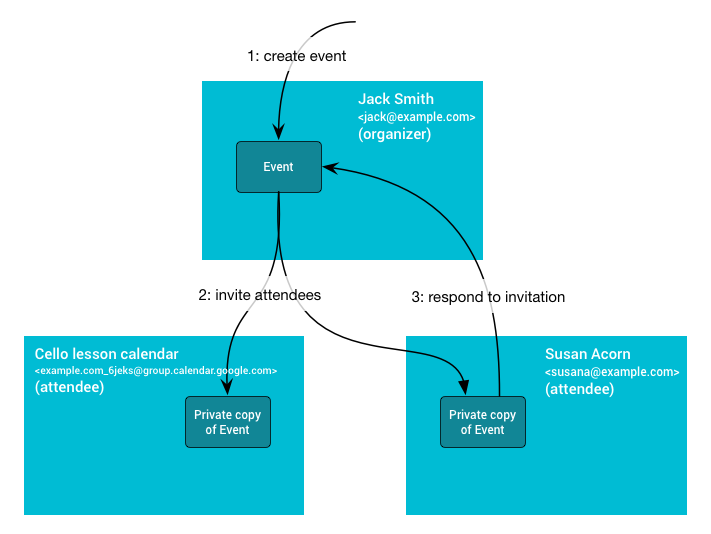

# Invite users to an event

Source: https://developers.google.com/workspace/calendar/api/concepts/inviting-attendees-to-events

Snapshot: 2026-10-11T09:59:04.482060+00:00; Google updated: 2026-09-03.

Google documentation: CC BY 4.0; code samples: Apache 2.0. [License](<../../LICENSE.md>). Converted to Markdown from the preserved [HTML](<../../pages/concepts/inviting-attendees-to-events.html>); no article content intentionally omitted.

---

<a id="create-event"></a>

## Create an event

If you have write access to the organizer's Google Calendar, you can add an event using the [`Events: insert`](../v3/reference/events/insert.md) method.

This method adds the event directly to the organizer's calendar, independently of their setting to add invitations.

<a id="add-attendees"></a>

## Add attendees

With this method, you can also add attendees to the same event by adding their email address to the [`attendees`](../v3/reference/events.md#attendees) property of the event. Any future changes made by the organizer to the event are [propagated](inviting-attendees-to-events.md#event-propagation) to the attendees.

Attendees receive the invitation from the organizer's email address. Calendar users receive the invitation in their email or in their calendar, depending on their event settings in Calendar:

- If they have the setting `From everyone`, the event is added directly to their calendar.

- If they have the setting `Only if the sender is known`, the event is added directly to their calendar if they have previously interacted with the organizer, if the organizer is in the same organization, or if the organizer is in their [Google Contacts](https://contacts.google.com). If the organizer isn't known to them, they can click **Add to calendar** or RSVP by clicking **Yes** or **Maybe** in the invitation email. Then the event is added to their calendar.

- If users have the setting `When I respond in email`, all invitations aren't added to their calendar until the user RSVPs by clicking **Yes**, **Maybe**, or **No** in the invitation email.

For more information about how invitations are added to Calendar, see [Manage invitations in Calendar](https://support.google.com/calendar/answer/13159188).

**Important:** Prepopulating the attendee's response using the [`attendees[].responseStatus`](../v3/reference/events.md#attendees.responseStatus) property doesn't automatically add the event to the guests' calendars. Furthermore, if more than 200 guests are invited to the event, response status is not propagated to the guests.

<a id="display-event"></a>

## Display the event directly in attendees' calendars

To display an event directly in Calendar attendees' calendars for any setting the attendee might have, you can [set the attendee's RSVP](inviting-attendees-to-events.md#set-attendees-rsvp) or [import a copy of the event directly in the attendee's calendar](inviting-attendees-to-events.md#import-copy). For both methods, you need [write access](https://developers.google.com/identity/protocols/oauth2/scopes#calendar) to the attendees' calendars; if you don't, consider [adding the organizer to the attendee's contacts](inviting-attendees-to-events.md#add-organizer), which might require write access to the attendee's contacts.

<a id="set-attendees-rsvp"></a>

### Set the attendee's RSVP

To set an attendee's RSVP to an event, take the following steps:

- Create the event in the Calendar organizer's calendar and add attendees (see [Add attendees](inviting-attendees-to-events.md#add-attendees)).

- Use the [`Events: update`](../v3/reference/events/update.md) method to set the [attendee's RSVP](../v3/reference/events.md#attendees.responseStatus) to `accepted` or `tentative`. You must have write access to the attendee's calendar. There might be a slight delay before the event appears on the attendee's calendar. [Learn more about how to use the `Events: update` method](../v3/reference/events/update.md).

This method adds the event to the attendee's calendar, but the attendee might still see the banner in their email that the invitation was sent from an address previously unknown to them.

<a id="import-copy"></a>

### Import a copy of the event directly in the attendee's calendar

To import a copy of an event into an attendee's calendar, take the following steps:

- If you have write access to the organizer's Calendar calendar, import a copy of the event using the [`Events: import`](../v3/reference/events/import.md) method.

- Import another copy of the same event in the attendee's calendar using [`Events: import`](../v3/reference/events/import.md). You must have write access to the attendee's calendar. Use the same event ID ([`iCalUID`](../v3/reference/events/import.md#iCalUID)) for the organizer's and the attendee's copies and make sure to specify the organizer in the attendee's copy.

With this method, the attendee can see the event in their calendar, but doesn't receive an invitation email from Calendar.

**Important:** If you don't use the same event ID, future changes to the event made by the organizer won't be automatically propagated to the attendee.

<a id="add-organizer"></a>

### Add the organizer to the attendee's contacts

If you don't have the attendee's credentials, you can instruct the attendee or their organization to add the organizer's email address to their Google Contacts in advance to display an event directly in their calendar. There might be a slight delay for a newly created contact to take effect.

- Ask the Calendar user to [add the organizer to their Google Contacts](https://support.google.com/contacts/answer/1069522).

- If the attendees belong to an organization, you can ask the organization's administrator to programmatically add email addresses to their users' contacts. Ask the administrator to enable [domain-wide delegation](https://support.google.com/a/answer/162106), impersonate the users and use the [`People: createContact`](https://developers.google.com/people/api/rest/v1/people/createContact) method to create contacts for each user, to ensure that future invitations from these email addresses automatically appear in their users' calendars.

- If you have access to the attendee's contacts, you can also add the organizer's email address to the attendee's contacts using the [`People: createContact`](https://developers.google.com/people/api/rest/v1/people/createContact) method.

<a id="invite-by-email"></a>

## Invite users by email

If you don't have write access to the organizer's Calendar calendar, or if you don't want to expose the organizer's email address, use the iCalendar protocol ([RFC-5545](https://icalendar.org/RFC-Specifications/iCalendar-RFC-5545/)) to invite users with email using an .ICS file.

If the attendee is a Calendar user with the setting `Only if the sender is known` and they haven't previously interacted with or recorded the address as known to them, the invitation isn't added to their calendar until they click **Add to calendar** or they RSVP to the event.

**Tip:** Don't use a generic email address (for example, `invitation@example.com`) to send invitations. Any abuse might impact all users who send invitations from that address. If you can't use the organizer's email address, use a unique, static email address for each organizer.

<a id="link-user"></a>

## Provide a link for users to add the event

Alternatively, if you want to make it easier for Calendar users to add an event as a one-off without keeping it updated, you can provide a link with a pre-filled event for the user to add themselves. This method creates a distinct event on the user's calendar, which you can't update unless you have access to the user's calendar.

Use the following link template:

```

https://calendar.google.com/calendar/r/eventedit?action=TEMPLATE&dates=20230325T224500Z%2F20230326T001500Z&stz=Europe/Brussels&etz=Europe/Brussels&details=EVENT_DESCRIPTION_HERE&location=EVENT_LOCATION_HERE&text=EVENT_TITLE_HERE

```


by updating the following information:

- **Start and end dates and times**: Use ISO 8601 format. In the above example, replace `20230325T224500Z` and `20230326T001500Z`.

- **Start and end time zones**: Format as an IANA Time Zone Database name. Place the time zones in the `stz` and `etz` fields.

- **Event description**: Must be URL encoded.

- **Event location**: Must be URL encoded.

- **Event title**: Must be URL encoded.

<a id="example"></a>

## Example

Consider the example of building an appointment booking service to help users book appointments with a business. When a user books an appointment, you want your service to add an event to the booker's and the business's Google Calendar calendars.

For the best user experience, we recommend that the business gives write access to their calendar, so that you can add the event directly to the business's calendar ([Create event](inviting-attendees-to-events.md#create-event)) and invite the booker to that event ([Add attendees](inviting-attendees-to-events.md#add-attendees)). To make sure the booker sees the event in their calendar and gets reminded of it, inform them to check their emails and RSVP **Yes** to the event immediately after making a booking. Once they RSVP to the event, they're sent [event notifications from Calendar](https://support.google.com/calendar/answer/37242) per their notification settings.

If you want to add the event directly to the booker's calendar, inform bookers to [add to their contacts](https://support.google.com/contacts/answer/1069522) the email address from which they will receive the invitation. Alternatively, ask bookers for write access to their calendar to programmatically RSVP on their behalf ([Set the attendee's RSVP](inviting-attendees-to-events.md#set-attendees-rsvp)) and send them an email notification about the confirmed booking.

If the business doesn't want to expose their email address, use a user-specific email address to send the event to the booker by using email ([Invite user from an email address](inviting-attendees-to-events.md#invite-by-email)).

<a id="event-propagation"></a>

## Event propagation

The following diagram explains the dynamics. First, Jack creates an event on his primary calendar (and thus owns the organizer copy). Then, he invites the Cello lesson group secondary calendar and Susan, who has the event setting `Only if the sender is known`. Attendees' copies are created on the Cello lesson group secondary calendar, and on Susan's calendar if she knows Jack, otherwise when she RSVPs or indicates she knows Jack. When Susan responds, the RSVP change gets propagated back to the organizer, updating the organizer's copy with Susan's response. These changes made to the organizer's copy of the event then get propagated to the other attendees.



<a id="shared-event-properties"></a>

### Shared event properties

The calendar where the event is created is the *organizer calendar*. This calendar owns the shared event information, including ID, start and end time, summary, and description. When this information is updated on the organizer calendar, the changes are propagated to attendee copies.

<a id="private-event-properties"></a>

### Private event properties

Not all information is shared between all the event copies. Some properties are private, such as reminders, `colorId`, transparency, or the `extendedProperties.private` property. These properties are controlled by the attendee's settings and not by the organizer calendar.

Attendees can also change the shared properties of the event. However, these changes are only reflected on their own copy and might be lost if the organizer makes a change.

The only event change that is propagated from attendees back to the organizer is the attendee's response status, stored in the [`attendees[].responseStatus`](../v3/reference/events.md#attendees.responseStatus) property.
